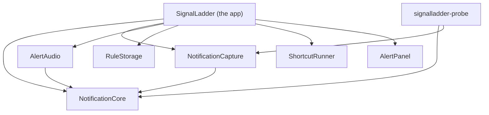
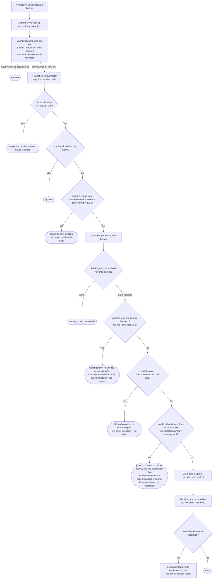

# How SignalLadder works

This page is for people who want to change SignalLadder, review it, or understand why it behaves as it does. It describes the code as it is on `main`, names the types you will meet, and says why the awkward parts are awkward. It does not describe planned work as if it were built. Where something is not implemented, it says so.

If you only want to use the app, start with [getting started](getting-started.md) and the [rules format](rules-format.md). If you want to contribute, read [CONTRIBUTING.md](../CONTRIBUTING.md) first; this page is the map it points to.

- [Principles that shape the code](#principles-that-shape-the-code)
- [Module map](#module-map)
- [From banner to sound](#from-banner-to-sound)
- [The escalation ladder](#the-escalation-ladder)
- [Knowing it still works](#knowing-it-still-works)
- [On-call mode](#on-call-mode)
- [Snooze](#snooze)
- [Launch at login and Settings](#launch-at-login-and-settings)
- [The guided first run](#the-guided-first-run)
- [Rules](#rules)
- [Audio](#audio)
- [Testing](#testing)
- [Tools](#tools)
- [Where to read more](#where-to-read-more)

## Principles that shape the code

Six ideas explain most of the design. Each has a reason, and the reason is usually an incident.

### Decisions live in pure, tested code; the app is glue

Everything that decides something is in `NotificationCore`: what a banner says, whether it is a repeat, which rule matches, when an escalation's next tier is due, what health is, what the menu says about it. That module imports Foundation and CryptoKit and nothing else. It cannot touch Accessibility, notifications, audio, the file system or the network, so every decision can be tested without a permission, a speaker or a real notification.

The app target, `SignalLadder`, connects those decisions to the operating system and has no tests of its own. So it holds as little as possible. Its own comments say what each piece is for: `CaptureController` "connects the Accessibility observer to the capture pipeline, and nothing more", and `RuleStore` "only connects" the decoder and the file layer.

_Why._ The capture pipeline used to be a closure inside the app target. Two reviews in a row named it the riskiest untested path in the app, and it is where the rule engine attaches. It moved into `CapturePipeline` so it could be tested before anything more was added to it. The same reasoning put the rules file in its own target, `RuleStorage`: it is the one place a bug destroys the user's rules. The same reasoning put the Shortcut's input file in `ShortcutRunner` and the escalation panel in `AlertPanel`, so that each is tested outside the app target.

`PurityTests` enforces the boundary for `NotificationCore` only. It is a plain text search of every source file under that module's folder, in subfolders too, for forbidden imports (`ApplicationServices`, `AppKit`, `Cocoa`, `Carbon`, `UserNotifications`, `AVFoundation`, `Speech`, `ServiceManagement`, `SwiftUI`, `Combine`) and for `FileManager`, `FileHandle`, `URLSession`, `Data(contentsOf` and `write(to`. `ViewLiteralsTests` holds one more part of the split, for the app target. It reads that target's sources with a small lexer, itself tested on canned source, and fails when a sentence is typed into a view or a menu. A new view file may hold no string literal but the empty string and the names of symbols. A new controller or coordinator may hold none at the places that show words: a title, an alert's message, a tooltip. The files that show words today are held to a list of the literals they already hold, and the list can only shrink, so a new sentence goes into a text enum in `NotificationCore`, where it is tested. `HarnessConstantsTests` does the same for the shell scripts under `Scripts/`, so that `Scripts/verify-live.sh` reads each word of the app's that it looks for from `NotificationCore` and types none: see [`Scripts/verify-live.sh`](#scriptsverify-livesh). Nothing else enforces the split. That a decision stays out of the app target is convention, kept by review.

### Notification content is never logged, and reaches disk in one place

Notification text is held in memory, in the last 50 captures, until newer ones replace it or you quit. There is no time-based expiry and no clear-history command; quitting is the only way to drop it. SignalLadder does not write it to logs. Apart from text you choose to save in a rule, it writes it to disk in one case only: the input file of a Shortcut, below.

Three things do reach disk, and all are deliberate:

- Text you put into a rule condition is saved in `rules.json`, and in the backups made when you save. The rule editor says so where you add it.
- The mute checklist stores a SHA-256 hash of each app name you confirmed in the app's preferences. It stores hashes, not names, because a name comes from a banner and a badly parsed banner can hand it a fragment of a message.
- A Shortcut's input file. Each time the last tier of an escalation runs a Shortcut, and a long escalation that a burst has joined can run it more than once (see [One escalation for a burst](#one-escalation-for-a-burst)), `ShortcutRunner` writes four fields of the notification that caused the run to `input.json`: `appNameGuess`, `title`, `subtitle` and `body`, never the raw text, the time or the subrole. It sits in a folder of its own (mode `0700`) inside `com.jamiewhite.signalladder.shortcut-input` in the system temporary directory, and the file itself is `0600`. It is deleted the moment the Shortcut's process ends, however long that takes. The app reports what happened within a second at most and does not wait for the end, so the file can outlive that report. Anything a crash or a quit left behind is removed at launch and at quit. This is the one place the app writes notification text you did not put there yourself, and only for a rule that names a Shortcut. **Test Shortcut** in the rule editor writes the same file, through the same `ShortcutRunner`, with the four fields of a made-up test notification that each say it is a test, so it writes no captured text. What the Shortcut then does with the text is up to the Shortcut you wrote.

A few short-lived copies sit beside that buffer: the deduplicator's keys, which are each capture's description and text children, and the words of each banner's recent reads beside the ids of the rules they set off, each kept for 1.5 seconds, the last alert outcome (which includes a spoken line) and the copies the Inspector and rule editor display. A live escalation keeps a copy of its notification too, for spoken repeats and for a Shortcut's four fields, and the row it began from holds the outcome of its latest repeat and of its final alert, either of which can include a spoken line. The escalation keeps its copy until it is finished with: acknowledged, and any Shortcut it started has reported. That can be longer than its row stays among the last 50, because a busy channel can push the row out while the ladder still runs. A long escalation that a burst has joined can keep one more, `Running.owedPage`: the newest match that joined too soon after a Shortcut run to run it again, which the coordinator runs the Shortcut for when the 10 minutes are up. It is set with the timer that will send it and cleared with it, so a page is owed exactly while that timer is armed, a newer match owed a page replaces it, and it is forgotten when it is sent, when the escalation is acknowledged, when a sleep converts it and with the escalation when it is retired. It is in the coordinator and in no other place: not in the summary, not on a row, not in anything the app is told. The count of matches is a whole number in the summary. All of these are in memory, and quitting drops them.

Five more values are saved, and none is from a notification. The first is `onCallSince`, in the app's preferences, the time on-call mode was switched on. It is the whole of what on-call mode saves. `OnCallStore` reads it once, when the app starts, and writes it when you switch the mode on or off. `OnCallState` reads whatever the preferences hand back, which may be anything. Absent is off, a finite number that is not negative is on since that time and never since a time after now, and anything else is on with the time not known, because the app fails towards alerting. The second is `launchAtLoginWanted`, a Boolean: what the user last asked of the Launch at login switch. It is the whole of what Settings saves. `SettingsModel` reads it when it is made and writes it in one place, at the user's own press. `LaunchAtLogin.wanted(stored:)` reads whatever the preferences hand back and answers true only for a Boolean true, so a number, a string or an absent key reads as not wanted. Turning the switch off saves false and does not remove the key. It records what was asked and not what macOS did, and the login item itself is macOS's. The third and fourth are the snooze's, and `SnoozeStore` is the only code that reads or writes them. `snoozeUntil` is the end of a snooze, as seconds since 1970 in a real number, and absent is no snooze. `snoozeHeld` is what snoozes held and the user has not dismissed, as one dictionary of numbers: `counts`, a rule's id as the text a `UUID` writes to a whole number of matches of 1 or more, `since`, the time of the first hold in seconds since 1970, `unannounced`, a whole number of matches held and not yet announced, and `unreadable`, the whole number 1, written only when an earlier record could not be read. An empty summary saves nothing and takes the key out. Neither holds a name, an app or any text, because a rule's name is looked up from the current rules by id when a line is shown. `SnoozeController` and `HeldSummary` read whatever the preferences hand back, which may be anything, and say so when a record was there and could not be read: see [Snooze](#snooze). The fifth is `setupProgress`, how far the first run got: one list of fixed words, `started`, `introductionSeen`, `focusAttested`, `dismissed`, `finished` and `skipped:` with a step's name, and nothing else, so no token can hold a name, an app or what a notification said. `SetupProgressStore` is the only code that reads or writes it, and `SetupProgress` says what a value read back comes to, which may be anything since the file can be edited: see [The guided first run](#the-guided-first-run).

The app has five loggers. The speech logger records how long a spoken alert took to start, and two fixed lines when speech produced no audio or did not finish in time. None of its messages has a parameter a sentence could pass through. The watcher's logs a process id, a subrole, an error code or a count. Its function takes a free-form message, so the rule that it is never given a notification's text is held by convention. The hotkey's logs a status code when the hotkey could not be installed or registered, and nothing else. The quit logger, `AppDelegate.quitLog` in category `quit`, logs one line for each quit the app is asked about: the quit's four-character reason code, or none, and the age of any power-off notice, or none (`QuitPolicy.logLine`). It is marked public and logged at the default level so that a log out or a restart can be read after it has finished, and it holds nothing a notification said. The login item's, in `LoginItem` under category `loginitem`, logs the domain and the code of an error when a request to register or unregister fails, marked public and at the error level, and never the error's description, which can hold a name or a path.

_Why._ The app reads other people's messages. Nothing about reading them requires keeping them, so it does not. The one exception is there so that a Shortcut you wrote can act on what arrived. It is kept as small as it can be: four fields, an owner-only folder and file, gone when the Shortcut's process ends.

Where this is enforced by a test, and where it is not:

| Claim | Enforced by |
| ----- | ----------- |
| `NotificationCore` opens no file and no URL, and imports no permission-bearing framework | `PurityTests` |
| Only `LoginItem.swift` names the system's login item, and nothing registers or unregisters but a press of Settings' switch or of a button | `PurityTests` keeps `ServiceManagement` out of the core, and `SettingsWiringTests` reads the app target's sources as text. They show that the text is there, not that it runs |
| What a snooze saves is a date and whole numbers keyed by a rule's id, with no name, app or text, and only `SnoozeStore` touches its two keys | `SnoozeControllerTests` walks every value handed to `save` and allows only numbers, the four field names and rule ids, with a rule named with a canary string held several times. `SnoozeGateTests` feeds a notification whose words are a canary through the pipeline with a snooze on, shows first that the words do reach the row and what is said, and finds none of them in what is saved, the summary line, the menu's lines or the row's. `SnoozeWiringTests` reads the app target's sources as text and holds that no other file names either key. They show that the text is there, not that it runs |
| What the first run saves is a list of fixed words, with no name, app or text, and only `SetupProgressStore` touches its key | `SetupProgressTests` holds every token the type can write to the words typed in the test, holds the key, and holds that no token can carry what a notification said, an app's name or a rule's name. `SetupWiringTests` reads the app target's sources as text and holds that only `SetupProgressStore.swift` names the key, that it writes the whole list in one place and reads the value as it is, and that the coordinator is given the one store and makes none. They show that the text is there, not that it runs |
| Nothing logs notification text, and the only notification text the app writes for itself is a Shortcut's input file | Convention. The comment on the watcher's log function says the `%{public}` format is safe only because no text ever passes through it |
| A Shortcut's input file holds those four fields and no more, is owner-only, and is deleted when the Shortcut's process ends, whether that is inside the one-second launch check or long after | `ShortcutRunnerTests`, against real folders: the exact fields, both modes read back from the file system, and deletion when the process ends after a success, after a failure, and after that second has already passed |
| Whatever a crash or a quit left in that folder is removed at launch and at quit | `ShortcutRunnerTests` for `sweep()`, including that it leaves anything outside its own folder alone. Calling it at launch and at quit is in `AppDelegate`, which has no tests |
| A Shortcut's own output is never logged, kept or shown | Partly. `ShortcutRunnerTests` show that a failure is worded from the exit code and never from the output. That the real process's standard output goes nowhere, and that its standard error is read only to tell "not installed" from any other failure, is in code no test starts a process to exercise |
| The panel and the menu never show what a notification said, and the Inspector's escalation line never repeats what a spoken alert said | `EscalationPanelTextTests` and `EscalationWiringTests` test the wording, and `BurstTextTests` and `BurstPipelineTests` test the count's words on all three surfaces, for every status and for counts of 1, 2, 7 and 20, with a spoken repeat and a spoken final alert in the summary. `AlertPanel` also has no dependency that could name a notification, so it is only ever given finished lines |
| What an escalation keeps beside the notification that began it is one notification owed a page, in memory, forgotten when sent, acknowledged, converted or retired | `EscalationJoinTests`, which reads `trackedCount`, the pending timers and the escalation's record back after each way out. Nothing of it is saved, and no summary, row or callback carries it |
| The app has no networking | `NoNetworkTests` reads the search under _What it never does_ in `docs/privacy.md`, takes its pattern from the page so that the two cannot drift, and runs it over every file under `Sources/`, a line at a time as `grep` does. It fails if any line matches, or if the page's pattern drops a name it held when the test was written. It shows what the source names, not what Apple's frameworks do at run time. The button that opens the latest release's page hands the address to `NSWorkspace`, which is not in the pattern, and the browser makes the connection |
| The only other program the app runs is `/usr/bin/shortcuts`, and only for a Shortcut a rule names: to list them, to run one as a last step, and to run one when you press Test Shortcut | Not test-enforced. A search of `Sources/` finds `Process` only in `ShortcutRunner`. That Shortcuts are listed only when a rule names one, and once per load, is tested in `EscalationFormatTests` |

The developer tool `signalladder-probe` prints text only when you pass `--show-content`. See [privacy](privacy.md) for the user-facing statement of all this.

### Say no more than was established

The app is an on-call tool, so the worst thing it can do is reassure you falsely. Wording is held to what was actually observed:

- _Played_ is not _heard_. An alert outcome records what the app did. When the Mac's output reported itself muted or at zero volume, the outcome says that too. When the output state cannot be read, it is not called silent.
- _Verified_ carries its age. The menu says _Working — verified 3 min ago_, and once the evidence is stale it says _Unverified — last verified 34 min ago_, which it does after 31 minutes, or after 6 while on call. A success from half an hour ago is not a statement about now.
- Muting is your word. Nothing can read another app's notification settings, so the walkthrough says _confirmed muted_, never _muted_.
- A preview is not a match. Re-checking old rows against new rules never rewrites what happened when they arrived, and never plays anything.
- _No rules loaded_ is not _matched no rule_. A row that was never evaluated is not shown as one that was.
- The filter for the app's own banners requires our name and our wording. Name alone would silently drop a real notification from any app that shares it.
- On-call mode lists only what the app can read. A Focus cannot be read, so no line says one is on. A sleeping Mac needs no reading, since it is what sleep is, and its line says what sleep does and claims that none happened. Muting is your word, so it says _not confirmed_ and counts the apps and never names one. The heading _Nothing urgent_ has a bell and no tick, because nothing urgent is not all is well for an app that checks only what it can read. And no page, line or comment says that a saved on-call date keeps anyone covered, since none does while the app is not running.
- Launch at login is _on_ only where macOS reports the login item as enabled, and the one sentence that says so is macOS's word (_macOS reports that…_). Every other status says what the status says and no more, and no sentence names a state that was not read, an entry the user added by hand, a temporary location or the user's own wish unless that is what was read. The on-call finding says SignalLadder _may_ not start again, and not that it will not, because what it has read is only that macOS does not report the item as enabled.
- A snooze counts matches, never messages. The app has read that a rule matched, and not what the notification was, so a snooze's lines name the rules the user wrote and count what they held, and say nothing of what a notification said or which app sent it. What was held is not called this snooze's, since the summary outlives a snooze and a new one adds to it. A record of what was held that could not be read is said to have existed, and is never dropped.
- The Setup Guide says a step is done on a fact only when the app read the fact, and on the user's word when nothing could, and the rail says which: _Done_ or _Done, your word_. _Verified_ is said only of a health that is verified, and the step that proves capture says SignalLadder read its own test banner and nothing of the user's other apps. No line says a Focus is on. A press that came to nothing says so beside its button, and nothing prompts for a permission until its button is pressed.

_Why._ Each of these was a real bug. On 2026-09-25 capture went blind about 80 seconds after a self-test passed, and health went on saying _verified_, with nothing to show it had aged, for up to half an hour.

### Failures are surfaced, never silent

A rule that should have made a noise and did not is the failure this app exists to prevent, so every path that can produce one reports it:

- One bad rule never silences the others. The rules file is decoded one rule at a time. A rule that cannot be used is left out and listed by position and name; the rest run.
- Problems are found when the rules load, not at the incident. A sound that is missing, unreadable, silent or too long, and a voice that is not installed, are reported by rule name when the file loads, as warnings and not refusals: the rule stays in effect, and an alert of it that would make no sound at all plays `AlertActionRunner.fallbackSound` (Sosumi) in its place and says so on its row. Refused, the rule's matches went to the rules below it, and a silent catch-all beneath it kept the page quiet; a sound file moved or a voice an update removed was enough (found on 2026-10-16). A Shortcut the Shortcuts app does not list is a warning and not a refusal too. The rule stays in effect whole, and the menu, the icon and the editor say the name was not found. A Shortcut's name is free text, and a typo, or a Shortcut renamed weeks later, must not switch off a rule that also sounds and repeats. A wrong name then fails when tier 4 fires and is held as a Shortcut that did not run. If the Shortcuts cannot be listed within a second, that one check is skipped, and the name is found out by running it.
- A failed alert never throws at the moment it matters. `AlertPlayer` returns an outcome (_Could not play: …_), which is recorded on the row and held in the menu until a later sound plays. An alert that made no sound at all tries the fallback sound next, in `AlertActionRunner`, the one path every tier's alert takes, and one that played is held the same way, as a failure: the rule's own alert did not play. Reloading rules does not clear it. A repeat or a final alert that fails is held the same way. A Shortcut that did not run is held on its own, and goes only when that Shortcut launches again under the same name: folded in with the sounds, the next repeat playing would clear it, and a launch of another Shortcut says nothing about the one that failed. It may have been the alert meant to reach someone away from the Mac. The failure carries the name it failed with, taken from the escalation's outcome and not from the rule, which a reload can change. Reloading the rules clears nothing, so a fixed rule leaves the failure standing until that name launches or the app quits. It is not keyed on the rule's id, since a rule with no `id` in the file gets a new one at every load, and a reload would then announce a fix nobody made.
- Unknown keys are errors. A misspelt `"alrt"` would otherwise leave a rule quietly silent.
- Nothing can forget to connect playback. The playback closures of the pipeline and of the escalation coordinator have no default values, and neither does the sound, voice and Shortcut check the loader runs.
- A rules problem, an alert that could not sound or played the fallback in its place, a Shortcut that did not run, or a rule warning (a Shortcut name that was not found, or a sound or voice that cannot be played) changes the menu-bar icon to the same warning state as a capture fault. `StatusGlyph` decides that, as one pure function, and three more things join them while the app is on call: see [On-call mode](#on-call-mode). A tool whose rules did not load is as silent as one that cannot see banners.
- A snooze silences nothing by default, and what it silences is kept until the user has seen it. A match is held only when its rule has the box ticked, the rule makes a sound or speaks, and its last step is not a Shortcut, so the alert that reaches someone away from the Mac is never held. What a snooze held is counted in the menu until the user dismisses it, and one that runs out having held something beeps once, because a menu that must be opened to be seen is where a missed page hides. A snooze never touches an escalation already running or the app's own health alarm. A snooze that fails to quiet something is visible and fixable, and one that swallowed a page would be neither. See [Snooze](#snooze).
- A burst joins one escalation, and a joined match is silent only with proof that something audible is about to happen. A match that joins plays its own alert unless a repeat is about to sound, is not the last the ladder will make, and something from the escalation was heard without a fault, since the absence of a failure is not proof. A page that a join suppressed is owed and sent when its 10 minutes are up, and one that failed is tried again by the next match, so the last incident of a burst is neither unpaged nor left to wait for a match that never comes. Where a choice is between one alert too many and one too few, it is one too many. See [One escalation for a burst](#one-escalation-for-a-burst).
- A sleep does not turn into stale alarms, or into silence. An escalation the Mac slept through is not resumed on waking. It ends as _missed while asleep_ and stays on the menu until you acknowledge it. The page it had not sent still goes, once, on waking: the phone is the tier meant for someone away from the Mac, and a late page is better than none (ruling 14 of the M4 plan, as amended on 2026-10-16). This rests on the awake time stopping while the Mac sleeps, which Apple documents and which has not yet been measured on a Mac that sleeps. See [The escalation ladder](#the-escalation-ladder).

### Event-driven, near-zero idle cost

The Accessibility observer, the watcher on the Notification Centre process and the audio engine all do nothing until something happens. The audio engine runs only while an alert plays, because a running engine keeps the output device awake.

The one deliberate polling exception is the health self-test, on a repeating timer armed at 30 minutes, or at 5 while on call. Silence proves nothing, so health has to be asked for. The timer is armed with zero tolerance as a precaution: the documentation lets the system add slack whatever the property says, and a late fire could turn a verified read into _Unverified_ against the one-minute grace. A test program that armed a timer this way saw none added. Three one-shot timers hang off it: a follow-up two minutes after a self-test that passes at launch, at an attach to Notification Centre, when capture starts, at a wake while on call and when on-call mode is switched on; a retry after a self-test that failed or could not run, which waits 60 seconds and then doubles; and a one-minute recheck while a self-test is blocked. See [Knowing it still works](#knowing-it-still-works).

The escalation ladder is event-driven, and nothing polls for a tier that is due. A match starts it, and each tier still to come has one one-shot timer, counted from the match. A match that joins it arms none of them, and arms at most one more, a one-shot timer for the page it owes, which counts as a tier still to come. While a tier is still to fire, the app also holds an activity assertion that asks macOS not to let the Mac idle-sleep, and it lets go as soon as no tier is. While on call it holds a second assertion of its own for as long as the mode is on. The Setup Guide starts no timer: it is read again when the app is activated, when the menu opens, after Check again and when a capture or a health change takes the Inspector's sync, and nothing polls for a grant of Accessibility. See [The escalation ladder](#the-escalation-ladder).

**Every timer the app owns.** These are the timers, and there are no others. Each is a `Timer` added to `RunLoop.main` in the common modes, so it fires while a menu is open or a prompt is up.

- **The app delegate holds five.** The self-test's repeating timer, every 30 minutes or every 5 while on call, with zero tolerance. Its three one-shots: the follow-up at 120 seconds, the retry at 60 seconds and then doubling up to the interval of the state the app is in, and the recheck at 60 seconds while a self-test is blocked. And the icon's, which repeats every 0.8 seconds to alternate the menu-bar icon, exists only while anything is escalating, and goes the moment nothing is.
- **`RunLoopEscalationScheduler` makes the rest,** one instance for the ladders and the snooze, each a one-shot timer with zero tolerance, so macOS adds no slack to when it fires. For each escalation there is one for each tier still to come, counted from the match: tier 2's, tier 3's next repeat, which arms the one after it, and tier 4's, each only if the ladder has that tier. There is at most one more for a page owed to a match that joined a burst, which arms itself again for 5 seconds while a Shortcut run is still pending. And a snooze has one, set for its end, which exists only while a snooze runs and only asks for a redraw and settles what is owed. Nothing relies on it, since every read of the snooze compares times: see [Snooze](#snooze).
- **Other delays are not timers.** They are blocks on the main queue, or a task. The watcher reads 50 milliseconds after the first event of a burst, and re-attaches after a delay that starts at 1 second and doubles to at most 30. The self-test waits up to 5 seconds for its marker (`Task.sleep` in `CanaryService`). `AlertPlayer` ends a spoken part after 15 seconds if the synthesiser stops calling back, and stops waiting for a voice's measurement after 15. `ShortcutRunner` reports a Shortcut that is still running after 1 second as launched.
- **There is no dispatch-source timer.** The two dispatch sources are the watcher's, on Notification Centre's process id, and the Shortcut runner's pipe reader, and neither is a clock.

There is no countdown, and so no repeating timer for one. With nothing escalating and no snooze, the scheduler holds no timer and the icon's does not exist. The self-test's repeating timer is the one that always does.

Idle cost was last measured during milestone M2: 0.00% CPU over ten seconds and about 60 MB resident, and 0.00% over fifteen seconds and about 77 MB with the Inspector open, before alerts, speech, the rule editor and escalation existed. It has not been re-measured since. `Scripts/verify-live.sh` samples idle CPU over ten seconds and fails above 2%, and its default run passed on 2026-10-13, on macOS 27.2, against a signed build, so idle CPU was at or below 2% over those ten seconds. That is a bound and not a measurement.

### No third-party dependencies

`Package.swift` has no `dependencies` at all. Every framework the code imports is Apple's.

_Why._ The app holds an Accessibility grant and reads other people's notifications. Everything it links runs with that access, so the code that does so should be the code in this repository, small enough to read.

## Module map

`Package.swift` declares fourteen targets: eight for the app, its libraries and its tool, and six for tests. It has no third-party dependencies, and its platform floor is macOS 14. SignalLadder supports Apple silicon only, but a package manifest cannot say so, and the package does not enforce it: `make-app.sh` builds for whichever Mac runs it, and [`release.sh`](#scriptsreleasesh) refuses anything but arm64.

| Target | Kind | Depends on | What it is for |
| ------ | ---- | ---------- | -------------- |
| `NotificationCore` | library | nothing | Every decision, as pure code. Banner location and text reading (`BannerTreeLocator`, `BannerTextReader`, `BannerTracker`, `BannerSubrole`, the subroles that count as a banner, and `NotificationCentreHistory`, which tells Notification Centre's list from a banner just drawn), parsing (`NotificationFieldExtractor`, from a `RawCapture` to a `CapturedNotification`), `CapturePipeline`, `CaptureDeduplicator`, `SelfNotification` (the app's own banners, recognised as they come back), the 50-row `CaptureRingBuffer` with its `ContextSnapshot` and `InspectorEntry`, the rule model, engine, glob and codec (`Rule`, `RuleEngine`, `Glob`, `RuleSetCodec`), the alert a rule makes (`SpeechAction`, the spoken half, and `Loudness`, which the audio uses to level-match a sound), the escalation ladder (`Escalation`, `EscalationCoordinator`, `EscalationScheduler`, `AlertActionRunner`, the one path every tier's alert takes, and `PlayerOwnership`, which says whose alert the player last started) and the join of a burst of matches into one escalation (`join` in `EscalationCoordinator`, `EscalationJoin`, `ListedEscalation` and `BurstPolicy`), health (`CaptureHealth` and `HealthCause`, `HealthEvaluator`, `SelfTestPlan`), on-call mode (`OnCallState`, `OnCallSwitch`, `OnCallCheck`, `OnCallWatch`, `HealthAlarmPlan`, `QuitPolicy`, `BeepAudibility` and `PowerHold`), the login item (`LoginItemStatus`, `LaunchAtLogin` and `AppLocation`) and which build is running (`BuildInfo`), snooze (`SnoozeController`, `HeldSummary`, `SnoozeDuration`, and `Rule.snoozeMayHold`, the rule's own decision about being held), the guided first run (`NotificationPermission`, the system's notification authorisation as never asked, denied or allowed; `SetupStep` and `SetupProgress`, the eight steps and the one list of tokens the first run stores, with what a value read from the preferences comes to; `SetupFacts` and `SetupPlan`, what it reads and what it decides from that, the launch decision and the menu's nudge included; `SetupCapture`, what has been captured and which entry an app the user picked leads back to; and `SetupText`, its words, the window's own labels and the choices a window would otherwise have made), the status icon and when the status menu may be rebuilt (`StatusGlyph`, which decides the icon's state and whether it says problem, and `MenuRebuildGate`), the rule editor's decisions (`RulesDocument`, `RuleOrder`, how a drag in the list reorders the draft, `AlertEditing`, the condition builder's edits by path in `ConditionEditing.swift`, whose `ConditionPath` names a place in the tree, `EscalationEditing`, `ShortcutTest` and the dry-run, `DryRun`), what the loader warns of (`RuleWarnings`), the mute walkthrough (`MuteWalkthrough`, `MuteChecklist`, which holds the checklist as hashes, and `BundleResolver`), and the wording the app shows (`HealthTitle`, `AlertMenuText`, `InspectorRowText`, `EscalationPanelText`, `EditorText`, `MuteWalkthroughText`, `OnCallText`, `PowerHoldText`, `LaunchAtLoginText`, `SettingsText`, `SnoozeText`, `BurstText`, `StatusGlyphText`, `StatusMenuText`, which holds the status menu's titles that no feature's text enum holds, and `WindowTitles`), and `HarnessText`, the names and ids the live check gives the marker rule it puts in the rules file and the banners that rule matches |
| `NotificationCapture` | library | `NotificationCore` | The parts that touch Accessibility and notifications. `AXBannerWatcher` (the only `AXObserver`, whose run-loop source is in every mode), `AXElementNode` (adapts `AXUIElement` to Core's `AccessibilityNode`), `CanaryService` (the self-test), `DeliveryStatusProbe` (reads the notification settings, and hands over the permission as a `NotificationPermission` beside the two Booleans health reads) |
| `AlertAudio` | library | `NotificationCore` | Playback. `AlertPlayer` (the audio graph, gain, speech), `SoundLibrary`, `OutputState`, `SpeechConverter` |
| `RuleStorage` | library | nothing | `RulesFile`: fingerprinted reads and safe writes of `rules.json`. It handles bytes; what they mean is `NotificationCore`'s job |
| `ShortcutRunner` | library | nothing | `ShortcutRunner`: runs a Shortcut for an escalation's last tier or for the editor's Test Shortcut, and lists the ones installed. It writes the Shortcut's input file, launches `/usr/bin/shortcuts` without waiting for it, deletes the file when the process ends, and sweeps what a crash or a quit left. Its own target because it is the one place notification text reaches disk, so it is tested against real folders, outside the app target, which has no tests. It has no dependencies, so it cannot take a `CapturedNotification`: the app hands it four strings (`ShortcutRunner.Fields`) |
| `AlertPanel` | library (AppKit) | nothing | `AlertPanelController`: the borderless panel that stays over every app and every Space until each escalation on it is acknowledged. Its own target, on `AlertAudio`'s precedent, so that the window it builds is tested. It has no dependencies, and is given rows already written as text, so it has no way to name what a notification said |
| `SignalLadder` | executable (the app) | all six libraries | Thin glue. `AppDelegate`, `CaptureController`, `RuleStore`, `HealthAlarm` and the menus: `MainMenu` (the main menu that an accessory app needs for ⌘X, ⌘C, ⌘V, ⌘A and ⌘Z in a text field, and which holds Settings… on ⌘,), `MuteWalkthroughMenu` (the walkthrough's items, with `AppLocator`, which lists the running apps for it) and `OnboardingCoordinator` (the two permission requests and the links to their panes). `ShortcutFields` is the one place the four fields a Shortcut is given are chosen. The rule editor is `RuleEditorWindowController` (which runs every flow that asks the user something), `RuleEditorModel` and SwiftUI views hosted in AppKit windows: `RuleEditorView`, `RuleDetailView`, `AlertEditorView`, `ConditionBuilderView`, `LadderEditorView` and `DryRunView`. The Inspector is `InspectorWindowController`, `InspectorModel` and `InspectorView`. `main.swift` starts the app. For escalation, the real parts the tested core may not hold: `RunLoopEscalationScheduler` (the real timers and clocks), `HotKeyController` (the global hotkey, through Carbon) and `PowerAssertion`, of which the app makes two, one for an escalation and one for on-call mode. For on-call mode, the stores and windows: `OnCallStore` and `MuteChecklistStore` (each reads and writes one preference key), `QuitSignals` (reads the quit's reason and the system's power-off notice) and the on-call check's window and view (`OnCallCheckWindowController`, `OnCallCheckModel` and `OnCallCheckView`). For Launch at login, `LoginItem`, the one file that imports `ServiceManagement`, and the Settings window: `SettingsModel` (which reads and writes the preference key `launchAtLoginWanted`), `SettingsView` and `SettingsWindowController`. For snooze, `SnoozeStore` (which reads and writes the preference keys `snoozeUntil` and `snoozeHeld`, and holds no key, word or rule of its own). A burst adds no file to the app target: `CaptureController` takes the coordinator's join and hands it to the pipeline, and the status menu's Acknowledge item carries `ListedEscalation`s. For the guided first run, `SetupProgressStore` (which reads and writes the preferences key `setupProgress` and holds no token or word), `SetupCoordinator` (which gathers every fact the plan reads and carries out each button as the core says), `SetupModel`, `SetupView` and `SetupWindowController` (the Setup Guide's window), and the Setup group of `SettingsModel` and `SettingsView`. No tests |
| `signalladder-probe` | executable | `NotificationCore`, `NotificationCapture` | A developer tool that prints banners as they are captured. Not part of the app bundle |
| `NotificationCoreTests` | tests | `NotificationCore` | Pure unit tests. The largest suite |
| `AlertAudioTests` | tests | `AlertAudio`, `NotificationCore` | Renders the real audio graph offline and measures it |
| `RuleStorageTests` | tests | `RuleStorage` | Real temporary folders, symlinks, injected write failures |
| `ShortcutRunnerTests` | tests | `ShortcutRunner` | Real temporary folders, with a fake launcher and a fake grace timer, so no test starts `/usr/bin/shortcuts` or waits on a clock |
| `AlertPanelTests` | tests | `AlertPanel` | Builds the real `NSPanel` and reads its properties and what it draws back. Showing and hiding are checked on a panel that records being ordered in and out. Never puts a window on screen |
| `NotificationCaptureTests` | tests | `NotificationCapture` | `CanaryService`'s bookkeeping, with its two calls into Notification Centre passed in, so no test posts a notification. Nothing else in the target is tested |



An arrow means "depends on". `NotificationCore`, `RuleStorage`, `ShortcutRunner` and `AlertPanel` depend on nothing in the package, which is why each can be tested on its own.

## From banner to sound

macOS gives no interface for reading other apps' notifications. SignalLadder reads the banner Notification Centre draws, through the Accessibility API. That is an observation of another process's interface, not a contract, so the code is built to notice when it stops working.



The steps, in order:

1. **A banner appears.** Notification Centre (`com.apple.notificationcenterui`) draws it. `AXBannerWatcher` owns the only `AXObserver` in the program. It is attached to that process's id, because the system-wide element cannot observe notifications. It registers for window created and window moved (required), and for element destroyed and layout changed (optional, and both matter; see below). If a required registration fails, it discards the observer and retries rather than run half-deaf. The observer's run-loop source is on the main run loop in every mode, so capture runs while a menu is open or an alert is up. See [Run-loop modes](#run-loop-modes).
2. **The watcher follows the process.** Notification Centre restarts. The watcher watches its process id directly and re-attaches with a capped, doubling delay (at most 30 seconds). Each successful attach asks for a self-test, because a fresh process is exactly when capture most needs proving again.
3. **The windows are read.** The event carries no payload, and events come in bursts, twenty or so as Notification Centre opens. So the watcher reads once per burst: 50 milliseconds after the first event, it reads every window Notification Centre has, whole, and passes each to `BannerTracker.scan`. It reads whole windows because only the whole window shows whether it is Notification Centre's list. The scan works through the `AccessibilityNode` protocol; in the app, `AXElementNode` adapts `AXUIElement` to it, with a 0.2 second timeout on every read. `BannerTreeLocator` finds banners by subrole (`AXNotificationCenterBanner`, `AXNotificationCenterBannerStack`, `AXNotificationCenterAlert`, `AXNotificationCenterAlertStack`, `AlertStack`), never by position. The search goes at most 12 levels deep and visits at most 256 nodes. It is depth-first and the deepest match wins, so a stack that holds banners yields them, not itself. `BannerTextReader` reads the banner's direct children, whose values hold the title, subtitle and body separately.
4. **The tracker decides what is new.** See [When a banner replaces another](#when-a-banner-replaces-another) and [When Notification Centre is opened](#when-notification-centre-is-opened). New banners leave the watcher as a `RawCapture` plus their text children. A banner with neither description nor children is logged by subrole, as possible partial blindness, and not remembered.
5. **`CaptureController` hands it on.** It forwards each banner to `CapturePipeline.process`, and calls back to the app to rebuild the menu when the outcome changes what you can see. While the status menu is open its items are not rebuilt, and the rebuild is made once when it closes. See [Run-loop modes](#run-loop-modes).
6. **`NotificationFieldExtractor` parses it** into a `CapturedNotification`. The app name is the first comma-separated segment of the banner's description, a heuristic, which is why the rules guide calls it "recovered heuristically". Title, subtitle and body come from the text children (one child is a title, two are title and body, three are title, subtitle and body, and from the third onwards any more are joined into the body). With no children it falls back to splitting the description at commas, which is lossy: a comma inside a field looks like a boundary.
7. **The pipeline filters, in this order:**
   1. The self-test. `CanaryService.noteCapture` recognises its own marker. This comes before deduplication, so the self-test's text never enters the dedupe window and cannot suppress a real notification that happens to match it.
   2. The app's own notifications. `SelfNotification.isOwnNotification` requires our app name and one of three titles (_SignalLadder is not capturing_, _SignalLadder cannot verify itself_, _SignalLadder self-test_). It is a backstop for our alarms, and for a self-test whose marker match failed.
   3. `CaptureDeduplicator`. macOS fires several events as one banner animates. A capture with the same text as one in the last 1.5 seconds, its description and its text children alike, is a repeat: it is counted on the row it duplicates and never reaches the rules, or one banner could sound its alert several times. The window is anchored to the first sighting and is not refreshed by a hit, so a fast-repeating source cannot suppress itself indefinitely. Suppressed repeats are shown in the Inspector, not dropped silently. A capture with any text the earlier one did not have is not a repeat. The tracker hands a banner on again when a read finds text the last read did not, and since any read can lose a child or the description to a timeout, that fuller read can keep the description and gain only a child. Compared by the description alone, as it was until 2026-10-16, it was a repeat, and a rule only its text matched never fired. The deduplicator also groups reads of one banner, for step 10: a capture that is not a repeat, but holds all of the text of a read in the last 1.5 seconds, or all of whose text such a read held, is another read of that read's banner. The text compared is the description's comma-separated fields and the children. The window is anchored to the banner's first read, so later reads never lengthen it.
8. **`CaptureRingBuffer` records the row.** It keeps the last 50, with a `ContextSnapshot` of the time and how many notifications from the same app the buffer holds from the last hour.
9. **`RuleEngine.firstMatch` picks the rule.** Rules are tried in file order and the first enabled match wins, so a notification matches at most one rule. The result is stored as the row's annotation. With no rules loaded there is no annotation, which is different from _matched no rule_.
10. **`CapturePipeline` asks the snooze, then the join, then acts.** It is the only place a rule's first alert is set off, either by its own call or, for a match that joins an escalation, by the coordinator it asks, and it is reached only from a live match on a newly recorded row: never from a preview, a repeat or the app's own traffic, and never for a read of a banner that has already set its rule off. That is asked first, of the deduplicator, before anything else is done about the match: if another read of this banner set off the same rule in the last 1.5 seconds, the outcome is `AlertOutcome.alreadySetOff`, and nothing is played or said, no snooze is asked, no escalation is joined or begun, and the last match stays the earlier read's, so one banner never sounds one rule twice. A read whose match is a rule its banner has not set off, such as a higher rule that only the fuller text matches, goes on as any match does, since that rule may be the one that pages: one alert too many, never one too few. Text and not the element tells reads of one banner apart, because a follow-up from the same sender can arrive in the same element, the title kept and the body replaced. Neither of those reads holds all of the other's text, so the follow-up is a banner of its own, and sounds. Between the match and the alert sits the snooze gate. Once the row is annotated _Matched …_ and the app is noted for the mute walkthrough (all but the live check's marker rule, whose banners come from the harness's own poster: `HarnessText.isMarkerRule`), the pipeline asks `holdForSnooze`, a closure with no default, once, which the app gives as `SnoozeController.holds`. Whether a snooze may hold a rule is `Rule.snoozeMayHold` and is not decided a second time here. When it says yes the outcome is `AlertOutcome.snoozed`: nothing is played or said, no ladder is begun and none is joined, and the match is counted, annotated and returned as recorded all the same. When it says no, the pipeline calls a playback closure the app injected, and `AppDelegate` connects those closures to `AlertPlayer`. The gate sits after the match, and not before the rule engine as the spec's §5.18 and its diagram draw it, so a held match is shown on its row as a match and is counted and kept, and the mute walkthrough still knows the source app's own sound is in question. Past the gate, on the side that is not held, a rule that has a ladder is asked once more, before tier 1: the pipeline calls `joinEscalation`, a closure with no default, which the app gives as the coordinator's `join`. A held match never asks, since a snooze is for what has not begun and never joins a ladder, and a rule with no ladder never asks, since each of its matches plays its own alert. When it answers with a join, the pipeline plays nothing itself and begins no ladder: the coordinator has counted the match and either played its own alert or left it to a repeat. When it answers nil, the match plays tier 1 and begins its ladder, as every match did before. It is asked before tier 1 and not after `beginEscalation`, which is called after tier 1, because a design that decided after would have played tier 1 for every match already. Later tiers are set off by `EscalationCoordinator`, which the pipeline starts and nothing else does. See [The escalation ladder](#the-escalation-ladder) and [Snooze](#snooze).
11. **`AlertPlayer` plays.** It looks up the sound, gets it decoded and level-matched, and schedules it on the audio graph. Speech is rendered through the same graph. See [Audio](#audio).
12. **The outcome is recorded.** `AlertPlayer` returns an `AlertOutcome`: _Played_, _Spoke_, _Silent by rule_, _Could not play: …_ and so on. The pipeline writes it on the row and keeps it as the last match. A failure is also held as unresolved until a later sound plays. A match a snooze held has the outcome _Snoozed — no alert_, which sets the last match and leaves the failure alone, so it neither sets an unresolved failure nor says one is fixed. A match that joined an escalation has the alert's own outcome when it played one, folded as any alert is, and `AlertOutcome.joinedEscalation` when a repeat stood in for it, which sets the last match and leaves the failure alone, as _Snoozed_ does. The row also records its match number (`CaptureRingBuffer.setJoined`, `InspectorEntry.joinedMatch`), so a match that joined and played its own alert still says it joined. A read of a banner that had already set its rule off has the outcome `AlertOutcome.alreadySetOff`, which leaves the last match and the failure alone, and its row says _Already set off by an earlier read of this banner, no alert of its own_, beside two squares. If the rule has an escalation and the match was neither held nor joined, the pipeline then calls `beginEscalation`, so the row, the last match and the menu icon are complete before the ladder starts.

Everything from the observer callback to the sound runs on the main thread. `CapturePipeline`, `EscalationCoordinator`, `CanaryService`, `AlertPlayer` and the app's delegate are `@MainActor`, and the compiler holds callers to it, so there are no locks to reason about.

Saving or reloading rules re-checks every row still in the buffer against the new rules. `CapturePipeline.setRules` writes each result as a preview on the row, never as its annotation, and never plays a sound or starts an escalation. That preview is what the blue line in the Inspector and the rule editor's dry-run show.

### When a banner replaces another

Measured on macOS 26.7 on 2026-09-29: banners do not stack. A second banner that arrives while the first is on screen replaces it inside the same window. It fires layout-changed events and the destruction of the old banner's elements. It fires no window-created and no window-moved. Capture used to listen only for the window events, so every such banner was missed, and a burst of alerts sounded only the first.

The fix has two halves. The watcher also registers for layout changes. Then `BannerTracker` makes sure a banner is not captured twice, because layout changes also fire again for a banner already read, at 1.6 and 2.2 seconds in the measured run, past the dedupe window. So the tracker keys on the element, not the text:

- A banner element it has not read before is new. A replacement is a new element.
- An element it has read is new again only if a re-read finds text it did not have before. A poorer re-read, where a timeout lost a child or the description, is not new and does not replace what was remembered. A fuller re-read reaches the rules even when only a child is new, because the deduplicator compares the text children as well as the description, and it does not set off again a rule its first read set off.
- It remembers hashes of each banner's text, never the text, and forgets an element once macOS reports it destroyed. A failed or timed-out read proves nothing, so it does not forget on one. At most 16 elements are held, apart from any still on screen.

A banner from one app replacing a banner from another was not tested. The measurements used test banners that all came from one app.

Persistent alerts behave differently, measured the same day with Script Editor set to persistent alerts. A second persistent alert from the same app, arriving while the first is still up, joins it in an `AXNotificationCenterAlertStack` that carries the newest alert's text. That subrole was missing from the allowlist, so every alert after the first in a stack was missed. Teams alerts are persistent when Teams is set to Alert, so the second of any two Teams alerts on screen together would have been missed. Now each alert that joins a stack is captured once.

Clicking a stack expands it into its alerts, and its **Show Less** button collapses it again. Both keep the same elements, and the alerts' text children do not change, but a stack's description ends with ", stacked", which goes on expanding and comes back on collapsing. This was measured on macOS 26.7 on 2026-10-02, with a test app's alerts set to persistent and carrying action buttons. The tracker took the changed description for new text, so every click captured the alerts in the stack again, at the time of the click, and a rule that matched them sounded again. Now a read is compared with the last capture of its element. Its text children come first. Its description counts as new text when it is the first description read, because it is where the app's name is, or when it has a field the last capture's description did not and the read has fewer text children than that capture, or none, so that the description is the only place new text can show. A read with every text child the last capture had takes nothing new from its description. Alerts from one app in different conversations, posted with different thread identifiers, did not stack in the same test: they sat side by side, and each was captured once.

### When Notification Centre is opened

Opening Notification Centre shows its history in the same window, under the same subroles, as a live banner. It opens either as a new window, or by turning the window of a banner still on screen into its list. A notification that arrives while it is open appears at the top of the same list. Before this was handled, every opening captured the history again, and a rule that matched an old notification sounded again.

Nothing about a row reliably says it is old. A row under a minute old shows no time at all, and older rows' time labels (_1m ago_, _10m ago_) come and go between reads. So the window decides. This was measured on macOS 26.7 on 2026-09-29:

- **`NotificationCentreHistory.isPanel` recognises the list.** The window has keyboard focus, and its scroll area holds the list's own menu button as a direct child. A window showing only banners had neither. Focus alone is not enough, because it was seen to stay on after the list closed.
- **When a window becomes the list, everything in it is history,** remembered by element. Its text is not read.
- **A row that appears after that is history** if it ends with a time label, as a row scrolled into view does, or if it replaces a captured banner with the same text destroyed in the last 2 seconds, which is a stack laid out again. That text match is used once, so a genuine repeat, such as a second _Build failed_, is still captured, unless it arrives within those 2 seconds.
- **Any other new row has arrived while the list is open.** It is captured once a second read, at least 250 milliseconds after the first, still finds no sign that it is old. The gap is past a measured 220 ms flicker of the time label.
- **A list closed and opened again with only one read between is a new opening** when every row it opened with has gone. One read that does not find the list proves nothing on its own, because a read of focus or of the menu button can time out. So a list that opened empty, with no row to have gone, stays the same opening through one such read. Before 2026-10-16 it did not, and the next arrival after a timed-out read was taken for history and never captured.
- **Outside the list nothing is set aside.** A live calendar reminder can end in something that looks like a time.

When it is unsure, it captures: a replay is the lesser error, and the other would miss an alert. Known gaps:

- A notification that arrives at the very moment the list opens is part of what the list holds when it opens, so it is taken for history and not captured while the list is open. Whether it is captured once the list closes, if its banner is still on screen, has not been checked.
- A genuine repeat that arrives while the list is open, within 2 seconds of a captured banner with the same text going, is taken for a stack laid out again and missed.
- A list that opened empty and is closed and opened again with only one read between is taken for the same opening, so a row that came in while it was closed and shows no time label can be captured again.
- A notification that arrives while the list is open is taken for history if its last line reads like a time label that its description does not hold.
- Once, during a test run on 2026-09-29, a persistent Outlook alert was not captured, and nothing was logged. One read on screen the next day arrived as an `AXNotificationCenterAlertStack`, alone, in a window that had keyboard focus, and the current build captured it. The builds of 29 September before #17's fixes could lose exactly that shape, by not recognising the stack or by taking a focused window with a button in it for the list. Which build was running was not recorded, so that is the likely cause, not a proven one.
- Once, not reproduced, a stack of seven persistent alerts from one app was laid out again as new elements when another alert arrived while the list was open, and three old alerts were captured again. A stack of two did not do this.
- The list's structure was measured on macOS 26.7 only. On a macOS where it differs, the list is not recognised, and its history is captured again when it opens.
- The time wording it recognises, such as _1m ago_ or _yesterday_, is English only. Numeric times such as _12:04_ are recognised in any language. Labels matter only for rows that appear after the list opens.

### Run-loop modes

Capture runs while a menu is open or an alert is up, and the menu is not rebuilt under the pointer. Both follow from what the main run loop does while it is busy.

Measured on macOS 26.7.1 on 2026-09-30, in a test program that touched nothing in the tree: while a popup menu was tracked the main loop ran in `NSEventTrackingRunLoopMode`, and during a modal session, and while a quit answered with `.terminateLater` was pending, in `NSModalPanelRunLoopMode`. A source added in the default mode alone received nothing in either. A mach-port source, the kind an `AXObserver`'s is, handled 10 messages in the default mode and 0 and 0 in the other two when added to the default mode alone, and 10, 10 and 10 when added to the common modes. A GCD main-queue block and a main-actor task kept running in all three, as a timer in the common modes did, when the quit began from a timer or from a quit Apple event. When `terminate(_:)` was called from inside a main-queue block, the block and the task did not run until its reply returned, and only the timer did. The app's Quit reaches it from a menu action and is not known to meet that. A popup menu stood in for the status item's own menu, which has the same tracking mode but has not itself been measured.

- **The observer's source is in the common modes.** `AXBannerWatcher` adds its source with `CFRunLoopMode.commonModes` and removes it the same way, two arguments. Added to the common modes and removed from the default mode alone, it was still serviced while a menu was tracked, which is why both calls changed. Before this, capture was paused while the status menu was open, while the quit prompt was up and while the unsaved-draft prompt was pending. Nothing else in `Sources` adds a source in the default mode alone, and every timer the app owns was already in the common modes. The watcher has no run-loop timer of its own: its delays are main-queue blocks. There is no unit test for this, since `NotificationCapture` has no test target and an Accessibility observer needs a real banner. In the app itself, on 2026-10-02, on macOS 26.7.1, capture was seen to keep running with the status menu held open and with the quit prompt up. What has not been seen is that a banner captured then is played and spoken: only the source and the timers were measured in the test program, and not the audio path or the speech callbacks in those modes.
- **The menu is not rebuilt while it is open.** With capture running behind an open menu, each change ends in a rebuild that empties and refills the one `NSMenu`, and a banner that arrives as you reach for a row could put an Acknowledge section above it and move every row under the pointer, so that your click lands on Acknowledge All, which silences a page you have not seen, or on Quit. A tier's repeat and a health refresh could do the same before. `MenuRebuildGate` answers each request with the steps to take, in order. The Inspector's sync, the icon's pulse and the icon come on every request, open menu or not, since none is under the pointer and a page that arrives mid-menu must show on the icon and the panel at once. The rebuild of the items comes only while the menu is closed. While it is open the items are left out and one is owed, and closing says to make it once, however many were asked for. `menuNeedsUpdate` tells the gate the menu is closed, so the rebuild it makes as the menu opens goes ahead, and then that it is open straight after that build, before it asks the on-call watch, and again on every path out. The watch can open the check window, which activates the app and can make the window key at once, and its coming to the front asks for a rebuild. With the gate still shut, that rebuild would empty the menu about to be shown and fill it again with no login item status. That the gate holds it then is read from the code and held by tests that read the app's sources, and has not been seen. `menuDidClose` tells it closed, and the owed rebuild is made on the next main-queue turn and asks the gate again. In the test program's popup menu AppKit reported the close and the chosen item's action in the same instant, and emptying the menu inside the close could take that item away before its action ran. The status item's own menu has not been measured. The close too is read from the code and held by `MenuRebuildWiringTests`, which with `OnCallWiringTests` holds that `menuNeedsUpdate` is the only other place that tells the gate the menu is closed. A gate left open by a missed close costs nothing lasting: the next `menuNeedsUpdate` resets it. The cost is that a re-probe's result shows at the next open and not in the menu in front of you, while the health line, the icon and the alarm carry it meanwhile.
- **A held menu acts only on what it showed.** The Acknowledge item carries, as its represented object, the escalations it listed when the menu was built, each as a `ListedEscalation`, an id and the whole number of matches it stood for then, made from the rows the menu was drawn from, and calls `EscalationCoordinator.acknowledge(listed:)`. An escalation that began later is untouched: it keeps its timers and its sound, since a silent first tier may not even have sounded. So is one whose `matchCount` has grown since the menu was built. Capture runs while the menu is open, and a match can join an escalation the menu listed in those seconds. That match is one the user was not shown, it may have joined silently, with nothing of its own sounded for it, and it may be owed a Shortcut page, which acknowledging would cancel, so a page could be lost to a click. The escalation is left escalating, with its timers, its sound and the page it owes, whether the match that joined was silent or played its own alert, the next menu lists it with its new count, and a click on that one ends it. Holding the item to the ids it listed was not enough, and the count goes with them, because of the rule that where two behaviours are possible the app takes the one that cannot lose or silence a page. The older `acknowledge(ids:)` no longer exists, so that nothing can call it by mistake. `silenceIfIdle` runs only when one of those that ended was still escalating and none is left live. `acknowledgeAll()` is unchanged, and the hotkey uses it, so it acts on everything listed, an escalation that began while the menu was open, or that a match joined, included. The panel is not held, and each of its rows calls `acknowledge(id)` for its own escalation.
- **The quit prompt asks again.** The prompt counts what is listed before it is shown, and capture now runs behind it, so an escalation can begin while it is up. `QuitPolicy.mayQuit` reads what stands again after each answer of Quit, and asks again, naming the new counts, while the escalating count, the missed count or the matches have grown. The matches are a third count, `QuitPolicy.Standing.matches`, the total of `matchCount` over the escalating and the unseen missed escalations, made by the one `Standing(listed:onCall:)` initialiser from the summaries the coordinator lists, so that no caller can leave them out. A match that joins an escalation the prompt named raises neither of the other two counts, and a silent join has sounded nothing for it, so a prompt that asked again only for escalations would let a Quit on a prompt that never named the match quit it away unseen, with the page it may owe never sent. The bold line says the matches, in the menu's words, only when they outnumber the alerts: _2 alerts (5 matches) are still waiting to be acknowledged. Quit anyway?_ With no match joined it reads as it always did. The matches are a total, as the two counts beside them are, so a match that joins one escalation can be offset by another acknowledged while the prompt is up, as an escalation begun can be by one acknowledged.

In a test program on a real tracked popup menu, with `MenuRebuildGate` compiled in from the repository and the delegate's logic copied from `AppDelegate`: two changes made while it was open emptied nothing, the first item stayed the same object, the chosen item's action ran with the ids it had listed, and the owed rebuild was made once on the next turn. With the rebuild made on every change, as before, the first change emptied the menu and it closed within a moment, and no action ran. That is a test program and not the app. In the app itself, capture was seen running with the status menu held open and with the quit prompt up (2026-10-02). The live checks still to do are: a banner posted while the status menu is held open, and another while the quit prompt is up, each played and spoken; one that adds a line to the held menu leaving the item under the pointer unchanged; Acknowledge (N) clicked after an escalation began under the held menu, or a match joined one, leaving it live and sounding; and the items chosen from a menu with an owed rebuild each running their action.

## The escalation ladder

A rule's alert is tier 1. A rule can also carry an `escalation`: up to three more tiers, each optional, that you stop by acknowledging. Tier 2 shows a panel, tier 3 repeats an alert, and tier 4 plays a last alert or runs a Shortcut. The [rules format](rules-format.md) says how to write one, and [The ladder editor](#the-ladder-editor) is how the rule editor sets one up. This section is about how the code climbs it.

Nothing polls for it. A match starts a ladder, and everything after that runs on timers.

### How a match starts it

`CapturePipeline.process` plays tier 1 as it always did and records the outcome on the row, unless a snooze holds the match, in which case it plays nothing and begins nothing (see [Snooze](#snooze)), or the match joins an escalation already running for its rule, in which case the coordinator has dealt with it and the pipeline plays nothing and begins nothing (see [One escalation for a burst](#one-escalation-for-a-burst)). Then, if the rule has an escalation and the match did neither, it calls the `beginEscalation` closure the app gave it, with the rule, the notification, the row's id and the outcome of tier 1, and `AppDelegate` connects that to `EscalationCoordinator.begin`, which keeps that outcome for a match that later joins. The order matters: the row, the last match and the menu icon are complete before the ladder starts, and the ladder records and redraws as it begins. A preview, a suppressed repeat, a read of a banner that had already set its rule off and the app's own notifications return before that call, so none of them can start one (`EscalationWiringTests`, `FullerReadTests`).

Capture errs towards reading a notification twice. A second read of one banner within 1.5 seconds of its first read, with more or less of the same text, that matches the same rule sets nothing off, and is neither joined nor counted (see step 10 of [From banner to sound](#from-banner-to-sound)). A second read after that, or one whose text replaced some of the first's, that a rule matches joins the first read's escalation, and is counted as another match, while that escalation's repeat is still going, or, for a ladder with no repeat, when it comes within 60 seconds of its last match. It begins its own ladder only where it cannot join: after an acknowledgement, after the repeats have stopped at their caps, after a long quiet on a ladder with no repeat, for a ladder you changed in the meantime, or after a reload for a rule whose file has no `id`. So one alert can still start two escalations, and that is why each row on the panel says when it began.

Two calls come back the other way:

- `CapturePipeline.recordEscalation` is called on every change. It writes the escalation's summary onto the Inspector row (`CaptureRingBuffer.setEscalation`, the one record of what the app did that is rewritten as it goes: `alertOutcome` is still written once). It also folds a later tier's failure into the failures that tier 1's already follow. A failed repeat or final alert is held until a sound plays. A failed Shortcut is held on its own, until that Shortcut launches again. Each repeat and the final outcome are folded once, because a summary is recorded again on a cap or an acknowledgement, and would otherwise set a failure that a later repeat had cleared. A Shortcut run again, by a match that joins or for a page owed, sets a new final outcome, which `EscalationSummary.finalCount` counts, so `foldedFinal`, like `foldedRepeats`, is a count keyed by row and each run's outcome is folded once: a re-page that fails is held as a Shortcut that did not run, as the first was, and one that starts clears the held failure only by its name.
- `CapturePipeline.escalationRetired` is called when the coordinator forgets an escalation, so what was folded from its row is forgotten too.

### What runs it

`EscalationCoordinator` runs every escalation's tiers 2 to 4. It is a `@MainActor` class, not an actor. Everything else that touches alerts is main-actor isolated, and the timers fire on the main run loop, so there is one queue and no race for an actor to guard. It lives in `NotificationCore`, so it touches nothing real: it gets its clocks and timers from an injected `EscalationScheduler` (`RunLoopEscalationScheduler` in the app), and its sounds, panel, Shortcut, recording and power through closures with no defaults. The tests give it a `ManualScheduler`, which advances both clocks by hand, so twenty repeats over ten minutes are proven without waiting for any of them.

- **Tiers are independent.** Tier 2, tier 3's first repeat and tier 4 each get their own timer, all counted from the match and not from each other. Tier 4 does not wait for tier 3 to finish, and an uncapped tier 3 cannot hold it back. Each repeat arms the next. An escalation keeps the ladder it began with, so saving or reloading rules changes later matches, not one already running, and a match for a rule whose ladder has changed does not join it. A match that joins arms none of these, and at most the one timer of the owed page below.
- **Caps are decided by the schedule.** Repeats stop at whichever of `maxRepeats` and `maxDurationSeconds` is reached first. Whether repeat _n_ fits is worked out from the interval, not from the time measured, because real timers are a little late, and comparing the time measured gave nineteen of the default twenty repeats in ten minutes. A capped escalation is not finished: it stays listed until acknowledged, and tier 4 still fires if it has not.
- **Timers are ticketed.** Each carries a ticket, and its work does nothing unless its escalation is still going and it is the timer that escalation is waiting on. A timer already on its way when you acknowledge, or delivered twice, does nothing.
- **It can be called back into.** Playing a sound, recording a summary or reporting a Shortcut can lead to an acknowledgement. So the coordinator writes every change back before it calls out, and reads its state again after. An acknowledgement made inside a repeat's own sound sticks.
- **Sleep is measured, not guessed.** The code does not assume its timers are reliable across a sleep. The coordinator works out how long the Mac slept as the wall-clock time since its last check, minus the awake time since then (`ProcessInfo.systemUptime`, in the app). It checks when an escalation begins, before any tier acts, and when the system wakes (`NSWorkspace.didWakeNotification`, not the display waking: a display can sleep and wake while the system stays up). If the Mac slept for more than 300 seconds, every escalation still going ends as _missed while asleep_. Its timers are cancelled and nothing stale fires, except the page: a tier 4 Shortcut whose timer had not fired, or the page owed to the newest match that joined, runs once, at once, and a page owed behind a run still out runs when that run reports, unless the miss has been acknowledged. The escalation stays on the menu until you acknowledge it, and on the panel too if its tier 2 had already shown. A shorter sleep resumes the ladder where it was. A stalled main thread moves both clocks together, so it converts nothing. Apple documents that `systemUptime` stops while the Mac sleeps. That has not yet been measured on a Mac that sleeps, so this rule is proven with injected clocks, whose `sleep(for:)` moves the wall clock alone, and has not been observed across a real sleep.
- **An escalation holds power only while a tier is pending.** While any escalation has a tier still to fire, or the one timer of a page owed to a match that joined a burst (which is no tier of the ladder, but is still to fire), the coordinator asks the app to hold a `ProcessInfo.beginActivity` user-initiated activity (`PowerAssertion`), which is there to keep the Mac from idle-sleeping, and to let go as soon as none has. A capped escalation that is still listed holds it only while such a page is owed to it: with nothing left to fire and nothing owed, it does not. It does not ask for the display to be kept awake. Whether it keeps a Mac that can sleep awake mid-escalation has not been checked on one. On-call mode holds the Mac awake too, with a second `PowerAssertion` of its own, so an escalation ending never releases it: see [On-call mode](#on-call-mode).
- **An escalation retires** once nobody can see or act on it: it has been acknowledged (or, if it was missed, seen), and any Shortcut it started has reported. Until then the coordinator holds its own copy of the notification, for spoken repeats and for the Shortcut's fields, and the one notification it may owe a page, which goes with it. A Shortcut that reports after its escalation was acknowledged is still recorded on the row.

**Every tier's alert takes one path.** `AlertActionRunner.run` turns an alert into a sound, speech or both through the three playback closures, and returns an `AlertOutcome`. Tier 1 (through `CapturePipeline`), a tier 3 repeat, a tier 4 final alert and the own alert of a match that joins an escalation (through the coordinator) all call it, and the closures all reach the one `AlertPlayer`. So a new alert cutting off the last, described under [Audio](#audio), holds across escalations with nothing new, and the coordinator tracks nothing about who is playing. Several escalations due at once are heard as one sound cutting off the next, never mixed, and nothing staggers them. A Shortcut is not an alert. Tier 4 is either an alert or a Shortcut (`FinalAction`), and `.shortcut` is deliberately not a case of `AlertAction`, so it can never reach `AlertPlayer` or tier 1.

### The Shortcut, the panel and the hotkey

**The Shortcut.** `ShortcutRunner` runs `/usr/bin/shortcuts run --input-path <file> -- <name>`. The name is one argument after `--`, never passed through a shell, so a name that starts with a dash is not read as an option. It writes the input file first, and if it cannot, the Shortcut is not run and the failure is reported: running it bare would quietly do something else. It never waits for the Shortcut. It reports once, whichever comes first: the process exits, or one second passes with it still running. A missing Shortcut exits well inside that second (about 0.06 to 0.15 seconds in the measurements), so it is reported as failed, in the app's own words (not installed, or an exit code) and never the Shortcut's output, which can echo its input. One still running after a second counts as launched, and a failure after that is not reported again. The file is deleted when the process ends, not when the report is made. The launcher and the timer are injected, so the tests never start a real process.

**The panel.** `AlertPanelController` is one borderless `NSPanel` over every app and every Space, full-screen apps included, that does not take focus. It has one row per escalation, newest first, each with its own Acknowledge button. It lists only escalations whose tier 2 has shown, so a rule with no tier 2 is on the menu and never on the panel. `EscalationPanelText` writes every line (the rule's name, when it began, and where the ladder is) before the panel sees it, and the panel is given only identifiers and finished strings. It shows at most six rows and counts the rest on a last line, so the oldest never sit below the screen's edge. A row that stays listed keeps its views, and an update changes its words in place, so a button is never rebuilt under a press. The order of two settings matters: setting `isFloatingPanel` resets the level, so it comes first, and `AlertPanelTests` reads both back so that a reordering fails. That the panel shows over a full-screen app was measured in a spike, on macOS 26.7, and has not yet been checked in the app itself.

**The hotkey.** `HotKeyController` registers Control-Option-Command-A once at launch, through Carbon's `RegisterEventHotKey`, which is why the app imports Carbon. Pressing it calls `acknowledgeAll()`, which acts on everything listed, unlike the menu's item: see [Acknowledging](#acknowledging). Carbon calls back through a C function with no actor of its own, on the main thread, so the controller takes the main actor with `MainActor.assumeIsolated` and not through a hop that an acknowledgement could arrive behind. It is best effort and never the only way: a failed registration logs its status code and is otherwise ignored, and the menu and the panel's buttons need no permission. On macOS 26.7 it needed no permission prompt. Whether other versions differ is not known.

### Acknowledging

A panel row's button calls `acknowledge(id)`. The hotkey calls `acknowledgeAll()`, which does nothing when nothing is listed. The menu's Acknowledge item calls `acknowledge(listed:)` with the escalations it listed when the menu was built, each with the count of matches it stood for then (`ListedEscalation`), so one that began while the menu was open is left alone, and so is one whose count has grown since: see [Run-loop modes](#run-loop-modes). Each cancels every timer the escalation still has, the owed page's too, forgets the notification it owed, and marks it acknowledged, which closes a burst: the next match begins a new escalation. A missed escalation is only marked seen.

Sound already playing is harder, because `AlertPlayer` knows that something is playing and not whose it is. So acknowledging one of several live escalations stops no sound: the one in flight plays out. Acknowledging the last live one, or every one, calls `silenceIfIdle`, which the app wires to `AlertPlayer.silence()`. The app's closure calls `silence()` only if the latest alert to reach the player was an escalation's: a tier 3 or tier 4 alert, the tier 1 of a rule that has a ladder, or the own alert of a match that joined one. `PlayerOwnership`, in `NotificationCore`, decides that from each alert's outcome, not from what it asked for: a repeat whose sound could not be found never reached the player, so it leaves an ordinary alert that is still playing as the thing acknowledging must not stop. A rule with no ladder plays through the same player without the coordinator seeing it, and acknowledging must never cut off its alert. For the same reason, a stray press of the hotkey with nothing listed cuts off nothing.

### What you see

While anything is listed, the status menu opens with an Acknowledge item ("Acknowledge" for one, "Acknowledge All (N)" for more), which acts on the escalations it listed when the menu was built and on none that began, and none a match has joined, while the menu was open (see [Run-loop modes](#run-loop-modes)), then a line for a Shortcut that did not run, how many alerts are escalating, with how many matches they stand for when the matches outnumber the alerts, so once one match has joined an alert (_3 alerts escalating (14 matches)_), and how many were missed while asleep. The Shortcut's line stays until that same Shortcut launches again, from an escalation, from a later run in a burst or from Test Shortcut, even when nothing else is listed. `AlertMenuText` writes them, and none carries what arrived. The menu-bar icon alternates between `bell.and.waves.left.and.right` and its filled form while anything is escalating, capped escalations included. `bell.slash.fill`, the warning state, takes precedence, and a live ladder is never counted as a fault, so a working ladder cannot look like a broken pipeline. `StatusGlyph` decides which of the six states shows: see [On-call mode](#on-call-mode) and [Snooze](#snooze). A snooze does not stop a ladder that is already climbing, and acknowledging is still the only way to. Quitting while anything is listed asks first, because quitting ends every escalation, and a Shortcut not yet run is never run. A log out, a restart and a shut down are not asked about, and quitting while on call asks too: `QuitPolicy` decides, as [On-call mode](#on-call-mode) says. An Inspector row whose rule escalated gains a line for where its ladder got to (`InspectorRowText.escalation`), with the count of matches after the status once a burst has joined it, which never repeats what a spoken alert said.

### One escalation for a burst

A rule can match many times in a minute, and capture can read one banner twice. A match for a rule with a ladder used to begin a ladder of its own, so a burst was a panel row, a repeating ladder and a Shortcut page for every match, and their repeats cut one another's sounds off. A match now joins the escalation already running for its rule, so a burst is one row, one count, one ladder and one Shortcut page. `EscalationCoordinator` decides it, because it already owns whether an escalation is live, converted after a sleep, capped or acknowledged, and a test with `ManualScheduler` can prove each of those.

Every decision is in `NotificationCore` and tested. The app target gives the pipeline the coordinator's answer and carries out what the core decided. The pieces:

| Piece | What it decides |
| ----- | --------------- |
| `BurstPolicy` | The three timings: the quiet gap, 60 seconds, the silent-join window, 60 seconds, and the re-page time, 10 minutes. It is one value, `standard`, with an initialiser that takes all three, so a test can move them and none can be forgotten. The coordinator takes it as `burstPolicy`, with `standard` as its default, as it takes its staleness threshold. There is no setting for any of them |
| `EscalationCoordinator.join(rule:notification:)`, `EscalationJoin` | Whether a match joins, and if it does, its number, what its own first alert did and whether it ran the Shortcut again |
| `AlertOutcome.wasHeard` | Whether an alert is evidence that something was heard |
| `Running.owedPage`, `Tier.repage` | The page owed to a match that joined too soon after a Shortcut run, and the one timer that sends it |
| `CapturePipeline.joinEscalation`, `AlertOutcome.joinedEscalation`, `InspectorEntry.joinedMatch` | The pipeline's asking, before tier 1, and what a row records |
| `BurstText`, `EscalationPanelText`, `AlertMenuText`, `InspectorRowText` | The words for a count and for a joined row, written once so that the panel, the menu and the Inspector agree |
| `ListedEscalation`, `QuitPolicy.Standing` | The two guards: what the menu's Acknowledge acts on, and when the quit prompt asks again |

**What joins.** `join` looks for a sleep first, as `begin` does, and then for the newest escalation with this rule's `Rule.id` that is `.live`, whose frozen ladder equals the rule's ladder as it stands, and that either has its repeating timer armed or has no tier 3 and was last matched no longer ago than the quiet gap. A name is not unique, so rules that share a name and have different ids never join. The gap is measured from the last match, so it rolls, and 60 seconds exactly joins and 61 does not. One whose tier 3 has capped, one that was acknowledged and one that was missed while asleep are never joined, and neither is one whose repeat is not armed: a ladder whose time limit is shorter than one interval is capped when it begins. A ladder that repeats needs no time window, because the ladder itself is the burst. A window would start a second repeating ladder as soon as a match fell outside it while the first was still repeating, and a Wake me ladder, which never ends by itself, would fork another every window for as long as it was left. The gap is for a ladder with no repeat, where there is nothing to fork and nothing audible to double, and it is there because a ladder with a panel and a Shortcut and no repeat has nothing armed to join, so without it every match of a burst would page the phone. A rule with no ladder is never asked about, since each of its matches plays its own alert and rate-limiting those is a different feature. A rule written with no `id` gets a new one at every load, so its next match after a reload begins its own escalation, which fails open, as one more ladder.

**Counting.** A joined match raises `EscalationSummary.matchCount`, notes the time of the match on both clocks, records the row and republishes the panel, so a row's count changes in place. The match's number counts the one that began the escalation as 1, so the first to join is 2, and a row's "match 3" and a panel line's "3 matches" agree. The count lives in the coordinator's summary and not in a count of rows, so it stays right when the first row ages out of the Inspector's 50. No tier's timer is touched. `join` writes the count and the time back before it plays an alert and reads the escalation again after, as every call out of the coordinator does, so an acknowledgement made inside the alert or the record sticks, an escalation ended or converted during the alert is not paged for, and a join made from inside another's alert is counted once and leaves the page to the newer match.

**What is heard.** Silence needs proof that something audible is about to happen, and joining is not that proof. A joined match plays the rule's own first alert, its spoken line rendered from its own notification, through the sound closures tier 3 uses (`AlertActionRunner.run`), so the player's ownership is the escalation's and Acknowledge All stops it. It plays nothing, and its words are not voiced at all, only when all four of these hold. Tier 3's next repeat is due within the smaller of one interval and the silent-join window: on an interval of 120 seconds, a repeat due in 60 seconds is within it and one due in 61 is not. That repeat is not the last the ladder will make, by its repeat limit or its time limit. The repeat is not itself silent, which a Custom ladder can make it. And something audible has been heard from this escalation without a fault, which is `wasHeard` of the last repeat if one has sounded, and otherwise of tier 1's outcome, which `begin` takes from the pipeline.

`wasHeard` is the best evidence the app has and says no more than that. It is true only for a sound, speech or both that played into an output the device did not report as silent, and an output whose state could not be read is not reported silent, so a sound that played into one counts as heard here. It is false for the same into an output reported silent, for a failure, for a silent alert, for no alert, for a held match and for each partial outcome, a sound whose speech was not said and speech whose sound did not play, since each is half heard. Its switch names every case with no default, and a test names each in a mirror enum, so a case added later stops the build until it is classified. A repeat that failed or sounded into a muted output leaves the next match to play its own alert. With the presets, whose repeats are 15 and 30 seconds apart, a repeat is always due within the window, so once something has been heard a joined match is silent, except one that joins before the last repeat the ladder will make. With a Custom repeat of 5 minutes or an hour a joined match is silent only in the minute before a repeat. The repeat plays the first match's alert, so a silently joined match's own spoken line is never voiced, and the panel shows the rule's name and a count, so two different incidents in one burst can sound like one. That is the trade, and it is made only where something is about to be heard.

**What is paged.** Tier 4 runs a Shortcut once, when it fires, with the first match's fields. A join runs it again, with its own, when tier 4 has run, no run is pending and either the last run failed or it started at least the re-page time ago, and exactly 600 seconds is enough. A failed run is exempt from the 10 minutes because, before a burst could join, every match began its own escalation and so retried a failed page, and a page that did not go would otherwise wait 10 minutes for another match, with only the held line to say so. It stays bounded by the pending rule: one run is out at a time, and a Shortcut that keeps failing is retried by each match that arrives after its last run reported, each failure held once.

A join that may not run it, because a run is pending or the last started less than the re-page time ago and did not fail, is owed a page. Its notification is kept as `owedPage`, replacing an older one, and one `.repage` timer, armed through `arm` like the others, runs the Shortcut with it once the re-page time has passed since the last run started, or at once if it has passed already. So an incident at 10:07 of an escalation whose Shortcut ran at 10:02, with nothing after it, is paged at 10:12 and not again, and a burst is paged no more often than every 10 minutes, a failed page apart. The timer does what every tier does: it looks for a sleep, and acts only if its escalation is still escalating and it is still the timer that escalation waits on. A fire that finds a run pending arms itself again for 5 seconds, which is a constant of the coordinator and not a fourth timing of the policy. A run that reports a failure while a page is owed runs it at once, once, and cancels the timer, and a report decides something now, so it looks for a sleep first. A join that runs the Shortcut cancels a page owed, since it pages for a match that came after. A join before tier 4 has run is owed nothing, since tier 4 pages with the first match's fields, and neither is any join for a ladder whose last step is an alert. Acknowledging and converting after a sleep cancel the timer with every other and forget the notification. The tier 3 cap does not, because a capped escalation is still listed and its tier 4 still fires, so a page owed is still owed. The timer counts as a pending tier, so the power assertion is held until it has fired. The four places that start a run, tier 4, a join, the timer and a failure report, share one `beginRun` and one `startShortcut`. The Shortcut's input stays the four fields of the match that caused the run, and the page cannot say how many matches there were.

**Time.** The last match and the last run are each noted on both clocks, as a `Stamp`, and how long ago one was is the longer of what the two say, and never less than nothing. A sleep, which only the wall clock counts, and a wall clock set forward make it older. A wall clock set back would leave a time kept on it alone in the future, and whatever is measured from it, a page that is owed included, would be held off for as long as the clock was set back. Read this way it is as old as the awake clock says, so no change to the wall clock makes a match or a run look nearer than it is, and the direction is always the one that begins a new escalation and pages again. The repeat's due time is on the awake clock, the one the timers fall due by, so a sleep too short to convert an escalation cannot make a repeat look nearer than it is. It is recorded with the timer's token, where `arm` makes it, so a timer that fires, is re-armed, caps or is cancelled takes its due time with it.

**What is shown.** `BurstText` writes the count for all three surfaces: "7 matches" from 2 and nothing for 1, so a line for an escalation no match joined reads as it always did, and "matches" and never "messages". The panel line reads "On-call mentions — since 10:42 — 7 matches — tier 3, repeat 3 of 20", for every status. The menu reads "3 alerts escalating (14 matches)", the matches totalled over what is escalating, a capped escalation included, and said only when they outnumber the escalations. The stem for one escalation, "1 alert escalating", is `AlertMenuText.singleEscalatingStem`, in the one-line shape the harness reads, and a line for one escalation with several matches is that stem and " (N matches)". The Inspector's escalation line reads "Escalating — 7 matches — reached tier 3 — repeated 3 of 20", on the row that began the escalation.

A row for a match that joined says which one it was. When a repeat stood in for its alert, the outcome is `AlertOutcome.joinedEscalation` and the line reads "Joined an escalation that repeats (match 3), no alert of its own", with no dash of its own, so that the menu's last-match line, which has one, reads properly. It says the escalation repeats and not that it already has, because a match can join silently before the first repeat has sounded. When the match played its own alert, its row keeps that outcome, and `InspectorRowText.alert(entry)` ends the line with the join, whatever the alert did: "Played Glass — joined an escalation (match 3)". The menu's last-match line for such a match is the alert's own words. `InspectorRowText.symbol` draws the silent join as `arrow.triangle.merge`, which is older than the macOS 14 floor. The new outcome has an arm at every exhaustive switch over `AlertOutcome`, with no default: it needs no attention, was not heard, has no spoken line, does not take the player, since a silent join neither takes it from an escalation nor gives it one, and leaves the failure state alone, as `.snoozed` does. A joined match that played is folded as any alert is. None of it holds what a notification said.

**The two guards.** Capture runs while the status menu is open and while the quit prompt is up, so a match can join an escalation in those seconds. The menu's Acknowledge leaves alone an escalation whose count has grown since the menu was built, and the quit prompt asks again when the matches have grown: both are described under [Run-loop modes](#run-loop-modes), and they are the same decision taken at two doors, since a match that joined is one the user was not shown, it may have been silent, and it may be owed a page.

**The app target.** `CaptureController.init` takes `joinEscalation`, with no default, and hands it to the pipeline as it is given. `AppDelegate` gives it a closure that asks the coordinator's `join`, lazily, as it gives `beginEscalation`, and a closure that finds the app gone answers nil, so the match begins its own ladder as a match always did. The Acknowledge item carries `ListedEscalation`s made from the rows the menu was drawn from, `InspectorView` draws the entry's alert line, and the quit prompt's standing is made from the summaries the coordinator lists. `BurstWiringTests` reads the app's sources as text and holds each of those. They show that the text is there, not that it runs.

**What is not built.** A count for the Shortcut: its input stays the four fields, and `ShortcutRunnerTests` is unchanged. A time window on a repeating ladder, a setting for any of the three timings, and a way to have a joined match voice its own line while a repeat stands in for its sound. Joining for a rule with no ladder. A burst on the owner's own rules, which has not been seen. `--escalation` in `Scripts/verify-live.sh` posts a burst of five banners under a marker rule's title, which no rule of the owner's matches, and checks that the menu counts them as one escalation. It passed in the app on 2026-10-13, as the next paragraph says: see [`Scripts/verify-live.sh`](#scriptsverify-livesh).

**What has been seen and what has not.** The decisions above are tested, with `ManualScheduler`, and the pipeline and the coordinator wired together as the app wires them, with each Shortcut reporting when a test says. In the app a burst has been seen once, on 2026-10-13, on macOS 27.2: `Scripts/verify-live.sh --escalation` was run against a Developer ID build of `main` at `d41dfbd` in `/Applications`, with the owner's approval, and passed 27 of 27. Five banners under the harness's marker title made one escalation, the menu counted 5 matches for it against the 5 banners the log said were presented from the harness's own poster, and the run acknowledged it and left `rules.json` byte for byte as it began. That is the first time one escalation for a burst was seen in the app, and it was on the harness's own marker rule and banners, read by the script from the menu: see [`Scripts/verify-live.sh`](#scriptsverify-livesh).

Not seen: a real burst on the owner's rules. No panel row, Inspector row or quit prompt was looked at with a count, and the script read no panel. Whether the panel's row with a count wraps to three lines at 420 points, which was measured for a row without one, and whether the Inspector's longer line fits, were not measured, and the symbol was not drawn at row size. No menu was held open while a banner joined an alert and no Acknowledge was clicked, and no banner joined an alert while the quit prompt was up. No Shortcut was run a second time, no Mac slept and no real clock was set back, and that the runner reports within its one-second check, which the 5 seconds rests on, was not measured. No joined match's alert or spoken line was heard, and no repeat was heard standing in for one. The device's own reading of whether an output is silent was not looked at on any output: `wasHeard` takes the flag the player sets. Nothing of it was seen on macOS 14, 15 or 26. The whole suite has been built and run since on Xcode 27.1 on macOS 27.2 (see [Testing](#testing)); Xcode 16.4 and macOS 15, which CI builds with warnings as errors, have not been run on this Mac, and nothing newer than Swift 6.1 is used.

The tests of this part are `BurstPolicyTests`, `EscalationJoinTests` (what joins, what is heard, the Shortcut and the owed page, the clocks, the calls back in, and the two guards against the real coordinator), `AlertOutcomeTests` (`wasHeard` for every case), `EscalationCoordinatorTests` (what `begin` keeps, the stamps and the repeat's due time), `BurstPipelineTests` (the pipeline's asking, the row, the fold of failures and storms with a real coordinator on `ManualScheduler`), `BurstTextTests`, `InspectorRowTextTests`, `CaptureRingBufferTests`, `QuitPolicyTests`, `EscalationWiringTests` (the cross-feature test: a ladder, a snooze, a join, a page, a sleep and an acknowledgement on one clock) and `BurstWiringTests` for the wiring. `HarnessConstantsTests` holds `AlertMenuText.singleEscalatingStem` to the shape the harness reads, and the harness's `--escalation` reads it.

### What is not built

`Scripts/verify-live.sh` has `--escalation`, `--on-call` and `--snooze` flags, which check an escalation and a burst, on-call mode and a snooze, and its default run opens Settings and checks that the menu carries no setup line. The default run and each flag passed against a signed build on 2026-10-13, on macOS 27.2, and a run interrupted with ^C, and the run after a killed one, have not been tried: see [`Scripts/verify-live.sh`](#scriptsverify-livesh). It reads window titles and no window's text, so it does not check the on-call check window's findings or the Setup Guide, and it checks neither the escalation panel nor the icon. A guided first run is built, and [The guided first run](#the-guided-first-run) says what has and has not been seen and what of it is not built. One escalation for a burst of matches is built, and [One escalation for a burst](#one-escalation-for-a-burst) says what has and has not been seen and what of it is not built. On-call mode is built, and [On-call mode](#on-call-mode) says what has and has not been seen. Snooze is built, and [Snooze](#snooze) says what has and has not been seen and what of it is not built. Launch at login is built, and [Launch at login and Settings](#launch-at-login-and-settings) says what has and has not been seen and what of it is not built. The ladder editor's views and model, in the app target, were drawn and driven in a test program built from copies of their sources, with the Shortcuts list and the launcher faked, so no Shortcut was run and no sound played. They have since been seen in the app itself, and their live checks are still to do.

## Knowing it still works

Absence of notifications proves nothing. A quiet Mac and a blind app look identical. Capture stopped working on the maintainer's Mac twice (2026-09-11 and 2026-09-25) while banners were still being drawn. The second time the health line still said _verified_, and a plain relaunch cleared it. The cause is not settled; the findings are in [docs/dev/notes](dev/notes). So the app does not treat silence as good news. It sends itself a notification and checks that it arrives.

### Health states

`CaptureHealth` has four states, and the menu's health line, which is its top line unless an alert is waiting, shows one of them through `HealthTitle`:

| State | Menu line | Means |
| ----- | --------- | ----- |
| `verified` | _Working — verified 3 min ago_ | A self-test round-tripped recently. The only state that is positive evidence |
| `unknown`, never verified | _Checking…_ | Nothing is known yet: at launch, before the first self-test |
| `unknown`, evidence is stale | _Unverified — last verified 34 min ago_ | A self-test should have run and has not. This is missing evidence, not a fault, so it never sounds the alarm |
| `degraded` | _Cannot verify itself_ | Capture may be fine, but something stops the app proving it |
| `blind` | _NOT capturing notifications_ | Nothing can be captured, or repeated self-tests failed |

Each `degraded` and `blind` state carries causes, most likely first, and each cause has advice that says what to do, not only what is wrong.

### Evaluation order

`HealthEvaluator.evaluate` is a pure function of a handful of plain values, so every combination is testable. It answers in this order:

1. Accessibility is not granted: `blind`. Nothing can be read, whatever a self-test says.
2. The observer is not attached: `blind`. It is usually restarting and recovers within seconds.
3. Notifications are not permitted, or the app's own banners would not be drawn: `degraded`. Delivery is judged before a failed self-test is blamed on capture. If the banner never appeared, capture was never exercised, and calling the app blind would send you to re-grant Accessibility for nothing.
4. A self-test failed, and it is read carefully:
   - If real notifications have been captured since, capture demonstrably works, so the fault is that the app's own alerts are not being shown: `degraded`.
   - If no banner activity at all was seen during the self-test, the result is deliberately ambiguous: `degraded`, naming both possibilities. Either the banner was never drawn (Do Not Disturb, a Focus, banners switched off) or it was drawn and the app did not see it. The evidence for both is the same, nothing. An earlier version guessed "suppressed", and told a user their notifications were muted when the app was in fact blind.
5. Otherwise it counts failures. None yet is `unknown`. Zero failures is `verified`, or `unknown` if the last success is older than the self-test interval plus a 60 second grace. The interval is the one for the state the app is in, 30 minutes or, while on call, 5, so evidence goes stale after 31 minutes off call and 6 on call. One failure is `degraded`. Two or more is `blind`.

The menu re-evaluates health synchronously each time you open it, from the last delivery status it read, so a fixed problem stops being reported at once. It then re-reads delivery settings in the background without spending a self-test.

### The self-test

`CanaryService` posts a real notification through `UNUserNotificationCenter`, titled _SignalLadder self-test_, with a random marker in its body. It sets no sound, so it is silent. The app's delegate asks for it to be shown as a banner. Then it waits up to five seconds for the marker to arrive through the capture pipeline, and removes the notification. The result is yes if the marker arrived and no if it did not.

A self-test that could not run is not a failure. If one is already in progress, or posting failed, the result is "did not run", and it never moves health toward `blind`.

`DeliveryStatusProbe` answers a separate question first: would the app's own banner actually appear? It reads notification authorisation, the alert style, whether Notification Centre delivery is enabled and whether Scheduled Summary is holding notifications back. This is why a Desktop-banners-off setting is reported as a delivery problem, not a capture one.

What it hands over is a `DeliveryStatus`: `authorized` and `wouldDisplay`, which health reads, and `permission`, which health does not read and which says what `authorized` cannot, whether the user was never asked or said no. `permission` is a `NotificationPermission`, made from the same authorisation status as `authorized`, so `.allowed` is exactly where `authorized` is true. A `DeliveryStatus` made without one derives it from `authorized`, as allowed or denied and never as never asked, since only a read of the system's status can say that a request could still show a dialog. The probe's own expressions for `authorized` and `wouldDisplay` are unchanged, and so are `HealthEvaluator` and its inputs. The guide reads `permission`, through `SetupCoordinator`, to tell a request that can still show a dialog from a denial: see [The guided first run](#the-guided-first-run).

`SelfTestPlan` decides whether a self-test can run at all. It needs Accessibility, an attached observer, and the app's own banners to be displayable. When blocked, it looks again every 60 seconds, and runs one as soon as it sees the block clear. Nothing waits for the next scheduled self-test. Without Accessibility it looks again whether or not a self-test was asked for, so a menu opening does not end the looking, and every health refresh starts capture, after asking the probe and before reading the conditions, once Accessibility is granted. A grant therefore starts capture within the minute with no menu opened. Before 2026-10-16, a detached observer with no grant scheduled no look, and capture waited for the menu.

| When | What runs |
| ---- | --------- |
| At launch, and after every attach to Notification Centre | A self-test |
| Two minutes after a passing self-test at launch, at attach or when capture starts | A follow-up self-test. Both recorded outages began within minutes of a relaunch |
| Every 30 minutes, or every 5 while on call | A self-test. The one polling timer in the app. It is armed with no tolerance, and armed again when on-call mode is switched on or off |
| After a failed self-test, or one that could not run | A retry after 60 seconds, doubling up to 30 minutes, or up to 5 while on call |
| While a self-test is blocked | A recheck every 60 seconds, running one as soon as the block clears |
| When on-call mode is switched on | A self-test at once, and, once it passes, the follow-up two minutes later. A pending retry is dropped, since the self-test takes its place |
| When the Mac wakes while on call | A self-test, and, once it passes, the follow-up two minutes later. Off call a wake runs no self-test: it checks whether an escalation slept through and settles the snooze, as it does on call |
| **Check Now** in the on-call check window | One self-test, and no follow-up |

The interval is one pure function read everywhere, and forgetting a place is a compile error. `HealthEvaluator.selfTestInterval(onCall:)` answers 1800 seconds off call and 300 on call, and `HealthInputs` has no default for its interval, so a construction that does not say how often self-tests run does not compile. The timer, the retry's cap and both constructions of `HealthInputs` read it for the state the app is in. `SelfTestPlan.nextRetryDelay(after:onCall:)` is the retry's rule: the delay doubled, never below 60 seconds and never past the interval, so off call it is 60, 120, 240, 480, 960 and then 1800, as it has always been, and on call 60, 120, 240 and then 300. Switching on drops a pending retry, because it runs a self-test at once that takes the retry's place. Switching off runs none and keeps the retry, because cancelling one with no self-test run in its place would leave a standing degraded state waiting up to 30 minutes under words that promise a retry in a minute. Two costs are accepted. The window in which real traffic can attribute a failure (`capturesSinceLastCanary`) shrinks from 30 minutes to 5, so more failures read as the ambiguous _self-test alert was never seen_ and fewer as _own alerts not shown_. And the self-test banner appears about 12 times an hour on whatever a screen share shows. A cadence that skips a self-test when traffic was just seen was refused: traffic is only used to attribute a failure and never counts as a pass.

### The three alarm channels

When health becomes `degraded` or `blind`, `HealthAlarm` reports it through three independent channels:

1. **The menu-bar icon.** It changes from `bell.badge` to `bell.slash.fill`. This is pure AppKit, and always visible. A rules problem, an alert that could not sound or a Shortcut that did not run changes it too. A live escalation gives it a different symbol, but never in place of this one, and so do a snooze, what a snooze held and being on call, which use `moon.zzz.fill`, `tray.full.fill` and `bell.badge.fill`.
2. **A beep** (`NSSound.beep()`). Also pure AppKit. It is reported to play at the Mac's Alert volume, which is a setting of its own and apart from the output's mute and volume. That has not yet been tested: see [On-call mode](#on-call-mode).
3. **A notification banner**, but only when delivery is confirmed working.

_Why three._ The self-test posts through `UNUserNotificationCenter`. If the alarm did too, revoking notification permission would break the self-test and silence the alarm about it in one step. Channels 1 and 2 depend on neither the notification system nor Accessibility, so a fault in either cannot silence them. Channel 3 is richer and clickable, but useless when delivery is the fault, so it is skipped then. Off call the alarm fires only when health changes, so it does not nag. On call it does go on, on a schedule, for as long as a fault stands: see [On-call mode](#on-call-mode). The app's own alarm banners are recognised on their way back through capture and never counted.

## On-call mode

On-call mode is a switch in the status menu for the hours when someone must be reached. It changes how often the app checks itself, how long its health beep goes on, what the icon and the menu say, what the app holds against sleep and what quitting asks, and it adds a window that lists what the app can and cannot see. Switching it on also ends a snooze: see [Snooze](#snooze). It changes nothing a rule can read, and it is not the editor's **On call** preset, which is a ladder that applies whenever its rule matches. The editor says so beside the preset (`EditorText.onCallPresetNote`).

Every decision is in `NotificationCore` and tested. The app target reads facts, hands them over and carries out the answer. The pieces:

| Piece | What it decides |
| ----- | --------------- |
| `OnCallState` | Whether the mode is on and since when, restored from a saved value that may be anything, and what saving a state does to the key. See [Notification content is never logged](#notification-content-is-never-logged-and-reaches-disk-in-one-place) |
| `OnCallSwitch` | What switching does, as an ordered list of effects, which includes ending a snooze when the mode is switched on. `AppDelegate.switchOnCall` carries it out |
| `HealthAlarmPlan` | When the health beep sounds and whether the banner is posted, and when capture that stays unverified is a fault |
| `SelfTestPlan` | The retry's delays and what a wake does (`wakeSteps(onCall:)`) |
| `OnCallCheck` | The findings, their order, which are urgent, what the menu keeps and what the window shows |
| `OnCallWatch` | When the check window opens and one beep sounds for a finding the health alarm cannot see |
| `StatusGlyph` | Which of six icon states shows, and its symbol, description and tooltip |
| `QuitPolicy` | Whether a quit is asked about, and what it says |
| `BeepAudibility` | Whether Alert volume makes the app's own beeps silent |
| `PowerHold` | What each of the app's two holds against idle sleep is called and holds against |

**Switching.** `OnCallSwitch.effects(turningOn:snoozeActive:)` is the list, and `effectsUntilSelfTestReturns` and `effectsAfterSelfTestReturns` take the same input, with no default, so the two halves stay one list. `AppDelegate.switchOnCall` reads whether a snooze runs once, as it begins, and hands it to both. Turning on: save the state, end the snooze if one is running, arm the self-test timer at 5 minutes, drop a pending retry, reset the health alarm and the watch, hold the Mac awake, draw the menu and the icon, run a self-test now and, when it returns, and only if the mode is still on, open the check window if a finding is urgent and let the watch look at the findings. The step that ends a snooze, `endSnooze`, comes straight after the save, before the menu and the icon are drawn and before the awaited self-test, since ending a snooze makes the app louder and never quieter. It keeps what the snooze held and announces nothing, because the user has just acted and is looking at the menu, which says _Snooze ended — you are on call_, and no effect dismisses a summary or announces one. Turning on with no snooze running, and every turning off, are the lists they were: a snooze is never touched by turning the mode off. Turning off: save, arm the timer at 30 minutes, let go of the hold, clear the watch and draw the menu and the icon. A pending retry is kept and the alarm's state is left alone. The list has no step that touches an escalation, so leaving running ones alone is a property of the type, which a test cannot express and so does not try to. The self-test is the one effect that is awaited, and it takes seconds, so the list is split there, and what waits for it is empty unless the mode is still on when it returns: a user who switches the mode off in those seconds gets no window and no watch. `OnCallSwitch.launchEffects(restored:)` is what launch does with the state it restored: a state that is on, one whose time could not be read included, holds the Mac awake before capture starts, and off holds nothing. `OnCallStore` reads the key when it is made, before capture starts, so the first schedule of self-tests is the right one.

**The health alarm.** `HealthAlarmPlan.decide` takes the health, whether delivery is healthy, whether the app is on call, the time and what the alarm remembered, and answers whether to beep, whether to post the banner and what to remember. `HealthAlarm` in the app keeps what the plan hands back, and beeps and posts when told.

- Off call it is the rule the app has always had: one beep for each change into an alarming state, and the banner with it when delivery is healthy.
- On call a change still sounds at once and begins its own count, and the beep then comes again after the on-call interval less a slack of 15 seconds, six times, so seven beeps in the first half hour, at 0, 5, 10, 15, 20, 25 and 30 minutes, and then every 30 minutes for as long as the fault stands, so the beep never stops while the fault does. Reading the plan's "every 5 minutes for the first six" as six repeats and not six beeps in all is a choice: it is the reading that sounds once more, and where a choice is between one alert too many and one too few it is one too many. The slack is three times the self-test's 5-second timeout. Asks come from a 300-second timer and from retry timers that each wait for a self-test, so two can fall 299.99 seconds apart, and an exact comparison would skip a beep and wait a whole cycle.
- The banner is still once per change and only with healthy delivery. Under a Focus it is swallowed while delivery reads healthy, so repeating it would repeat nothing anyone sees.
- **Capture that stays unverified is a fault on call.** `.unknown` is not an alarming health, `HealthAlarm` returned silently for it, and a self-test that could not post records no failure, so capture left unverified for hours would have been told by the menu line alone. On call it is a fault once it has stood for two on-call intervals, 10 minutes, or for 2 minutes when the Mac has woken since health last read verified. The 2 minutes count from the later of the first unknown read and the wake, so capture left unverified before a long sleep does not beep the moment the Mac wakes, before the self-test it runs could answer. It sounds on the same schedule and posts no banner, since there is no cause to put in one. Off call it never sounds. `HealthAlarmPlan.isUnverifiedFault` is the one function that says so, and `StatusGlyph` asks it too, so the icon and the beep cannot disagree.
- Every time the alarm remembers is taken back to the time of the read when it is later, so a clock set back cannot leave the alarm waiting for the clock to catch up before it sounds again.

**Waking.** `SelfTestPlan.wakeSteps(onCall:)` is the list the wake observer carries out, and it has no default arm: each step is carried out in its own. Off call it is the check for an escalation that slept through, as it has always been, and then settling the snooze (`settleSnooze`). On call it is the check, then settling the snooze, then telling the alarm the Mac woke, then a self-test with the ordinary follow-up two minutes later, in that order. The snooze is settled on every wake whether or not the mode is on, since a snooze may be started while on call and one that ran out in a sleep owes what it held: its own timer is not relied on across a sleep, so a Mac with the lid closed through the end of a meeting says so as it wakes and the icon loses the moon then, and not at the next banner or the next opening of the menu. The step carries out `SnoozeController.settle()` and nothing else, and the redraw is the controller's, asked for through its own change callback only when the settling found the snooze over, so a wake in the middle of a snooze leaves it running and draws nothing. A self-test right after a sleep can fail once on a healthy app, so a healthy app may give the one _did not complete_ beep, which the retry a minute later clears. That `NSWorkspace.didWakeNotification` reaches the app after a real sleep has not been seen.

**The beeps and Alert volume.** Every cue the app gives when a rule cannot speak for it is `NSSound.beep()`: the health alarm's, the watch's and the snooze's announcement, once, when a snooze that held something runs out. It is reported to play at the Mac's Alert volume in System Settings › Sound, a setting of its own and apart from the output's mute and volume that `OutputState` reads. That has not yet been tested. `BeepAudibility` takes the value as the app target reads it from the global preference `com.apple.sound.beep.volume`, a number or nothing, and is silent only below 0.02, the threshold `OutputState` uses for a silent output. A value that could not be read is not silent, since the app has then read nothing and claims nothing. That the slider writes the preference was not seen, and the value is read and never written.

**The check.** `OnCallCheck.findings` turns what the app has read into findings, in order: capture not verified yet or the first cause of a degraded or blind health, a muted output only when a rule sounds, Alert volume at zero, rules not in effect counted or no rules in effect, no rule enabled, rules that sound nothing and run no Shortcut, Shortcut names not found counted, rules with a sound or voice that cannot be played counted, the login item, apps not confirmed muted counted, and last the two standing notes, a Focus and a sleeping Mac. Each is a sentence or a count. None names a rule, an app or a Shortcut, and none holds what a notification said: a test gives the inputs that carry names a canary string and asserts that no line holds it. The login finding appears when `OnCallCheck.Inputs.startsAtLogin` is false and for nothing else, so a status that was not read says nothing. It is worded from the state Settings would show (`OnCallText.loginItemOff(for:)`) and carries the button that state allows (`LaunchAtLogin.findingAction(for:)`), the only finding with a button: see [Launch at login and Settings](#launch-at-login-and-settings). A finding is urgent when a page may not arrive, or the check is asking whether the app is ready and it is not. The advisories, the no-sound note, a Focus and sleep, are never urgent. `menuLines` drops what the menu's standard lines already say, and `windowLines` keeps everything with the urgent ones first. Each finding has a short `menuText` where its sentence is long, since the Focus note is 1,420 points wide in the menu's font and the menu's other lines are 450 at most. A test measures the short forms in that font. `hasUrgent` is the one answer to whether anything is urgent, which `shouldOpenWindow` gives and the window's heading is drawn from.

**The watch.** The health alarm cannot see that a rule was refused, that no rule is enabled, that a Shortcut name was not found, that a rule's sound or voice cannot be played, or that macOS does not report the login item as enabled. `OnCallWatch.decide` takes the findings and what stood at the last look, as kinds and counts and never a name. A finding that is new, or whose count has risen, opens the window and sounds one beep, once. One that goes or falls is recorded and silent, so its return sounds again. A muted output and an Alert volume of zero open the window and sound nothing, since a beep could not be heard through either. Off call it returns nothing and forgets everything. The app asks it at launch when the mode was restored, after every reload and every save, at every health refresh and at the switch, so a Mac that comes up at 3am with a rule refused is not told by the slashed bell alone. It is asked again with each read of the login item's status: when the menu opens, when the app becomes active, when Settings is shown, after each request Settings makes (the finding's button makes one) and when the check window comes to the front or is opened from the menu. A change made in System Settings is then sounded for when the user comes back, and does not wait for the next health refresh. Asking is idempotent: the answer is a function of the findings and of what the last answer left standing, so a menu opening beside the health refresh it starts asks twice and sounds at most once.

**The icon.** `StatusGlyph` chooses among problem, escalating, snoozed, held summary, on call and normal, in that order of precedence, and gives each its symbol, description and tooltip: `bell.slash.fill`, the two pulsing `bell.and.waves.left.and.right` glyphs, `moon.zzz.fill`, `tray.full.fill`, `bell.badge.fill` and `bell.badge`. The snoozed and held states are the snooze's, and [Snooze](#snooze) says what each shows. It replaces `StatusProblem` and absorbs its test. A problem is any of eight things: five whenever (health alarming, a rule the user wrote not in effect, a rule in effect with a Shortcut name not found, the last alert could not play and none has since, a Shortcut did not run and has not started since) and three only while on call (capture unverified past the bound `HealthAlarmPlan` sounds for, a muted or zero-volume output while an enabled rule sounds, and Alert volume at zero). A live escalation is never folded into a problem, and neither is a snooze, which is never shown with the slashed bell, since that means a fault. The description of the on-call state adds _self-test every 5 minutes_ only while self-tests are running, since while one is blocked none is. When the system does not know the symbol an appearance names, `NSImage(systemSymbolName:)` answers nil and the status item would be blank, so the app uses the normal symbol. Whether `bell.badge.fill` is told apart from `bell.badge` at menu-bar size has not been judged on a real menu bar, and the menu and the tooltip carry the state either way.

**The menu and the window.** Beneath the health line and its cause, and beneath the setup line while setup is not finished (see [The guided first run](#the-guided-first-run)), the menu has the **On Call** item, ticked while on, and, while on, the since-line (`AlertMenuText.onCallSinceLine`), the awake line while the hold is held, the findings the standard lines do not carry (`OnCallCheck.menuLines`) and **Show On-Call Check…**. After the last of those lines, on or off call, and above the separator that comes ahead of the capture count, come the **Snooze** item and its lines: see [Snooze](#snooze). The window, `OnCallCheckWindowController` and `OnCallCheckView`, is an ordinary window titled `WindowTitles.onCallCheck`, never a modal. It lists every finding, and has one button of its own, **Check Now**, which runs one self-test and arms no follow-up and is not the window's default, so a Return meant for what the user was typing cannot post a banner. The login finding's button sits beneath that finding's row as an element of its own, which VoiceOver does not read as part of the row, with the message of a press that failed or changed nothing beneath it. It is activated as the Inspector is, brings its list up to date when it comes to the front from what can be read at once with no self-test, and names no app and holds no notification text. The view and the controller hold no word of their own and no symbol name, and take each from `OnCallCheck`: they are on `ViewLiteralsTests`' strict list.

**Quitting.** `applicationShouldTerminate` is what a log out, a restart, a shut down and an update's restart also call. A prompt there blocks them until it is answered, and cancelling it aborts them. On-call state never expires, so a prompt for being on call would meet every shutdown. So `QuitPolicy` decides from two signals that `QuitSignals` reads: the quit's own reason, a four-character code the system sends with the quit event (`kAEQuitReason`), and the age of the last `NSWorkspace.willPowerOffNotification`, counted in awake time from the moment it arrived. `QuitPolicy.reason(fromCode:)` maps `'logo'` and `'rlgo'` to a log out, `'rrst'` and `'rest'` to a restart and `'rsdn'` and `'shut'` to a shut down, and an absent, zero or unknown code to the user. `QuitPolicy.prompt` is nil for a log out, a restart or a shut down, and while a notice is no older than `noticeLifetime`, 120 seconds, whatever the quit's reason says. Otherwise it is the escalation prompt while anything is listed, one line longer while on call, the on-call words alone when on call with nothing listed, and nil when nothing stands. A quit nobody can classify is asked about. The notice has a lifetime because nothing else would end it: a log out aborted by Cancel on the unsaved-draft sheet, or by another app, would leave a flag standing and every later quit would skip the prompt. The app forgets the notice whenever a quit is answered with Cancel. A cancel made in the system's own dialog is expected to reach the app as nothing, so for up to two minutes after one a menu Quit or ⌘Q would skip the prompt and end on-call alerting without a word. That has not been seen.

AppKit answers a quit that arrives while another is being answered as handled, and does not call `applicationShouldTerminate` again, so a log out that began while the prompt was up would be held by it, with only the notice able to reach the app. That case was seen at a real log out on 2026-10-05: see below. A notice that arrives while the prompt is showing answers it as Quit (`QuitPolicy.noticeAnswersShowingPrompt`), and only the notice does: more beginning to escalate, or an alert acknowledged behind the prompt, never answers it for the user. `QuitPolicy.mayQuit` is the whole question, as a loop in the core and not in `AppDelegate`: it shows the prompt, reads what stands again after each answer of Quit, and asks again, naming the new counts, while `askAgain` says that more now stands, since capture runs behind the alert. Cancel ends it at once. The one line `QuitPolicy.logLine` makes is logged for every quit, which is how the live check learns which signal arrives. The unsaved-draft sheet that follows is unchanged and still holds a log out until it is answered.

**Holding the Mac awake.** `PowerAssertion` takes its reason and options from a `PowerHold`, so the app makes two of them, each holding its own `ProcessInfo.beginActivity` activity, and one being let go of never lets go of the other. The escalation's is `.userInitiated`, with the reason _An alert is still escalating_. On-call mode's is `.idleSystemSleepDisabled` and nothing else, with the reason _On-call mode is on_. It stops a Mac idle-sleeping and nothing more: a closed lid or a sleep chosen by hand still sleeps it, and the display is not held. It is taken at launch when the restored state is on and at a switch, and let go of at a switch alone. `PowerHoldTests` hold which reason goes with which options, and `PowerHoldWiringTests` read the app's sources as text to hold what the core cannot: that the app makes two holds and no third, that the coordinator's closures begin and end the escalation's and nothing else, that on-call mode's is begun at launch and at a switch and ended at a switch alone, and that nothing but `PowerAssertion` begins an activity. They show that the text is there and not that it runs.

**What has been seen and what has not.** The decisions above are tested. Several of the system calls were also checked in test programs outside the repository, each built from the app's own files and not the app: the two holds listed by `pmset -g assertions` for the program's own process, as a PreventUserIdleSystemSleep named _On-call mode is on_ and not twice, with no display assertion beside it, on a Mac that has system sleep disabled; `OnCallStore` over a preferences file, read back by a second process; the health alarm with its beep and banner replaced by counters; `QuitSignals` and the text of `applicationShouldTerminate` in a delegate of a real `NSApplication`, driven by quit events the program sent itself, in which AppKit posted the power-off notice for every event that carried a reason and for none that carried none, and a notice posted while the real alert was up ended it as Quit; and the check window, drawn in light and dark in three states, and the icon's five states, drawn on a menu bar. The app itself has since been run with some of this, on the owner's Mac, on Developer ID builds: by the owner and the maintainer on macOS 26.7.1, and once by the live check on macOS 27.2.

- **2026-10-02.** Capture kept running with the status menu held open and with the quit prompt up. The quit prompt, _You are on call. Quit anyway?_, was asked on a menu Quit. The on-call hold, with the reason _On-call mode is on_, was taken at switch-on and released at switch-off.
- **2026-10-02, 23:01: a real restart while on call, with no prompt showing.** The app logged the quit's reason code, 'rest', and a power-off notice 0.0 s old, quit with no prompt and exited in 0.13 s. On-call state was still saved after the reboot, and when the app was started again it came back on call and took its hold at launch.
- **2026-10-05, 17:44: a real log out while on call, with the quit prompt already showing.** The owner chose Quit, and the prompt appeared. They then chose Log Out from the Apple menu and confirmed it. macOS's quit event reached the app 10 s later, and AppKit ignored it as already terminating. 13 ms after it the waiting quit was answered, by the power-off notice answering the prompt, and the app exited cleanly, with no force-quit and no interrupted log out. After logging in, macOS started SignalLadder as a login item at 17:45:27, one copy, which is not in the reopen-windows list. It came back on call, took its hold at launch and attached capture 0.8 s after launch, and the owner heard no beep at login. See [Launch at login and Settings](#launch-at-login-and-settings).
- **2026-10-13, macOS 27.2: the live check.** `Scripts/verify-live.sh --on-call` was run against a Developer ID build of `main` at `d41dfbd` in `/Applications`, with the owner's approval, and passed 25 of 25. After **On Call** was chosen the menu showed the since-line, `rules.json` was unchanged and the saved key `onCallSince` was written, and after the mode was switched off the key was gone and the menu showed no on-call line. The script reads the menu, the titles of the windows and that one key, so it did not look at what the self-test it started showed, at what the check window said if it opened, or at the hold against idle sleep.

Of the three live checks the commits that built it named, two were made in part. Capture was seen running behind a held menu and behind the quit prompt, and the menu holding still was not seen. A real restart and a real log out were seen: at the restart the log showed both signals, the quit's reason code and a power-off notice, and at the log out the notice answered the prompt. A restart with the prompt showing, a log out with no prompt showing and a shut down were not seen. The third, a Mac with default power settings left idle while on call, which the Mac the hold was tried on is not, since its system sleep is disabled, was not made. The plan's list is longer, and what it lists that is not above is unseen: the self-tests that switching on starts, at once and about 2, 5, 10 and 15 minutes later; a real reload, save and relaunch sounding one beep and opening the window for a refused rule, and a fix sounding nothing; the mode turned off and on with an escalation running, which should leave it running; a Focus turned on while on call turning the health line and sounding the repeating beep; the check window opening over the app in front and not taking a keystroke meant for something else, and opening for an unconfirmed muted app and a muted output; a muted output turning the icon at the next health refresh; Alert volume at zero silencing `NSSound.beep()`, which needs a beep to be heard, and a beep heard at the restored volume; the Mac asleep for more than 10 minutes on call, and the self-test on waking; the 5-minute banner judged on a shared screen; the icon at menu-bar size; the hold surviving an escalation ending; and the mode switched off while the self-test that switching on started is still running, which should open no window.

## Snooze

A snooze quiets some rules for a while, for a meeting, and it is built so that it cannot quietly swallow a real page. It holds nothing by default. A rule is held only when the user ticked **Stay quiet while I have snoozed** on it, it makes a sound or speaks, and its last step is not a Shortcut. What it held is kept and counted in the menu until the user dismisses it. It runs for 15 minutes, 30 minutes, 1 hour or 2 hours, and never longer. It never touches an escalation already running, the self-test, the app's own notifications or the health alarm. A snooze that runs out having held something beeps once.

Every decision is in `NotificationCore` and tested. The app target reads facts, hands them over and carries out the answer. The pieces:

| Piece | What it decides |
| ----- | --------------- |
| `Rule.quietWhenSnoozed`, `Rule.snoozeMayHold` | The user's box, and the rule's own answer to whether a snooze may hold its matches |
| `SnoozeDuration` | The four lengths, and `longest`, 2 hours |
| `SnoozeController` | Whether a snooze is on and when it ends (`endsAt`, `isActive`), the pipeline's verdict on a rule (`holds`), starting, ending and dismissing, what is owed (`settle`), and what is saved |
| `HeldSummary` | What was held, by rule id, when the first was held, how many matches are not yet announced, and whether a saved record could not be read. How it is read back and what is saved |
| `SnoozeText` | Every title, stem and sentence, and `menu(...)`, the one value that says which lines the status menu has, in what order |
| `CapturePipeline`, `AlertOutcome.snoozed` | The gate between a match and its alert, and what a held match records |
| `StatusGlyph` | The snoozed and the held-summary icon states and their words |
| `OnCallSwitch` | Ending a snooze when on-call mode is switched on |
| `SelfTestPlan` | Settling the snooze on every wake (`settleSnooze`) |
| `EditorText` | The caption beneath the box in the rule editor |

**Which rules.** A match is held only when all of these hold: a snooze is running, the rule's box is ticked, the rule alerts aloud, and its last step is not a Shortcut. The last three are one pure `Rule.snoozeMayHold`. `Rule.alertsAloud` is true for an enabled rule with a sound or speech on tier 1 or on any later tier. A rule that makes no sound is not held and not counted, because a snooze is for quieting sound and holding a rule that makes none would swallow a silent panel for no gain. A rule whose last step is a Shortcut is never held, whatever its box says, because the phone page is the alert that reaches someone away from the Mac. The box is not cleared: it is ignored while tier 4 is a Shortcut, and counts again when the Shortcut is taken away. A Shortcut with a blank name is still a Shortcut to a snooze, which is the safe direction. A rule is held whole, its ladder included. The flag is written as `"quietWhenSnoozed": true` and only when true, and no preset sets it, since a rule that is opted in to being silenced must have been opted in on purpose.

**The gate.** `CapturePipeline.init` takes `holdForSnooze: (Rule) -> Bool`, with no default, so no caller can forget to connect one, and the app gives `SnoozeController.holds`. `process` asks it once for each live match on a new row, after the row is annotated _Matched …_, after `appsThatAlerted` is set (so the mute walkthrough still knows the source app's own sound is in question) and before tier 1. The self-test, the app's own notifications, a suppressed repeat and a read of a banner that had already set its rule off return above it, and a preview never comes through `process`, so none of them reaches it. So a second read of one banner within 1.5 seconds is not held, or counted, a second time. The pipeline takes the closure's answer as it stands: the controller refuses a rule `snoozeMayHold` does not allow and does not count it, so the decision is made once. There is one path for a held and an unheld match, in which the outcome is `AlertOutcome.snoozed` or the result of tier 1, and only a ladder is skipped. A held match plays and says nothing, begins no ladder, is annotated and counted, sets the last match and leaves the failure state alone. `AlertOutcome.snoozed` has an arm at every exhaustive switch over the outcome: `needsAttention` is false, `spokenText` is none, `InspectorRowText.alert` says _Snoozed — no alert_, `InspectorRowText.symbol` is `moon.zzz`, `tookThePlayer` is false (a held match neither takes the player from an escalation nor gives it one) and the fold of failures leaves it alone. The menu's last-match line says _Last match: On-call mentions at 10:10 — held while snoozed_, in `SnoozeText.heldStem`, because the row's own words would put a second dash in a line that has one. That line is not marked with the warning sign, and a held match does not push an older failure out of the menu, which still comes first. An escalation already running is untouched: a snooze started mid-ladder leaves that ladder repeating, and its tier 4 still fires. A match of a ticked rule that begins during the snooze is held and starts no ladder. A rule with no tick, no sound or a Shortcut last is asked about, is not held, climbs as it always did and is not counted.

**Time.** `endsAt` and `isActive` compare times each time they are asked, and are not read from a flag a timer sets. `endsAt` is the smallest of the saved wall end, 2 hours from now, and an awake-time deadline (`EscalationScheduler.awakeTime()` plus the duration, set when the snooze started, kept in memory and never saved), and is nil once that is not after now. So a timer that never fired, in a sleep or an App Nap, cannot leave the app quiet, a wall clock set back an hour cannot stretch a 15-minute snooze to 75 minutes or a 2-hour one past 2 hours from now, and a sleep, which stops awake time, is governed by the wall end. After a relaunch only the saved end and the 2-hour cap apply. A saved end that is in the past, is not finite or is not a number gives no snooze and is taken out of the preferences. One further off than 2 hours gives 2 hours and is saved as that, since left as it was it would give 2 hours from every read and every relaunch. The one timer only asks for a redraw and settles what is owed. One that fires with the clocks not yet at the end is set again for what is left, and one that was cancelled and is still on its way, or is delivered twice, does nothing, since each carries a ticket as the escalations' do. The controller runs on the escalations' `RunLoopEscalationScheduler`, the one instance, and not on one of its own: the scheduler keeps each timer under its own token and cancels only the token it is given, so a second holder would neither see nor stop the first's, and one instance is one definition of now and of awake time for the ladders, the quit notice and the snooze.

**What is kept.** `HeldSummary` is the counts by rule id, the time of the first hold and the number of matches held and not yet announced. It survives the end of a snooze, a relaunch and a new snooze, which adds to it, and only `dismissSummary(shown:)` clears it. Matches held at 10:10 of a 10:00 to 10:30 snooze are still counted after a second snooze starts at 10:45 without the menu being opened. `dismissSummary` takes the summary the Dismiss line was made from, and takes out what that line counted, rule by rule, and what was still owed for it, and leaves the rest. The status menu is not rebuilt while it is open (see [Run-loop modes](#run-loop-modes)), so a match held in those seconds is counted and saved and is not on the line in front of the user, and a Dismiss that cleared everything would take it out unseen, with its count, its place in the icon's state and the announcement it is owed. The app keeps the summary from when it built the menu and hands it back, as the Acknowledge item keeps the escalations it listed. The time of the first hold is then not known and is left out, not made up. A record that is there and cannot be read is never dropped. What can be read of it is kept, the summary says that some could not be, a new hold does not wipe that, and only Dismiss clears it. A rule's name is looked up from the current rules by its id when a line is shown, and a count whose id is not among them reads _a rule that cannot be found by its id_. A rule written with no `id` gets a new one at every load, not only at a relaunch, so after any Reload Rules or editor Save its held count reads that way. The count is kept and shown, and only the name cannot be. A stable id was considered and not built, because two such rules with one name would share it. The names are in alphabetical order without regard to case, those not found last, three and then _and N more_, and the count at the front of the line is every match counted, those of the rules not named included.

**Saying so.** A menu that must be opened to be seen is where a missed page hides, and a snooze that ends at the end of a meeting is the moment the user looks up. So a snooze that runs out having held something says so aloud, once. The announcement is owed while no snooze is active and the unannounced number is above zero. `settle()` makes one call of the announce closure, which the app makes `NSSound.beep()`, and zeroes the number first, so an announcement that reads the snooze again does not make a second. It is called when the timer fires, at every read that finds the snooze over, when a snooze starts (so what an earlier one held is announced and not folded into the new one), on every wake and once at launch. A Mac that slept through the end announces at the first read on waking, and a relaunch after an end that nobody heard announces once at launch and not again. `end()` zeroes the number without announcing, since the user ending it is looking at it, and the summary stays. A snooze that held nothing never beeps. An announcement count that cannot be read is taken to be everything that could be counted, so the user is told once more and not never. The beep is the health alarm's own channel, which needs neither the notification system nor a rule's sound file, and it is reported to follow Alert volume, which has not yet been heard: see [On-call mode](#on-call-mode). If it does follow Alert volume, it is silent with that at zero, and the tray icon and the summary line, which do not depend on it, are what still say something was held. It is the one sound a snooze makes: showing a line or Dismiss makes none.

**The menu.** `SnoozeText.menu(rules:onCall:snoozeEndsAt:summary:endedByOnCallAt:now:time:)` returns one value, a `SnoozeMenu` of items in order, and the app adds each as it is given. No title, order, condition or length is the app's. Every item is top-level except the durations, the on-call line and **End Snooze**, which are the Snooze item's submenu, because a submenu that must be opened inside a menu is the same hiding place and the harness reads top-level items. The menu as a whole, top to bottom, is the escalation section, the health line and its cause, the setup line while setup is not finished, a separator, **On Call** and its lines, then these, a separator, the capture count, **Show Inspector…**, the rules section, a separator, **Settings…** and **Quit SignalLadder**. The snooze's items are, in order:

1. **Snooze**, whose submenu holds, while on call, _You are on call. A snooze quiets only the rules you ticked that make a sound and do not run a Shortcut._, then _For 15 minutes_, _For 30 minutes_, _For 1 hour_ and _For 2 hours_, then **End Snooze** while one runs. Choosing a length replaces the snooze that runs, from now. The on-call line does not say a snooze quiets every rule you ticked, because a ticked rule that makes no sound, or whose last step is a Shortcut, is never held, and a user on call told otherwise could believe their phone page is quiet.
2. While a snooze runs, _Snoozed until 15:30 — quiets 3 of 5 rules_, and then _Still alerting: On-call mentions_, with three names and then _and N more_, and no line when none still alert. Both count the enabled rules that alert aloud, the quieted ones being those `snoozeMayHold` allows, so a ticked rule whose last step is a Shortcut is among those still alerting, and a rule that was never going to sound, because it is silent, off, has no alert or has only a Shortcut, is in neither. It reads _1 of 1 rule_ for one. The time is the menu's own HH:mm.
3. Or, while none runs, _Snooze ended — you are on call_, after switching on-call mode on ended one. It stands for `SnoozeText.endedNoticeLifetime`, 2 hours, counted from the moment it ended, and only while on call, while no snooze runs and in the run of the mode that ended it: the moment must not be before the mode's since, a since that could not be read ties it to nothing so the line is not shown, and a moment later than now, a clock set back, shows nothing. The app notes the moment in memory as it carries out `endSnooze`, does not save it, so a relaunch has no line, and clears it where it starts a snooze, since the core is not told of a snooze that starts and ends after the moment.
4. Whenever no rule may be held, _Snooze quiets no rules yet — tick “Stay quiet while I have snoozed” on a rule that makes a sound and does not run a Shortcut_. It stands during a snooze too, after the lines above, since it says what to do about it.
5. While an undismissed summary exists, its line, such as _6 matches held while snoozed: On-call mentions ×2, Team chatter ×4_, or _1 match held while snoozed: On-call mentions ×1_, and **Dismiss**, before, during and after a snooze. A record that could not be read is its own sentence, _Some matches were held while snoozed and their record could not be read_, or an ending on the counted line, _— and some other matches were held and their record could not be read_.

`SnoozeText` holds each title and stem as a constant, on one line in the shape the harness reads, and `HarnessConstantsTests` holds `menuTitle`, `fifteenMinutesTitle`, `endTitle`, `dismissTitle`, `activeStem`, `heldStem` and `heldOneMatchStem` to that shape and out of every script's typed text. `Scripts/verify-live.sh` reads `menuTitle`, `fifteenMinutesTitle`, `endTitle`, `dismissTitle` and `activeStem`, and its summary guard reads `heldOneMatchStem`, for its `--snooze` check: see [`Scripts/verify-live.sh`](#scriptsverify-livesh).

**The icon.** `StatusGlyph` has six states in the order problem, escalating, snoozed, held summary, on call, normal, so a snooze is outranked by a problem and by a live escalation and outranks the held summary and on call. Snoozed is `moon.zzz.fill`, described _SignalLadder — snoozed until 15:30, 3 matches held_, or _no matches held_ for a snooze that has held nothing. Held is `tray.full.fill` while no snooze runs and a summary stands, described _SignalLadder — 3 matches were held while snoozed. Open the menu._ Each adds _, and you are on call_ to its description and its tooltip while the mode is on, before the full stop in the held one, and the tooltip is the description in both. A summary whose record could not be read counts as a summary, since it is a page that may have been held, and its description says some matches could not be counted. The snoozed description counts what the summary holds, which a new snooze adds to, and does not call it this snooze's. A snooze is never shown with the slashed bell, which means a fault, and a problem found during one is still a problem. No description changes as time passes and there is no countdown. `StatusGlyph.Facts` takes `snoozeEndsAt` and `heldSummary` with no defaults, and `appearance(for:pulse:time:)` takes the closure that formats the end. The app gives it the controller's `endsAt` and `summary`.

**On-call mode.** Switching on-call mode on ends a snooze, and the menu says so (item 3 above): see [On-call mode](#on-call-mode). Starting a snooze while on call is allowed, and the submenu says what it quiets. Switching the mode off never touches a snooze.

**The editor.** Beneath the ladder and its **Customise…** disclosure the rule editor has the switch **Stay quiet while I have snoozed**, off for every rule that has not been ticked, and a caption in small grey type. `EditorText.snoozeCaption(for:)` is the one function that chooses what the caption says. It asks `Rule.snoozeMayHold` itself, on a copy of the rule that is ticked and switched on, so the editor cannot say a rule is held that the pipeline would not hold, and it does not ask whether the rule is switched on, which the editor's own line says. For a rule that may be held it says what the box holds, in the form that fits the box: _While snoozed, nothing this rule does will start: no sound, no panel and no escalation._ for a ticked box, and _If you tick this, then while snoozed nothing this rule does will start: …_ for one not yet ticked, since nothing is held until it is, and then _A snooze never touches an alert that is already escalating._ For a rule that makes no sound it says the box does nothing to it. For a rule whose last step is a Shortcut it names the Shortcut, says the box does nothing while tier 4 is one, and, while the box is ticked, that the tick is kept if the Shortcut is taken away. A rule that is both is told both. The box is never disabled. Every sentence is an `EditorText` constant or function, and the only word of the rule's that any quotes is a Shortcut's name, which the user typed. The box's label for a screen reader is `EditorText.label(.snoozeSwitch)`, which says `SnoozeText.ruleSwitchLabel`, the words of the menu's line that asks for the tick, so the two cannot differ. `Control` gains a case for it, and it is no tier. The view writes the flag in one place and no other file of the app target names it, so no control of the ladder reaches it, and a preset is an `Escalation` and a `SetAside` and carries nothing of the rule's. Duplicating a rule copies the flag with the rest of the rule.

**The app target.** `SnoozeStore` reads the two values when the controller is made and writes what the controller hands it under the controller's own two keys, with the defaults injected as `OnCallStore`'s are, and holds no key, word or rule of its own. `AppDelegate` makes the controller once, from the store, calls `settle()` first thing at launch, which is also what restores it, so what a snooze that ran out unheard owes is announced before the menu is drawn or capture can ask, and gives `CaptureController` `holdForSnooze: snooze.holds`, with no default. The controller's `changed` asks for a redraw on the next turn of the main queue, as `menuDidClose` does, and never on the spot, and the redraw is `rebuildMenu()`, so it goes through the gate and an open menu holds still. It cannot be on the spot, because the controller calls `changed` from inside a read that finds the snooze over and from inside the pipeline while a match is being recorded, and a redraw made there would empty the menu it was in the middle of filling and draw a match that is not recorded yet. It converges, since the state is changed before `changed` is called and the redraw's own reads find nothing more to say. `settle()` is called in two places, at launch and in the arm of the wake's step, and nowhere else. Each menu item carries what the core handed it: a duration item the length it starts, and Dismiss the summary its line was made from. `SnoozeWiringTests` reads the app's sources as text, as `OnCallWiringTests` does, and holds each of this, and that no word of a snooze is typed into a file of the target. They show that the text is there, not that it runs.

**What is not built.** Per-app snooze, which would need names stored that could not be shown back. A link to a calendar, since "until the meeting ends" would need a new permission. A per-rule end time, and a snooze with no end. A snooze that also quiets the sound of a running ladder, which would need a check at every sound tier (the coordinator now keeps each escalation's rule id, for the join). A way to let a snooze hold a rule whose last step is a Shortcut, which is the owner's opt-in and is not offered. A confirmation panel and a countdown, which would need a timer that ticks. Any clause that names a rule that applies only while on call, since that condition is not built. A snooze is for what has not yet begun, so an escalation already climbing is still stopped by acknowledging it, which leaves open the gap that [M4's Ruling 3](dev/plans/2026-09-25-m4-escalation.md) named.

**What has been seen and what has not.** The decisions above are tested, with an injected clock, injected closures for saving, redrawing and announcing, and a property list round trip in place of the real preferences, which is the shape the defaults keep. The app has been run with it in part. On 2026-10-05, on macOS 26.7.1, at 22:26, on a Developer ID build of the snooze branch run from `/Applications`, with no rule ticked:

- The menu showed the Snooze item under On Call, with its four lengths and, since no rule was ticked, _Snooze quiets no rules yet — tick …_.
- A 15-minute snooze started from the menu saved an end exactly 15 minutes later.
- The icon's description and tooltip read _SignalLadder — snoozed until 22:41, no matches held_.
- The menu read _Snoozed until 22:41 — quiets 0 of 10 rules_ and _Still alerting: …_, with three names and _and N more_.
- The submenu gained End Snooze, which took the saved end away and put the icon back to normal.
- The rule editor showed the switch, unticked and usable, with its accessible label and the caption for a box not yet ticked on a rule a snooze may hold.

Not seen that day: a match held, since no rule was ticked, and so its Inspector row, the held line and Dismiss, and no Dismiss was pressed with a match held while the menu was open. The live check has since held one, as the next paragraph says. No real beep was heard, no snooze was seen to run out and no Mac slept through an end, so that `NSWorkspace.didWakeNotification` reaches the app after a real sleep, and that the beep is heard on waking, have not been seen. A relaunch in the middle of a snooze was not seen, and nor was on-call mode switched on during one. What `UserDefaults` hands back for these two keys, read when the app starts, is read as that round trip gives it and was not seen: only the saved end was seen, written and taken away. The moon and the tray were not judged at menu-bar size or in dark mode, the box was not seen ticked, the editor's switch and its caption were not seen on macOS 14 or 15, and how VoiceOver reads them was not seen. Both symbols are in the 2019 set by the availability list in `CoreGlyphs` on a Mac running macOS 26, which is older than the macOS 14 floor, and the system knows both names there. It was built and tested on Xcode 26.6 on macOS 26 as it was made, and the whole suite has since been built and run on Xcode 27.1 on macOS 27.2 (see [Testing](#testing)). Xcode 16.4 and macOS 15, which CI builds with warnings as errors, have not been run on this Mac, and nothing newer than Swift 6.1 is used. The live checks that remain are a banner posted while the menu is held open and Dismiss pressed in those seconds, a snooze across a real sleep, the beep at the Alert volume, and a held match, its row and the held line looked at on a real screen.

On 2026-10-13, on macOS 27.2, `Scripts/verify-live.sh --snooze` was run against a Developer ID build of `main` at `d41dfbd` in `/Applications`, with the owner's approval, and passed 29 of 29. It put the snooze marker rule, which a snooze may hold, first in `rules.json`, chose **For 15 minutes** in the Snooze submenu, and posted one banner under the marker's title. Its checks, all of which passed, were that the menu showed a running snooze, that it showed the marker's one match held while snoozed, by the summary guard, and that nothing was escalating. It then chose **End Snooze**, dismissed that summary and left `rules.json` byte for byte as it began. So a match held by a snooze, the menu's held line and **Dismiss** have been seen on the marker's rule, read by the script from the menu. The owner had no rule ticked for snooze, so the run quieted none of theirs. Still not seen: the held match's Inspector row, the beep when a snooze runs out having held something, a snooze across a real sleep, a relaunch in the middle of a snooze, on-call mode switched on during one, the moon and the tray at menu-bar size or in dark mode, VoiceOver, and anything on macOS 14, 15 or 26.

The tests of this part are `QuietWhenSnoozedTests` (the flag, the format and the rule's own decision), `SnoozeControllerTests` and `HeldSummaryTests` (the clock, the limits, what is held and saved), `SnoozeAnnouncementTests` (the controller as the app builds it, a launch to a launch), `SnoozeGateTests` (the pipeline), `SnoozeTextTests` and `SnoozeMenuTests` (the words and the menu's order), `SnoozeEditorTests` (the caption and the box), `StatusGlyphTests`, `OnCallSwitchTests` and `SelfTestPlanTests` for the icon, the switch and the wake, and `SnoozeWiringTests` for the wiring.

## Launch at login and Settings

Settings is a small window with two groups, Launch at login and Setup, and at its foot one line that says which build is running, with a button beneath it that opens the latest release's page. Launch at login is the user's. The app asks macOS to start it at login only when the user presses the switch or a button, never at launch, never when a menu opens and never again after the user switches it off, and it says of the login item no more than the system's status says. The Setup group is a line that says where the Setup Guide stands and a button that opens it: see [The guided first run](#the-guided-first-run). There is no Permissions or About group, so no button does nothing. The window is ordinary, never a modal: nothing the app opens waits on the user.

Every decision is in `NotificationCore` and tested. The app target reads the status, hands it over and carries out what the user pressed. The pieces:

| Piece | What it decides |
| ----- | --------------- |
| `LoginItemStatus` | The system's four statuses (not registered, enabled, needs approval, not found) as the core's own four cases, so the core imports nothing. A status a later macOS adds reads as not found (`whenUnrecognised`), which is never on and is offered a registration only from an Applications folder |
| `AppLocation` | Where the app runs from: `/Applications`, the user's `~/Applications`, translocated (an `AppTranslocation` folder anywhere in the path) or elsewhere (a `.build` folder, a mounted volume, a Downloads folder, a program that is not in a bundle). It is an Applications folder only for a name ending in `.app` that sits directly in the folder, and the home folder is a parameter, so `~/Applications` is tested with no environment |
| `LaunchAtLogin` | What Settings shows for a status, a place and the saved wish (`state`), what a press asks the system (`request`, `Action`), what a failed request comes to (`outcome`, `outcomeAfterReading`), whether the app starts at login (`startsAtLogin`, true only for enabled), whether the menu's one line appears (`reconcile`), what a press saves (`Action.wantedAfterPress`) and the on-call finding's button (`findingAction`) |
| `LaunchAtLoginText`, `SettingsText` | The words: the buttons, why it is not offered, the menu's line, what a request said, the switch's label, a sentence for each state, the menu title, the version line, and the words and the fixed address of the button beneath it |
| `BuildInfo` | Reads the version, the build number and the three stamp keys from a dictionary of the shape `Bundle.main.infoDictionary` gives, each optional. A value that is not what the script writes reads as not recorded and never fails |
| `WindowTitles.settings` | _SignalLadder Settings_ |

**What Settings shows.** `LaunchAtLogin.state(status:wanted:location:)` gives one of four states, from the status and where the app runs from:

| Status | In an Applications folder | Translocated | Elsewhere |
| ------ | ------------------------- | ------------ | --------- |
| enabled | on | on | on |
| not registered | off, able to be switched on | not offered | off, able to be switched on |
| needs approval | switched off in System Settings | not offered | switched off in System Settings |
| not found | off, able to be switched on | not offered | not offered |

- Enabled is on wherever the app is, since it is what the system read.
- Not found is what a bundle that was never registered reads, in `/Applications` and outside any Applications folder (measured on 2026-10-05, below), and what an unbundled program reads (measured on macOS 26.7.1, twice, before 2026-10-05, and the plan gives no date). It cannot tell a copy that cannot register from one that has not, so it is off and registrable only from an Applications folder and is not offered from anywhere else. Not registered says the system looked, so it is off wherever the copy is, a translocated copy apart.
- A translocated copy is offered no registration whatever it reads, since registering from one is reported to fail or to misread. That was not seen. The reason says to move the app to Applications, after which the copy there reads its own status.
- Needs approval is shown as _switched off in System Settings_, with **Open Login Items…** and **Switch on again**. The first is the way to the place the user decides, and the second asks again. It is not shown from a translocated copy, since one of the two registers.
- What the user wanted changes only what an off item says, that they switched it on and macOS does not show it. It is never a reason to say the item is on.
- The switch can be pressed when it reads on or off, and not where the system has the item switched off, where the buttons are the way, or where the item is not offered.

**What a press asks, and what it comes to.** The switch asks for `register()` when turned on and `unregister()` when turned off, which is `LaunchAtLogin.request(switchTurnedOn:)`, so the app target chooses neither. **Switch on again**, the on-call finding's **Turn on Launch at login** and **Continue** on the Setup Guide's last step with its box ticked register too, the last by the same two functions (see [The guided first run](#the-guided-first-run)), and **Open Login Items…** only opens System Settings. There is no **Turn on** button beside the switch in Settings: the switch is the one click that asks, and a button of that name beside a switch of that name would be two controls for one act. A failed request is read by `LaunchAtLogin.outcome(ofRequest:domain:code:)`:

- 12 when registering and 6 when unregistering are read as already so, a success. That is the safe reading where they occur, since neither was raised by a second request on macOS 26.7.1.
- 11 is needing approval, 3 is a copy whose signature was not accepted, and anything else, or a known code from another domain, is a failure shown with its code. Each code is read only for the request the SDK says raises it.
- The domain is compared as text, `SMAppServiceErrorDomain`, because the system's constant for it is macOS 15 and later and the floor is 14. Its value was read on macOS 26.7.1 on 2026-09-30. That macOS 14 and 15 give the same text was not seen, so another domain is a failure in the app's own words, the safe way to be wrong.
- Whatever a request answers, the status is read again and that is what is shown. `outcomeAfterReading` reads the answer against the new status: a registration that came to what was asked and a status that does not read enabled is said, as needing approval when the status reads so and as still not enabled otherwise, so that a button never leaves no result. A failure, an enabled status and an unregistration are left as they were. What `register()` answers for an item that needs approval was not measured.

**The adapter, the model and the window.**

- `LoginItem` is the one file that imports `ServiceManagement`. It maps the system's four statuses to the core's four, makes the two requests (`unregister()` in its synchronous form, since the asynchronous overload can be ambiguous in an async context), hands the core each error's domain and code, logs those two and nothing else, and opens Login Items in System Settings. It keeps nothing.
- `SettingsModel` reads the status when the window is shown, on every activation of the app and after every request, whatever the request said, and shows what the last read said. The status has no change notification, so it is never cached, and a change made in System Settings is seen when the user comes back. It saves the user's choice under `launchAtLoginWanted` in one place, at the user's own press: the position the switch was turned to, true for a button that registers, nothing for **Open Login Items…**. Nothing registers by itself, and the app delegate, the menu build and every refresh ask neither request. What a press said is `LaunchAtLoginText.message(after:statusAfter:)`'s, which is nil for a read that no request made, so a fault fixed in System Settings does not stand in the window after the user comes back.
- The status menu reads the status in `menuNeedsUpdate`, as the menu is about to be shown, once, and the one value is what the menu's line, the on-call findings and the watch's ask are made from. A rebuild made at any other time is handed none, reads nothing and has no line, since it is never shown: the menu is rebuilt as it opens. A read is a synchronous call that took 10 to 21 ms when reads were spread out and 2 to 3 ms back to back (below), so it stays on the main thread, once for each opening.
- `SettingsWindowController` and `SettingsView` are an AppKit window hosting SwiftUI, as the Inspector's are, with `isReleasedWhenClosed = false` and an explicit activation, so that an accessory app's window does not open behind the user's. It can be resized, with a minimum, so that a long reason is not cut off. It is 400 high and at least 400, so that two groups, the longest sentences and the button beneath the version line fit at the least width (see _The latest release_ below; it was 360 high and at least 340 before the button). The view shows the switch, the sentence, the buttons and the message of Launch at login, then the Setup group's line and button, then the version line and the button beneath it, in that order, and holds no word of its own. The switch is named for VoiceOver by its own label, and the version line is secondary text with `.textSelection(.enabled)`, so it is built to be copied into a bug report. Selecting and copying it was not tried.
- **Settings…** is in the status menu after the rules section and before **Quit SignalLadder**, on ⌘,, and once in the main menu's application menu, also on ⌘,, which still has no Quit. Both open the one window of the one model.
- **The Setup group.** `SettingsModel` holds `setupLine`, which is `SetupText.settingsLine` for the facts it is handed and nothing until it has been handed any, `takeSetupFacts(_:)` and the `openGuide` closure the app delegate sets. `SettingsView` shows the line and the button, **Open the Setup Guide…**, with no word of its own. The line says where the guide stands from the progress alone (not started, in progress, closed or finished), and for a guide not started or closed what the plan reads of Accessibility, Notifications and a first rule. A finished guide says only that it is finished, and one in progress says only that it was started and not finished. Settings is a second reader of `SetupPlan.configuration`, so its facts are built after the rules are loaded, and a test holds that order.

**The menu's line and the on-call finding.** `LaunchAtLogin.reconcile(wanted:status:onCall:)` says whether the menu's one line appears: the user switched it on, macOS does not report it as enabled, and the user is not on call. It reads _macOS does not report Launch at login as enabled; see Settings_, sits directly above **Settings…**, changes no icon and gives way to the finding while on call. It is held under the width of the menu's widest line, which was measured on macOS 26.7.1 only. While on call, `OnCallCheck` has an urgent finding when `startsAtLogin` is false: `OnCallText.loginItemOff(for:)` says first what may follow, _SignalLadder may not start again after a restart or log out._, and then what was read, in Settings' own words for the state. It does not mention an entry added by hand, and it does not depend on the user's wish. It says _may_ because what was read is only that macOS does not report the item as enabled, and that a hand-made entry reads enabled was measured on macOS 26.7.1 alone: on macOS 14 and 15, the floor, an entry that the status does not show may start the app all the same. The finding is as urgent, and beeps as often, with a button or without one. `OnCallCheckModel.perform` runs the core's action for the button, and `AppDelegate.performLoginItemAction` hands it to `SettingsModel.perform`, so there is one path that registers. The finding appearing opens the window and sounds one beep, once, and not again while it stands, whatever it then says. It going is silent and its return sounds again. The status is read once for each pass that needs one, and the pass shares it and keeps nothing.

**The version line.** `Scripts/make-app.sh` writes three keys into the staged copy of `Info.plist` after it copies `Resources/Info.plist` and before it signs, since the signature seals the file: `SLBuildCommit` (`git rev-parse --short=7 HEAD`), `SLBuildDate` (the time of the build in UTC) and `SLBuildModified` (true when `git status --porcelain --untracked-files=no` lists anything). `BuildInfo` reads them, and `SettingsText.version(_:date:)` gives the line: _Version 1.0.0, built from_ the commit _on_ the date, with _with local changes_ after the commit when the stamp says so, and _Version 1.0.0. The commit it was built from was not recorded._ when there is no commit. Each part is said only when it was read. `Resources/Info.plist` carries 1.0.0 in both `CFBundleShortVersionString` and `CFBundleVersion` (they were 0.1.0 and 1). `BuildInfo` reads the second as text, and `SettingsText.version` names it after the release number, as _(build 7)_, only when it differs from the release number, so the line does not repeat the number. The two are compared as text, so 1.0 is not taken to be 1.0.0. Until 2026-10-14 it was always named, in brackets with no word, so the 1.0.0 download reads _Version 1.0.0 (1.0.0)_; the owner decided that day to leave it out when the two are equal. A Developer ID build of 1.0.0 has run, on 2026-10-13, for the live check, and on that day, at 20:54 on macOS 27.2, the copy in `/Applications` built from `5611934` showed _Version 1.0.0 (1.0.0), built from 5611934 on 13 Oct 2026_ at the foot of Settings, read through the Accessibility API. On 2026-10-14 the released 1.0.0 showed _Version 1.0.0 (1.0.0), built from a6de31b on 14 Oct 2026_, read the same way. The line without the bracket is held by `BuildInfoTests`, and was first seen in the app later that day, after 07:22 on macOS 27.2, when a Developer ID build of `main` at `0b378c0` had replaced the released 1.0.0 in `/Applications`: it showed _Version 1.0.0, built from 0b378c0 on 14 Oct 2026_, read the same way. A test in `BuildInfoTests` parses `Resources/Info.plist` and holds the release number to the pattern `Scripts/release.sh` stops at, read from the script so that the two cannot drift, and the build number to up to three whole numbers separated by periods, which is how Apple documents the key and has not been measured. A date is read in the one shape the script writes, UTC with a Z, and must come back as the same text when it is written out again, since the system's reader alone takes the 30th of February as the 2nd of March. `SettingsText.dateFormatter(locale:timeZone:)` shows it in the user's locale, _2 Oct 2026_ in British English and _Oct 2, 2026_ in American. The line is there so that a stale copy can be told from a new one when both say the same version, as every build of 1.0.0 does. On 2026-10-02 a build from before a capture fix was run in place of a newer one, because both said 0.1.0. The count of changes is of tracked files, so a new file git does not track yet is not counted though the build compiles it, and a line without _with local changes_ is not a claim that the build is exactly that commit. The line is not on the menu, and nothing about it uses the network.

**The latest release.** Beneath the version line is one button, **Latest Release on GitHub…**, which opens `https://github.com/JWhite212/SignalLadder/releases/latest` in the browser, so that the user can compare the newest release with the line. It is option 2 of [the options for updates after 1.0](dev/plans/2026-10-14-updates-options.md), which the owner chose as the first piece of 1.1. The app checks nothing, so the button is not called _Check for Updates…_. Its words are `SettingsText.latestReleaseButton`, the options page's suggestion, which the owner has not settled. The address is `SettingsText.latestReleaseURL`, fixed in the core with no query and no fragment, so it carries nothing about the Mac or the build. `SettingsModel.openLatestRelease()` hands it to `NSWorkspace.shared.open` at the user's press and does nothing else, and the browser makes the connection. GitHub's `releases/latest` is the newest release that is neither a draft nor a pre-release, so a release candidate must be marked as a pre-release or the button offers it to everyone ([Each release](dev/releasing.md#each-release) says so). `SettingsTextTests` pins the words and every part of the address, `SettingsWiringTests` holds the view's button to the model's one call and no other file to the address, and `ViewLiteralsTests` refuses the words typed back into the view. `NoNetworkTests` holds the privacy page's search to printing nothing, with this button in place. The window grew for it. Measured on 2026-10-14, on macOS 27.2, in a scratch program that laid out a copy of the view with a stand-in model and the real core's words: the longest content the window can show (a login item the system holds for approval, its two buttons and the message after a request that needs approval, a guide closed with a required step outstanding, and a two-line version line) needs 390 points at the least width, 420, and 374 at 480. Without the button it needed 358 and 342, so the same content did not fit the old minimum of 340 at the least width on macOS 27.2. The window is now 400 high and at least 400. That copy was drawn offscreen, in light only, at 420 by 400 and 480 by 400, and everything fitted. Seen in the app on 2026-10-14, on macOS 27.2, on that Developer ID build of `main` at `0b378c0` in `/Applications`, read through the Accessibility API: the window measured 480 by 428, its content 400 high, and the button, enabled and 180 by 20, sat directly beneath the version line, with 20 points of padding below it inside the window. At 07:23:09 the button was pressed through the Accessibility API, with `AXPress`, and not with a mouse. Chrome, the default browser, came to show _Release SignalLadder 1.0.0 · JWhite212/SignalLadder_, the page `releases/latest` leads to, and no dialog appeared. `lsof -i -a -p` on SignalLadder's process listed no socket before the press, and none at eight samples over the 4 seconds after it. `nettop` showed no flow for it, and its unified log showed only local XPC services and LaunchServices handing the address over. Not seen: a click with a mouse, any browser other than Chrome, dark mode, and anything on macOS 14 or 15, where nothing was measured either.

**What is not built.**

- The by-hand word. The plan had Settings tell a user who added SignalLadder to Login Items by hand to say so or to remove that entry first, and had a saved `launchAtLoginByHand` Boolean, a button on the finding, a checkbox in Settings and a quiet menu line for it, all gated on what a hand-made entry reads. It read enabled on macOS 26.7.1, so on that macOS the advice would be false and nothing of it was built. Task 2's `loginItemByHand` input and its finding were removed. Whether a hand-made entry reads enabled on macOS 14 and 15 is not known, and Task 9 of the 1.0 plan lists a human check for it. If an entry added by hand does not read enabled there, the by-hand word is built for that macOS before 1.0 is tagged.
- A Permissions or an About group.
- A guard against a second copy, which the plan leaves until two copies are seen to occur, and a grace period for capture's _not attached_ at login, which Task 9 looks for. At the one log in seen, capture attached 0.8 s after launch and no beep was heard.

**Measured, seen and not seen.** Measured on 2026-10-05, on macOS 26.7.1, with the owner's approval, by a scratch probe app with a bundle identifier of its own, signed with the same Developer ID and the Hardened Runtime, that read `SMAppService.mainApp.status` on the main thread. It was a stand-in, not SignalLadder:

- A never-registered copy outside any Applications folder read not found, and so did a never-registered copy in `/Applications`.
- An entry the owner added by hand in System Settings › General › Login Items, with the **+** button, read enabled. `unregister()` against that entry succeeded, the status went to not registered and the entry left Login Items. A second `unregister()` succeeded with no error 6.
- `register()` succeeded and read enabled, with one entry. A second `register()` succeeded with no error 12 and made no second entry.
- A status read took 10 to 21 ms when reads were spread out and 2 to 3 ms back to back, so it is a synchronous read, once for each opening of the menu.

Seen on 2026-10-05, on macOS 26.7.1, on Developer ID builds of this work run from the repository's `build/` folder: the Settings window opened from the status menu's **Settings…**. It showed the Launch at login switch dimmed and off, the sentence _Launch at login is not offered from where this copy of SignalLadder is running. Move SignalLadder to Applications, then open that copy._ and the version line, which named the commit the build was made from and the day, with no "with local changes". The status menu had **Settings…** before **Quit SignalLadder** and no Launch at login line, since Launch at login had never been switched on. Read through the accessibility API, the switch's description is its label, Launch at login, which is what VoiceOver says. Separately, the on-call check's view was drawn offscreen in a scratch program, in light and dark, for an item that can be switched on, one that needs approval and one that is not offered, in an earlier form of the finding. The line that shows what a press said beneath the button was added after and was not drawn.

Seen on the same day, on macOS 26.7.1, by the owner and the maintainer on the owner's Mac, on Developer ID builds, from a copy in `/Applications`: the owner switched Launch at login on at 15:49:40, and macOS registered it, the background-task record reading type app, enabled, allowed and notified, and capture stayed healthy. After a real log out at 17:44, macOS started SignalLadder as a login item at 17:45:27, one copy, which is not in the reopen-windows list. It came back on call, took its hold at launch and attached capture 0.8 s after launch, and the owner heard no beep at login: see [On-call mode](#on-call-mode). Replacing the bundle in place, as an update does, kept it registered, which was seen twice that evening.

On 2026-10-13, on macOS 27.2, the live check's default run chose **Settings…** from the status menu of a Developer ID build of `main` at `d41dfbd` in `/Applications`, found a window titled _SignalLadder Settings_ and closed it. It reads window titles and no text, so nothing the window showed was seen then.

On 2026-10-14, at 07:22 on macOS 27.2, the released 1.0.0 (`a6de31b`) in `/Applications` was replaced in place by a Developer ID build of `main` at `0b378c0`, made with `make-app.sh release` and copied over it with `ditto`. SignalLadder was quit for about 3 seconds. Afterwards the menu's health line read _Working — verified just now_, so the Accessibility grant carried over, and no Setup Guide window opened. Settings, read through the Accessibility API, showed the switch on and the sentence _macOS reports that SignalLadder is set to start when you log in._ So Launch at login stayed registered across a replacement in place on macOS 27.2. That was a build of the source copied over a release, not an update from one release to the next made from a DMG in Finder, so it does not tick the upgrade box of [the go/no-go bar](dev/releasing.md#before-any-public-release-the-gono-go-bar).

Not seen:

- An update from one release to the next, dragged from a DMG in Finder. The replacements in place seen, on 2026-10-05 and 2026-10-14, were of builds made from the source.
- A copy in `~/Applications`, which `AppLocation` counts as an Applications folder by decision. Only `/Applications` was measured, and was seen registering.
- SignalLadder's own `unregister()`, from the switch turned off in Settings. The probe's was measured, and the app's was not.
- The errors 3, 6, 11 and 12, a status of needing approval, a translocated copy, and `register()` on top of an entry added by hand.
- The window in dark mode, the switch showing the status again after a request that changes nothing, pressing ⌘, in the status menu or from the main menu, selecting and copying the version line, the line in the status menu, the on-call finding and its button on screen with the message beneath it, a press of either button, the watch asking on an activation, and the watch opening the check window as the menu opens.
- Anything on macOS 14 or 15, including whether a hand-made entry reads enabled there, whether the same error domain is given there, and whether the same statuses are read.
- The build on Xcode 16.4 and macOS 15, which CI makes.

The tests of this part are `AppLocationTests`, `LaunchAtLoginTests`, `SettingsTextTests`, `BuildInfoTests`, `OnCallCheckTests` and `OnCallWatchTests` for the decisions and the words, and `SettingsWiringTests` and `OnCallWiringTests` for the wiring, which read the app target's sources as text and show that the text is there and not that it runs.

## The guided first run

The guided first run is a window, the Setup Guide, that explains each step before it asks for anything. It opens by itself for a new install, and it can be opened again from Settings, and from the status menu while the menu has a setup line. It is built and tested, and the app has been run with it in part: see **What has been seen and what has not** below. What it decides is in `NotificationCore`. The app target gathers the facts it reads, shows what it says and carries out its buttons.

Every decision is in `NotificationCore` and tested, and the app target carries out what it is told and decides nothing. The pieces:

| Piece | What it decides |
| ----- | --------------- |
| `NotificationPermission` | The system's notification authorisation as three values: never asked, denied or allowed. `reading(authorizationStatus:)` takes the raw value of `UNAuthorizationStatus`, so the core imports nothing: 0 is never asked, 1 is denied, 2 and 3 are allowed, and 4 (ephemeral, which the macOS SDK marks unavailable) and any other value are denied. Allowed is exactly where `DeliveryStatusProbe` counts the status as authorised. There is no value for "not read yet", which is the absence of one, held where the plan holds its facts |
| `SetupStep`, `SetupProgress` | The eight steps in the order the guide shows them (how it works, Accessibility, Notifications, prove it can read, first rule, mute the source app, Do Not Disturb and Focus, keep it running), and the one list of tokens that is all the first run stores, with what a value read from the preferences comes to (`init(storedValue:)`) |
| `SetupFacts` | What the plan reads. None of it has a default, so a place that forgets a fact does not compile |
| `SetupPlan` | Each step's state and what it rests on, which step is current, whether the app is configured, where the guide stands (`standing`), whether it opens at launch and so whether the launch prompts are kept, what the menu's nudge says, whether the guide's window counts as open (`WindowPresence`), whether a close of it is a dismissal (`closeIsDismissal`), what Continue comes to on each step, and what the last step's box is and what its buttons come to |
| `SetupCapture` | Whether anything has been captured, the app name of each entry as a rule reads it (names only, newest first), and which entry an app the user picked leads back to: the newest whose app compares equal as rules and the mute checklist compare names, and none for a blank name |
| `SetupText` | The words: one value for each step (`StepWords`), with each button an action and its label, so that a window maps a press to what it does without matching on words, and the summary. Also the window's own labels (`windowLabels`), the two sentences that stand where a modal alert stood and the two that stand beside a button whose press came to nothing, Settings' line and button, and the choices a window would otherwise have made: which presses read again, start capture, ask for one self-test and close the window, where "Not now" is shown, the symbol and the words for a state, and which words a row of a list has |

The app target holds the rest, and decides none of it:

- `SetupProgressStore` reads `setupProgress` once, through `SetupProgress.init(storedValue:)`, and writes the whole list in one place, `record(_:)`. No other file names the key, and the store holds no token and no word.
- `SetupCoordinator` gathers every fact the plan reads, in `facts()`, and carries out each of the seventeen buttons as the core says, one arm each and no default. What only the app delegate holds comes through the seven closures of `SetupCoordinator.Sources`: whether Accessibility is granted, what the notification probe last answered (nil until its first answer, which is the guide's nil), what health reads, when a self-test last succeeded, the read for Check again, an opener for the rules file that hands back its failure, and the formatter for a moment, which is the menu's own clock. The rest is read from the app's one copy of each: the rules in effect and the captures, the rules' status and the editor's read-only reason, the shared `MuteChecklistStore`, Settings' model and the one store of tokens.
- `SetupModel` holds only what the core hands it and what the user did in the window: the plan's readings for the rail, the step to show, the words, the summary, the pick for each step, the box's tick, the sentence the last press handed back and whether a press is under way.
- `SetupView` draws them, and `SetupWindowController` is the window. These three hold no string literal at all, and neither do the store and the coordinator, which `SetupWiringTests` holds to none, as the strict list of `ViewLiteralsTests` does not (a sentence returned from a function is not one of its sites).
- `AppDelegate` makes the store, the coordinator and the window once each, decides nothing about when the guide opens, and asks the plan.
- Settings gains a group: see [Launch at login and Settings](#launch-at-login-and-settings).

**What is read, and what is stored.** A step's state is read from facts wherever a fact can show it, so a permission taken away afterwards is never hidden by something saved. A step is done on a fact the app read (Accessibility granted; notifications allowed and its own banners drawn; health verified; an enabled rule that alerts aloud and is in effect; the login item on) or on the user's word (the introduction seen, every app to mute confirmed, the Focus attested), and `SetupText` says apart which. Otherwise it is outstanding, not known yet (only notifications, and only until the first probe has answered), not applicable (muting, until the first rule is done and there is an app to name), blocked (the first rule, while the rules file cannot be written, with the editor's reason) or skipped. Only "Prove it can read" and "Keep it running" may be skipped. A skip is a state of its own and never done: a skipped "Prove it can read" is never verified, and a time is said as a verification only beside a health that is verified now. A skip stored for any other step is not looked at. It makes no permission or rule done, does not make the app configured and does not quiet the nudge.

What is stored is `SetupProgress`: one list of strings under the preferences key `setupProgress`. Its tokens are thirteen fixed words, `started`, `introductionSeen`, `focusAttested`, `dismissed`, `finished` and `skipped:` with each of the eight steps' names, so none can hold what a notification said, an app's name or a rule's name. A token this build does not know is ignored when read and kept when written back, so an older build does not take away what a newer one saved. `recordDismissed()` is the one way to write `dismissed`, and it writes nothing for a guide that is finished, so that the window's close path can call it every time and ask nothing. That makes the order of dismissing and finishing the one pair whose order is saved. The preferences' value may be anything, since the file can be edited, so the core says what it comes to. A list is read from the strings in it, so an element that is not a string is no token and the rest stand, and a key that is absent, and anything that is not a list (a string, a number, a Boolean, a date, a dictionary, data), is a fresh install's progress, which opens the guide only where Accessibility is not granted and leaves the menu's line for any required step that is outstanding. The next record replaces it with a list. Reading such a value as finished would hide a step that is outstanding.

**When the guide opens, and the nudge.** `SetupPlan.standing` sorts the progress into not started, in progress, closed and finished, and `opensAtLaunch` reads it, so that the launch decision and Settings' line are one reading. `opensAtLaunch` is false once the guide is finished and after it was dismissed, which "Not now" and closing its window both record, except that the close a quit makes is not recorded. It is true for a guide that was begun and not ended. A progress that holds the introduction, the Focus attestation or a skip of a skippable step and no `started` reads as begun, since only the guide's own buttons write those. Otherwise it is true for a fresh install, which is nothing stored with Accessibility not granted, and false for an upgrader who has Accessibility, configured or not. A dismissal is not undone by a later start, so a guide that was dismissed, begun again and left does not reopen at launch. Nothing in it reads health or the notification fact. `windowOnReopen` answers what opening the app again shows while it runs with none of its windows on screen, which `AppDelegate.applicationShouldHandleReopen` carries out: the guide while the nudge would show with the guide closed, and Settings otherwise. It asks `nudgeLine`, so the two cannot come to differ. `promptsAtLaunch` is one answer for both launch prompts, which are the two calls `AppDelegate` makes at launch to `OnboardingCoordinator.requestAccessibilityIfNeeded()` and `OnboardingCoordinator.requestNotificationAuthorization()`: they are kept for everyone the guide does not open for, and skipped exactly when it does.

`nudgeLine(_:guideIsOpen:)` is one line or nil. It is nil while the guide's window is open, once the guide is finished, and for a configured upgrader whatever health reads. It counts only Accessibility, Notifications and a first rule, and only when one is read to be outstanding: a blocked first rule counts, and a notification fact that has not been read yet does not. It stays after a dismissal, and it never mentions health, an app or anything a notification said. `SetupText` words it: _Setup is not finished — still to do: Accessibility and a first rule_, with the outstanding steps in the plan's order, once each. The stem, `SetupText.nudgeStem`, is a constant of its own on one line, in the shape the harness reads. `configuration` says configured, not configured or unknown, and leaves health out, since health reads "Checking…" at every launch.

**At launch.** The rules are loaded before anything builds a menu, gathers a fact or asks the plan. `setUpStatusItem()` makes the item and its menu and builds nothing in it, and the first menu is the one `reloadRules()` ends in. The rules have no "not read yet": only the notification fact can be nil. The rules fact is their status, what `RuleReach` counts and the editor's read-only reason, and a store that has not loaded reads as no file, which the plan takes for a user with no rule, so a nudge made too early would tell a configured upgrader that it still needs a first rule. The plan's Task 7 note offered testing the order or giving the rules a "not read yet", and the choice was the order, which `SetupWiringTests` reads from the app's sources. Launch then gathers the facts and asks `promptsAtLaunch` and `opensAtLaunch`. It calls the Accessibility prompt only under the first, shows the guide under the second, and the task that follows makes the request for notifications only under the first. The probe and the health refresh run either way. The Accessibility prompt moved from before capture is started to after the reload, since the decision is made there. A user sees no difference, since the call returns at once and its dialog is answered later, as before.

**The menu's line.** The nudge is one item, built by `rebuildMenuItems` directly beneath the health line and its cause and before the separator that comes ahead of **On Call**, from `SetupPlan.nudgeLine` and whether the window reports itself open. The window is open for the nudge only while it is on screen and not minimised (`WindowPresence.isOpenForTheNudge`), so a guide on the Dock leaves the line standing, since the line is the way back to it, and a required step must not be lost without it. The line goes through `MenuRebuildGate` like every other item, so it does not move under the pointer, and choosing it shows the guide.

**The window.** `SetupWindowController` is an ordinary AppKit window hosting SwiftUI, as the Inspector's and Settings' are, titled `WindowTitles.setupGuide`, _SignalLadder Setup Guide_, with `isReleasedWhenClosed` false, an explicit activation so that an accessory app's window does not open behind the user's, and one instance. Every window controller shows its window the same way: it activates the app, brings the window back from the Dock if it was minimised, and makes it key and front. The Inspector, Settings and the On-Call Check did not ask for it until 2026-10-16. On macOS 27.2 `makeKeyAndOrderFront` brought a minimised window back anyway, measured in a scratch program, so the guard makes the five alike and covers macOS 14 and 15, where it was not measured. `WindowShowWiringTests` reads every window controller and holds all of them to it. It opens at 900 by 640 and can be resized. It is never a modal, and capture goes on behind it. The rail beside the step lists the eight steps, each with its state in words and in a symbol, and is not a button: there is no going back and no jumping. The step shown is `SetupPlan.current`, which passes over every step that is done, skipped or not applicable, and when none has anything left the summary takes the step's place, with no ninth row in the rail. No button is the window's default button, because the window opens by itself and a Return meant for something else must not ask macOS for a permission. There is no ⌘W, because the main menu has no Close item, so no key closes the window, as none closes the Inspector or Settings.

`show()` calls the coordinator's `willShowGuide()` first, which records the start before anything else and hands back the facts gathered after it, so that what the window first shows already reads as begun. That is what keeps the launch decisions true: a guide shown and left, without it, would be a fresh install's again. Closing is the coordinator's too. `windowWillClose` hands it `guideDidClose(appIsQuitting:)` every time, so the close box, "Not now" and Finish come to the one record, and the window is never merely ordered out or vetoed. **A quit is not a dismissal.** AppKit closes every window still open when the app quits, after it has told the app it will terminate, and sends each delegate the same `windowWillClose`. Recorded, that would end the resume that a fresh install which quit part-way through is owed. So the controller notes `NSApplication.willTerminateNotification`, and the core refuses to record that close. A guide left open at a quit is started and not dismissed, which `opensAtLaunch` reads as in progress for everyone: it opens at the next launch, for a configured upgrader who opened it from Settings as for a fresh install.

**What a press does.** A permission is asked for only by the press of its button. The Accessibility pane and SignalLadder's own notification pane are opened by `OnboardingCoordinator`'s helpers (the second by `BundleResolver.ownNotificationSettingsURL` with the app's bundle identifier, which opened the top of Notifications until 2026-10-16, and which on macOS 27.2 opens a window titled SignalLadder, measured that day), the Focus pane and an app's page by the addresses `BundleResolver` makes, and Login Items by Settings' model. A mute is confirmed in the shared checklist, and the first rule is made by calling `ruleEditor.show(makingRuleFrom:)` directly with the entry `SetupCapture` finds, since the Inspector's hook is assigned only inside `showInspector()`. **Make a Rule from This…** is offered by the first rule's step if and only if the step lists an app. While the rules file holds a rule, **Edit Rules…** (`ButtonAction.editRules`, which calls `ruleEditor.show()`) follows, with `SetupText.firstRuleHasRules`, so a rule made from a banner and saved switched off is switched on rather than made again. Making a rule from a banner selects a rule already made from that app and not touched since (`RuleSeed.untouchedSeed`) rather than inserting a second, in the guide and the Inspector alike (2026-10-16). Banners that all gave no app name leave nothing to pick, so the step offers **Check again** and says the rule is made from the Inspector. The last step's Continue and Skip are Settings' model's to carry out, through the one function that saves the user's choice and the one path that registers, and the coordinator holds no key and calls nothing of ServiceManagement. The lookup of an app's page that finds none or several, the rules file that was not opened and a press about an app that could do nothing (none picked, or the banner it would be made from gone) each hand back a sentence of the core's to show beside the button, and open nothing. None is an alert, and none is a silent nil.

Which presses read again is the core's (`ButtonAction.readsAgain`): **Check again**, and the request for notifications, whose answer changes what the probe says and which nothing else would tell the guide before the next activation. Asking for Accessibility does not, since its grant is made in System Settings and noticed on activation. Both start capture first, when Accessibility is trusted and capture is not running (`startsCaptureIfTrusted`), as the menu does when it opens. Without it a fresh install that grants Accessibility in the guide would have no capture to prove, because the guide skips the launch prompt whose task starts capture. `readAgain(startCapture:runSelfTest:)` then reloads the rules, so that an edited file stops reading as blocked, asks the probe again and evaluates health, and asks for one self-test only where the core says: **Check again** on "Prove it can read" (`runsSelfTest(on:)`), as the on-call check's **Check Now** asks for one. It arms no follow-up of its own. That is what the guide asks for, and not a promise that no other self-test follows: capture that the read starts asks for one when it attaches, and for another two minutes later if that passes, as at launch and when the menu's opening starts it, and the health refresh runs one for a block that has cleared, which is Accessibility or the app's own banners newly true (`SelfTestPlan.decide`). Neither is the guide's to hold back, since holding them back would leave health unverified, after the grant that cleared it, until the next scheduled self-test.

**When it is read again.** With no timer. `refreshSetup()` gathers one set of facts and hands them to the window, which keeps itself up to date only while it is on screen or minimised, and to Settings' model for its line. It is called when the app is activated, when the menu opens, after **Check again**, from `syncInspector`, which every capture and health change takes, when the guide is shown and when its window closes. The window also reads again when it comes to the front, which is how a grant made in System Settings or a rule made in the editor is noticed when the user comes back. Activation first evaluates health again from what can be read at once and the delivery status as last probed, as the menu's opening does, and then rebuilds the menu, as every other write of health does, so that the icon and the Inspector's health line change with the guide and do not wait for the next rebuild. It runs no self-test and asks the probe nothing. It does not ask the on-call watch either, so that a mere return to the app sounds and opens nothing of its own. Settings' model asks the watch with the login item it reads for the same notice. The login item the guide reads is Settings' model's as last read, and can be older than the menu's own line, which reads it as the menu opens: a change made in System Settings shows in the menu at once, and on the last step and in the summary's on-call line after the next activation. The status is a synchronous call on the main thread, and every capture and health change reads the guide, so the guide does not make one of its own.

**No new modal, no new timer, and the alarm untouched.** The two modal calls the guide reaches become sentences beside its buttons. The mute lookup that finds no app, or several, says so, names the app and lists the identifiers that matched, as the menu's alert does, in the past, since the guide has no alert before the pane opens. `openRulesFile()` gets the file ready, opens it and loads the rules, shows nothing and hands its failure back. The menu's item and the editor's button keep the alert they showed, and the guide shows `SetupText.rulesFileNotOpened`, which says no editor was opened and gives the reason the error gave, since the only error that reaches it is the one `RuleStore.createExampleIfMissing()` throws, which cannot hold notification text. The status menu's item for the file, `SetupText.rulesFileMenuTitle`, is the guide's button's words with the ellipsis the menu gives an item that leaves the app. The delegate holds the same two `runModal` calls and three mentions of `NSAlert`, and the same five timers, as before, and gives `HealthAlarmPlan` no input from the guide. A beep that sounds over the guide's explanation is the lesser fault, and the icon, the beep and the guide's own text all show a fault throughout. `SetupWiringTests` holds each of these from the app's sources.

**The last step's box.** It is shown, and starts ticked, only for a login item that is off and can be switched on, whatever the user had wanted. It is absent, with the reason, for an item that is on, one the system has switched off or holds for approval, and a copy that cannot register from where it runs. `SetupPlan.pressing(_:state:boxTicked:)` says what Continue and Skip come to. Continue registers, with the request Settings' switch makes, only when the box is shown and ticked, and says to save the user's choice, as Settings does for a press that registers. Skip, an unticked box and a state with no box register nothing and save no choice, and record a skip, so that a user who declined is not held at the step. No skip is recorded for an item that is on. A read leaves the user's tick alone: a box that has just appeared starts ticked, one already shown keeps the tick the user left it with, and one not shown is not ticked, so a read cannot put back a tick the user took off. For an item the system has switched off the step offers **Open Login Items…**, which only opens the pane. It does not offer **Switch on again**, since what a registration answers for such an item was not measured.

**The words.** `SetupText.words(for:facts:time:)` gives a step everything it shows. They reuse the app's existing wording (`MuteWalkthroughText`, `OnCallText`, `SettingsText`, `LaunchAtLoginText`, `EditorText` and `HealthCause`'s advice) and say no more than was established. _Verified_ is said only of a health that is verified, with the time the facts give. A problem that names no cause is given `SelfNotification.fallbackBody` and never _still checking_. Muting and the Focus are the user's word, and no line says a Focus is on or was on. A step that is done on the user's word says so in the rail's label, _Done, your word_, and one done on a fact is _Done_: the step shown large is never a done one, so the rail is where a sighted user meets a step that is done, and a tick and _Done_ beside the muting that only the user can vouch for would read as a thing SignalLadder had checked. VoiceOver is given the full basis of each. The notifications step offers a request only for never asked, where macOS may still answer with its own prompt. For denied it offers the way to Notification Settings and no request, which may show no dialog, and for banners that would not be drawn it names the three settings the probe reads. For a login item that is not on, the last step and the summary say SignalLadder may not start again after a restart or log out, which is the on-call finding's sentence, since "will not" waits on a measurement on macOS 14 and 15. The steps are counted from one in the window, so Notifications is _Step 3 of 8_, where the plan and the comments on `SetupStep` count from zero.

The names of apps are in `StepWords.apps` alone, as a list to choose from, and in no sentence of a step's words or of the summary, except one: the practice line's caution says the practice banner arrives as Script Editor. That name is a fixed constant, from [getting started](getting-started.md), and not one parsed out of a banner, and the test that no line names an app exempts that one line and no other. The window's labels name an app in three places, each made from the name the user picked from the lists the steps offer and never from a name of its own: the label VoiceOver reads for a row of the first rule's list, the label it reads for a row of the mute list, and the lookup's sentence, which says the name twice. A second test holds those three to those references and holds every other label to naming none. A press that came to nothing says so beside the button, and the sentence stands until the next press, a change of step, a different pick or the window's closing.

**Decisions beyond the plan, for the owner to confirm.** The first five were made when the plan and the words were built. A Continue with an unticked box, or with no box, records a skip, which is how the guide moves on, since the last step is done only by a fact or a skip and a user who declined would otherwise be held at it. A skipped step is its own state and not done, where the plan's step reads done when the login item is enabled or skipped. The mute step is also not applicable when there is no app to name, where every app confirmed would be true of nothing and claim a word that was never given. A guide that was dismissed and opened again does not resume at launch, since a dismissal is not undone and the nudge is what is left for it. And `recordDismissed()` writes nothing for a finished guide, where the plan has the window ask whether it is finished: removing that guard, and the tests that hold it, would record a dismissal after a finish. The window and its wiring add these:

- The duties the plan gives the window (recording the start, saving the last step's choice, mapping a picked name to an entry) and the dismissal are the coordinator's, which the window calls.
- A quit is not a dismissal, so a guide left open at a quit opens at the next launch for a configured upgrader who opened it from Settings. If the owner would rather the upgrader were not met by it, `opensAtLaunch` is the place, at the cost that a fresh install that became configured during the guide and then quit would not be met by its optional steps again.
- A guide on the Dock leaves the nudge standing.
- Check again, and the request for notifications, read again, and start capture where Accessibility is trusted; the plan says only that Check again reads the step's facts again.
- Banners that all gave no app name leave the first rule's step with no app to pick, and it says where the rule is made instead. Offering a pick of an unnamed banner was the other way to close it, and is not built.
- A press that can do nothing says so beside its button, and the list the user picked from is made again from what is there.
- The guide has no way to take back **I've Turned Its Sound Off**. The menu's walkthrough toggles it.
- The login item the guide reads can lag the menu's line until the next activation.
- A value in the preferences that is not a list reads as a fresh install's progress.
- The window counts its steps from one. Its labels name an app in the three places above, which widens the rule that no sentence does. The rail says _Done, your word_ and the large step has no line for what it rests on. A sentence beside a button stands until the next press. The summary's Finish is pressed on the last step, since the coordinator asks for a step and the summary's one button reads none. The mute step's rows are the menu's own words for an app, _… not confirmed muted_, and the first rule's rows the name alone. The buttons stack when they do not fit on one line.
- ⌘W closes the guide, as its close box does, and so records a dismissal. A keyboard user also reaches **Not now** by Tab. The Close item was added on 2026-10-16.
- Activation evaluates health again and rebuilds the menu, and does not ask the on-call watch. Whether it should is the owner's.
- Settings' line is also read again when the guide is shown and when it closes. The nudge stands beneath the health line and its cause and before the separator, and not after it. The status menu's item for the rules file is a core constant of its own.
- The mute lookup's sentence names the app and lists the identifiers of the apps that matched, as the menu's alert does, and the rules file's failure shows the error's description, as the alert did.
- The Settings line for a Mac that was set up before the guide existed says the guide has not been started and that the three steps are done, and does not say it was configured from before, since the plan knows the steps are done and not when or how.

**What is not built.** A run of the harness's check on a Mac whose menu carries the setup line. The default run of `Scripts/verify-live.sh` fails when a line begins with `SetupText.nudgeStem`, which a Mac whose guide is finished does not carry. The check passed on 2026-10-13, on macOS 27.2, on a menu that had no such line, and it has not been seen to fail on a real menu: see [`Scripts/verify-live.sh`](#scriptsverify-livesh). A step that tells a rule made from the practice banner from one made from a real notification: the plan's facts say whether a rule alerts aloud and not which app it names, so a rule made from the practice banner would count as a first rule. The words say, before the user chooses, that such a rule is for practice only and will not match their real notifications, and whether the plan should also tell the two apart is not decided. A start of capture on activation alone, which is as it was: launch, the menu opening, and now Check again. A Close item or key for the window.

**What has been seen and what has not.** The decisions are tested, and so is the wiring, as text: `SetupWiringTests` reads the app's sources and shows the text is there, not that it runs. The window was drawn offscreen in a scratch program built from copies of the view, the model and the core, with a stand-in for the coordinator, at 900 by 640 in light for each of the eight steps and the summary, in dark for three, and at 760 by 520 for one. That drawing was made before the rail said _Done, your word_, the large step lost its line for what it rests on, and the rows were made by `SetupText.appRow`, so those were not drawn. Settings' view was drawn offscreen from a copy and a stand-in model, in light at 480 by 360 and at 420 by 340, for the usual lines and the longest (a login item the system holds for approval, a message beside it, and a guide that was closed with a required step outstanding): both groups and the version line fit. It was not drawn in dark, because the drawing came out blank. On 2026-10-14, on macOS 27.2, a fuller case with a two-line version line was laid out for the button beneath it, and it did not fit at 420 by 340 even without the button: see _The latest release_, under Launch at login and Settings, for that measurement and the window's new height. Measured in scratch programs and not in SignalLadder: that a quit closes each window still open after the app is told it will terminate, and that an observer of the termination notice has run before that close, on macOS 26.7.1; and that a block observer on the main queue runs at once for a notice posted on the main thread, in the order the observers were registered, which is what Settings' model reading the login item before the delegate reads the guide rests on, on macOS 27.2. A test holds the three places that order rests on. The scratch measurements were not made on macOS 14 or 15.

The app has been run with it in part. On 2026-10-12, on macOS 27.2 (build 26B5101f), the owner's copy in `/Applications` was replaced in place, with the owner's approval, by a Developer ID build of this branch at bbbf3fb, at 21:14. No build with the guide had run on that Mac before, so nothing was stored under `setupProgress` at that launch, and the Mac was a configured upgrader: Accessibility trusted, notifications allowed, 10 rules active and Launch at login on.

- At that launch no window had opened 10 seconds later and no permission prompt appeared. The status menu, read shortly after, said _Working — verified just now_ and had no setup line.
- Within the next minute the owner opened Settings, which showed its Setup group and **Open the Setup Guide…**, opened the guide from it and clicked through it to **Finish** themselves. Afterwards `setupProgress` held `started`, `introductionSeen`, `focusAttested` and `finished`: the introduction's Continue, the Focus step's tick and Finish. What each screen they passed said was not recorded.
- Settings then read _You finished the Setup Guide._ beside **Open the Setup Guide…**, with Launch at login on.
- Pressing **Open the Setup Guide…** again opened a window titled SignalLadder Setup Guide with the rail of eight steps (_Step 1 of 8: How it works_ to _Step 8 of 8: Keep it running_) and the summary. Under _What SignalLadder read_ it said that Accessibility is allowed, that SignalLadder may show notifications and its banners would be drawn, _SignalLadder read its own test banner: verified at 21:16._, that a rule that sounds is in effect, and that Launch at login is set. Under _Your word, which SignalLadder cannot check_ it had the mute and Focus lines, then the on-call and snooze lines, and **Finish**. Closing it with its close button closed it and changed nothing stored.

On 2026-10-13, on the same Mac and macOS 27.2, the live check's default run passed 15 of 15 against a Developer ID build of `main` at `d41dfbd` in `/Applications`, and one of its checks was that no line on the menu began with the setup line's stem. So the menu had no setup line then, as on 2026-10-12. The line itself has still not been seen.

Not seen: a fresh install and the guide opening at launch; the launch prompts being skipped; the menu's line shown; Check again; the inline failure sentences; the steps that ask for a permission, make a first rule, mute an app or show the Launch at login box; the rail's state values and VoiceOver; dark mode; macOS 14 and 15; and anything on macOS 26 (the earlier features were seen on 26.7.1, and this was 27.2). Not seen before that sighting, and not recorded in it: that a list of strings read from the preferences at a later launch is what was written, which is the mute checklist's precedent; the close at a quit, in the app; that `applicationDidBecomeActive` is delivered after `applicationDidFinishLaunching` for this accessory app, which is what AppKit does for an ordinary app and was not measured here (if it came first it would read nothing, since the rebuild returns at once while the status item has no menu and no window exists, and the reload's own rebuild reads the facts); and that the icon and the Inspector's health line change at once on coming back after a grant or a revocation. The build on Xcode 16.4 and Swift 6.1, which CI also runs, was not made, since only Xcode 26.6 was installed when the commits were made; nothing newer than Swift 6.1 and no SwiftUI newer than macOS 14 is used, and the build checks availability against the macOS 14 floor.

The tests of this part are `NotificationPermissionTests`, `SetupProgressTests`, `SetupPlanTests`, `SetupCaptureTests` and `SetupTextTests` for the decisions and the words, `SetupWiringTests` for the wiring, and the changes to `SettingsWiringTests`, `ViewLiteralsTests`, `WindowTitlesTests`, `HarnessConstantsTests`, `MuteWalkthroughTests` and `RulesDocumentTests`. `SetupTextTests` also reads `SetupView.swift` and `SetupCoordinator.swift`, and fails for each label of `windowLabels` that the code does not write. The pattern that holds the words to saying no Focus is on, `FocusClaim`, is in the tests, and `OnCallCheckTests` reads it from there, so that the two cannot differ.

## Rules

The user-facing description is the [rules format](rules-format.md). This section is about how the code holds it.

### The model

A `Rule` is a name, a condition, an enabled flag, an optional alert, an optional escalation, which holds tiers 2 to 4 while tier 1 stays the alert, and a `quietWhenSnoozed` flag that is off unless set, which is the user's opt-in to a snooze holding the rule (`Rule.snoozeMayHold` is the rule's own answer: see [Snooze](#snooze)). A condition (`RuleCondition`) is exactly one of `and`, `or`, `not` or a field comparison. The fields are `app`, `title`, `subtitle`, `body`, `raw` and `subrole`. The operators are `equals`, `notEquals`, `contains` and `matches`. `CapturedNotification.value(of:)` is the one place a field becomes a string, so the Inspector, the engine and the editor cannot disagree about what `app` means.

- **Comparison ignores case and accents.** `equals` and `notEquals` compare with case- and diacritic-insensitive options, and `contains` uses `localizedStandardContains`. A rule written as `microsoft teams` must match _Microsoft Teams_. The alternative is a rule that looks right and never fires.
- **`matches` is a glob**, not a regular expression. `*` is any run of characters and `?` is exactly one. The pattern covers the whole field, and both sides are folded the same way. `Glob` is a linear two-pointer match with a single backtrack point, so the worst case is bounded. _Why glob:_ a rule is evaluated against every notification on the main thread, and a pattern that could hang would hang capture with it. A `regex` operator is not built. It needs a save-time lint, a length cap and a time budget first. A wildcard never splits a character: `?` matches one whole character, so `s?` does not match `ß`, even though `ß` folds to `ss`. Getting that right took three review rounds.
- **First enabled match wins.** `RuleEngine.firstMatch` walks the array in order.
- **An alert is one of four things**, or absent: a sound with a gain, speech, a sound then speech, or `silent`. `nil` means no alert was set and `silent` means the author chose quiet. The Inspector says which.
- **Empty groups keep their mathematical meaning** in the evaluator (`and([])` is true, `or([])` is false), and the loader rejects them, so a half-written rule cannot match everything.

### The codec

`RuleSetCodec` reads and writes the file: `{"version": N, "rules": [...]}`. It is pure, bytes in and rules out.

- **Versions 1 to 5.** Version 2 added alerts, version 3 speech, version 4 escalation and version 5 `quietWhenSnoozed`. A file is written at the lowest version that can hold its rules. A rule with an alert in a version 1 file is refused, and so is a spoken alert in a file below version 3, an escalation in a file below version 4 and a rule with `quietWhenSnoozed` in a file below version 5. A build that predates alerts would read that file and silently drop every alert in it. The version number is what makes an older build refuse the file instead of misreading it. A version newer than the app knows loads nothing, so a build that predates version 5 refuses a whole version 5 file with its newer-version state, which is the loud failure, where without the bump it would refuse one rule with a confusing message about an unknown key. The 0.1.0 release reads versions up to 3, and so refuses any file this build writes at 4 or 5 the same way.
- **`quietWhenSnoozed` is written only when true, and read like every other optional key.** `RuleSetCodec.version(for:)` returns 5 only when some rule has it set, a refused rule included, and otherwise answers as it did, so a file whose rules do not use it is written at the version it always was. Absent, `null` and an explicit `false` all read as off, and none needs version 5. A value that is not a Boolean, such as `"yes"` or `1`, refuses that rule with its location, and the file's other rules still load. The check for a file declared below 5 is the first arm of the chain, newest first, so a rule that also speaks and escalates in a version 1 file gets the one message, which names the key and 5, and not three.
- **The version is read before any rule.** A future format may shape rules differently. Decoding it with today's rules would report a list of misleading per-rule errors instead of the one true fact: the file is newer than the app.
- **Hand-written coding, strict keys.** The default coding would render a field condition as `{"field":{"_0":"title","_1":"contains","_2":"x"}}`, which is unreadable and breaks silently if the enum is reordered. Any key the codec does not expect is an error, not ignored. One thing cannot be caught: a key written twice in one object, because the JSON reader keeps the last one without saying so.
- **A ladder is read as strictly as an alert.** `Escalation` rejects unknown keys at every level, so a tier 2 delay written as `afterSeconds` is caught. A cap left out is the default cap, never no limit: only `null` means no limit. `decodeIfPresent` reads a missing key and `null` alike, so the codec tells them apart itself, and it writes every key back, `null` included, so a file the app writes never leans on a default. A rule with an escalation and no alert of its own, an escalation with no tiers, and a silent tier 3 or tier 4 alert are each reported as problems.
- **One rule at a time.** Each entry is decoded separately. A rule that cannot be decoded, or that decodes and has problems, becomes a `Problem` with its position, its name where recoverable, and a reason. The others load. Only a file that cannot be understood at all (not JSON, the wrong shape, a newer version) loads nothing, and the menu says so.
- **Checked when the file loads.** `SoundCheck` asks whether each named sound exists, decodes, is audible and is at most 30 seconds long, and whether each named voice is installed. It does this for every tier's alert, not only tier 1's. A failure is a warning, from `RuleWarnings`, and not a refusal: the rule stays in `rules`, one warning lists every sound and voice of it that cannot be played, and an alert of it that would make no sound at all plays the fallback sound. `RuleSetCodec.reasons` no longer reads the check, which stays in its signature so that every place that judges a rule passes the one check. For an enabled rule whose tier 4 names a Shortcut, `RuleWarnings` also checks that the Shortcuts app has one of that name, matched exactly, capitals included. A miss is a warning and not a refusal, so `RuleSetCodec.reasons` does not carry it and the rule stays in `rules`. `ShortcutRunner.installedShortcuts` lists them with `/usr/bin/shortcuts list`, only when an enabled rule names one, at most once per load, and bounded to a second. `RuleStore.reload` computes the warnings beside the status with the one `SoundCheck` it already builds. When the list cannot be read there is nothing to warn about, and the list is never logged. A rule that is switched off is not warned about, and a blank name is a refusal from `problems(in:)` and is not warned about as well. The `voices` and `shortcuts` parameters have no default, so no caller can forget them. The loader and the rule editor use one function to judge a rule, and the editor asks `RuleWarnings` whether the rule has a warning, and when it does shows `EditorText.shortcutNotFoundAdvice` beside the name field, advice that makes no claim about whether the rule is in effect. Given the same rules and the same list of Shortcuts they agree on which rules name a Shortcut that is not found, but each reads the list for itself: `RuleStore.warnings` is assigned only in `RuleStore.reload` (Reload Rules, or a save), while the editor lists the Shortcuts again after each **Test Shortcut**. So for a while after a Shortcut is made, the editor can stop warning while the menu still does.
- `RuleStoreStatus.reloaded` decides what the app runs on after a reload, from what was read and the rules running. A file that cannot be read, cannot be opened or is a newer format keeps the rules that were in effect, when one of them is enabled, as `notReloaded`, which counts them and gives the file's reason. Anything else is what the file says, a missing file included. `RuleStore.reload` keeps `appliedFingerprint` at the earlier file's while it keeps that file's rules, so the editor does not call the file it shows in effect, and computes the warnings for the rules it runs, which prepares their sounds again.
- `RuleStoreStatus` turns the whole outcome into what the menu says. Whether the icon warns is `StatusGlyph.isProblem`, a pure function of the facts the app has read: five that hold whether or not the app is on call (health alarming, a rules problem, a rule warning about a Shortcut, a sound or a voice, an alert that could not play and a Shortcut that did not run) and three that hold only while it is. See [On-call mode](#on-call-mode). The app target calls it and builds no boolean of its own.

### Storage

`RulesFile` in `RuleStorage` is the only code that writes the rules file. The app writes it in exactly two cases: creating an example when there is none and you ask to open it in a text editor, and when you press **Save** in the rule editor. Never on load, never to tidy it, never to replace a file it could not read.

Three guarantees, each tested:

- **Nothing is lost.** Before a write, the bytes on disk are copied to `rules.previous.json`. The original is copied, not moved, and the last step is the only one that touches `rules.json`. A failure at any point leaves the old file whole.
- **Nothing is half-written.** The new file is written atomically: a temporary file, then a rename.
- **Nothing is overwritten unseen.** A read returns a snapshot whose fingerprint is the SHA-256 of the bytes, or "no file" as a state of its own. A save states the fingerprint it was made from, re-reads, and refuses with the file's current contents if it differs. A hand edit made while the editor was open is never replaced silently. The editor then offers **Cancel**, **Save Anyway** or **Reload from Disk**, and says what changed and what each does to the draft. Cancel is the default button, so a Return keeps the draft: the save that led here is most often a Return on the close prompt's Save. **Reload from Disk** discards the draft, so it comes last and is drawn as destructive. The order and the words are `EditorText.conflictChoices` and `conflictInformative`, and the controller reads the answer back by the button's place (`conflictChoice(at:)`).

Details worth knowing:

- **Save Anyway** keeps the version it replaces as `rules.replaced-yyyy-MM-dd-HHmmss.json`, with a `-2`, `-3` suffix if two fall in the same second. It never uses the rotating `rules.previous.json` slot, where the next ordinary save would overwrite it.
- **Symlinks** are written through to their target, so a synced or versioned copy stays linked. A link whose target cannot be found is refused, not treated as "no file". Otherwise a save would replace the link with a new file holding only the new rules.
- **Creating** the file uses an operating-system guarantee (`.withoutOverwriting`), so a file that appears in between is never replaced.
- **The documented gap.** A write that lands in the milliseconds between the re-read and the rename is not detected. Closing it would need file coordination, which text editors do not take part in.
- **The editor opens read-only** for a file it cannot represent in full: unreadable, from a newer version, or holding entries that do not decode. Saving would have to drop what it could not read. `RulesDocument` decides this, in `NotificationCore`.

A save, **Reload Rules** and **Open Rules File in Text Editor…** all end in the same place, `AppDelegate.reloadRules`. `RuleStore.reload` prepares every sound and voice, `CapturePipeline.setRules` previews the new rules on the rows already held, and the menu is rebuilt.

### The ladder editor

The rule editor shows and edits a rule's ladder, under its first alert. What it decides and says is in `NotificationCore`, with tests, and the views only show it:

- **`EscalationEditing` holds every change a control makes.** Each control changes exactly one field of the ladder. Showing a ladder writes nothing, so a value nobody edited is never rewritten, including one the controls would not write, such as an interval of 0 from a hand-written file.
- **A preset is derived and never stored.** The four presets are literals in `EscalationEditing`, not references to the escalation defaults, so changing a default is a conscious act and not a quiet turning of every On call ladder into Custom. A golden test pins On call to the defaults. A preset is recognised from its numbers, ignoring the repeat's alert and tier 4, and it owns tiers 2 and 3 only. It never adds a Shortcut. The file always holds the explicit ladder.
- **What a control drops is set aside, not discarded.** Tiers 2 to 4, each limit's own number, tier 4's alert and its Shortcut's name, and a custom ladder replaced by a preset are held in `EscalationEditing.SetAside`. The view keeps it above the Customise disclosure and rebuilds it for each rule, so choosing back restores what you had and not a default. It lasts only while the rule is selected and the editor is open.
- **Off over a Shortcut asks first.** `EscalationEditing.choose` returns a question and changes nothing, and the view asks it inline and not as a modal.
- **The words are `EditorText`'s.** The ladder's sentence, the preset names, the hints and the labels for a screen reader are constants and functions there, and `ViewLiteralsTests` fails if `LadderEditorView` holds a sentence of its own.
- **A switch beneath the ladder lets a snooze hold the rule, and no preset touches it.** `quietWhenSnoozed` is not a tier and not part of the ladder, so no control of the ladder reaches it: an `Edit` has an escalation and a `SetAside` and no field for the rule's flag, and choosing a preset never hands it the rule. Its caption, from `EditorText.snoozeCaption(for:)`, says what a snooze does for that rule: see [Snooze](#snooze).
- **Test Shortcut** is `RuleEditorModel.testShortcut(name:)`. It runs the name through the `ShortcutRunner` that tier 4 uses, with `AlertEditing.shortcutTestNotification`, and publishes how it ended with the name it was for. `ShortcutTest` decides when the button is offered and which result is shown beside which name, exactly. A start tells `CapturePipeline.shortcutStartedInTest(named:)`, through `CaptureController`, which clears a held failure of that name and changes nothing else. After any result the model lists the Shortcuts again, so a Shortcut made while the editor is open stops being reported as not found in the editor. The menu's line comes only from `RuleStore.reload`, so it goes on Reload Rules or a save, not on a test.
- **The editor keeps the file's version.** `RulesDocument.load` returns the version the file declares, and the editor judges a rule exactly as the file holds it by that version, as the loader does. A rule the loader refuses must not look clean in the editor, which would be the direction that silences a rule that may page someone. A rule the draft has changed or added is judged by none, since a save writes the version it needs. Save is offered when the draft differs from the file (`RulesDocument.canSave`) and also when the file declares less than its rules need (`fileNeedsRewriting`), because a rule unchanged since load equals itself and could not otherwise be saved. The dry-run reads the draft as a save would write it, so `DryRun.isUnsaved` is also true while a rule that is switched on, the selected one or one above it, is held back by the file's version alone. Its verdicts then say _Not in effect until you save_. The flag follows the same path, since the editor and the loader are both driven by `RuleSetCodec.reasons` and `version(for:)`: a rule with `quietWhenSnoozed` in a file that declares less than 5 is reported in the loader's words and can be saved as it stands, and the bar says _rules.json declares version 4 but holds a rule that needs 5, so that rule is not running — Save writes version 5 and puts it into effect_. Ticking the box on a rule in an older file is judged as a changed rule and written at 5.

## Audio

`AlertPlayer` in `AlertAudio` is one `AVAudioEngine` with a graph that is wired once:

```
sound player  → EQ ────────┐
                           ├→ alert mixer → PeakLimiter → main mixer
speech player → speech EQ ─┘
```

- **One format.** Every sound is converted to 48 kHz stereo float when it is first loaded, so a new sound never re-plumbs the graph mid-alert. Speech is float32, 22.05 kHz, mono, which is what Apple's voices render; Eloquence voices render at 16 kHz and `SpeechConverter` brings them to it.
- **Sounds are prepared when rules load**, not when an alert fires. Each is looked up (`SoundLibrary`: the macOS sounds and your own `Sounds` folder, yours winning on a clash), decoded whole, converted and measured. A file that cannot play is a rule warning reported at load, and its rule plays the fallback sound when it would make none. Decoding then also happens off the capture path. Sounds are refused above 30 seconds before they are decoded, because they are held in memory whole.
- **Level matching is to a peak of −1 dBFS.** At `gainDB` 0 every sound's peak lands at −1 dBFS, however loud or quiet its file. A quiet file is raised by at most 24 dB, so it does not turn into its own hiss, and a file whose peak is below −60 dBFS is refused as silent. Playing it and reporting _Played_ would claim an alert nobody could hear. This is peak normalisation, not loudness normalisation. It removes the largest measured inconsistency, a 10 dB spread between the macOS sounds, and does not claim more.
- **Gain and the limiter.** A rule's `gainDB` runs from −40 to +12 and is checked by the codec, because the EQ stage applies whatever it is given (+40 was measured working despite a documented ceiling), so the bound has to be ours. Sound and speech each keep their own gain and meet ahead of one Apple `PeakLimiter`, so there is one safety net and one place gain can go wrong.
- **One alert at a time.** A new alert cuts off the last, on every node it used, because two alarms at once is noise. A sound-and-speech alert claims the graph once, not once per part; two claims would have the second cut off the first. A generation counter makes the late completion of an interrupted alert harmless: it can neither stop the engine under its replacement nor declare it finished. **Test Sound** and **Test Speech** are refused while a real alert plays, and are never recorded.
- **The engine runs only while an alert plays.** It starts on demand, which costs a few milliseconds, and stops when the last part finishes. A change of output device resets the player to the state between alerts. So does `AlertPlayer.silence()`, which is a stop with no new alert after it: the app calls it only when you acknowledge the last escalation (see [Acknowledging](#acknowledging)).
- **Speech goes through the same graph.** `AVSpeechSynthesizer.write` renders to buffers, which are scheduled on the speech player as they arrive, instead of being spoken directly. So speech shares the gain stage, the level matching and the limiter, and can be rendered offline in tests. The sound never waits for the speech.
- **The synthesiser is held.** One `AVSpeechSynthesizer` lives for the app's lifetime once a rule speaks. Starting one per alert can take seconds. A held one started speaking within about 130 ms in the recorded trials (median 48 ms, after 5 to 30 minutes idle, five trials). Nothing longer than 30 minutes idle was measured. A stall watchdog ends a spoken part after 15 seconds if the synthesiser stops calling back, so the engine is never left running. Lines are capped at 240 characters.
- **The voices are listed once, and kept.** Whether a voice is installed is read from `speechVoices()`, since a lookup by identifier alone can return a fallback voice. Listing them took 44 to 52 ms a call (69 to 106 ms the first time) with 184 voices on macOS 27.2, on 2026-10-16, before any audio of a spoken alert was scheduled, and the speech latency above starts after it. `AlertPlayer` now keeps the list. It drops it when the rules are prepared again and when macOS posts `availableVoicesDidChangeNotification`, and lists again whenever a voice is not in it, so a voice installed since is found. A voice that is in the list is confirmed by its identifier first, which took 27 to 110 µs, and listed again when that lookup does not answer with the same voice, so a voice removed while the app runs, with no notification and no reload, is still reported missing and the fallback sound plays. That lookup answered nil for a voice that is not installed on macOS 27.2, and another voice on the macOS 15 runner, which is why only the same identifier counts. Removing a voice while the app runs has not been tried.
- **Each voice is measured once.** When a rule that uses a voice on any tier loads, a second private synthesiser renders a fixed phrase silently and records the voice's peak, in the background, so an alert never waits behind a measurement. Until it is in, a voice is treated as if it peaked at full scale: quieter than it will be, never louder.
- **The output state is checked.** `OutputState` reads the default output device's mute and volume through CoreAudio, which needs no permission. It reports the output as silent only when the device positively says so: muted, or volume below 0.02. An unknown state is not called silent. It is read when an alert plays and on every menu rebuild, never cached, and it is why the outcome can say _Played Glass — but the Mac's sound output was muted or at zero volume_.

The app does not choose an output device. It plays through the Mac's default output at its volume.

## Testing

`swift test` needs no certificate and no permission prompt. At the time of writing it runs 2398 tests, on a Mac with the en-GB voices the speech tests use installed:

| Target | Tests | What they are |
| ------ | ----- | ------------- |
| `NotificationCoreTests` | 2260 | Pure unit tests over the rule engine, glob (including Unicode folding), codec, health evaluator, pipeline, ring buffer, dry-run, mute walkthrough, the escalation ladder, the ladder editor's presets, typed numbers and words, the Shortcut warnings, the editor's handling of a file's version, on-call mode (its saved state, what switching does, its findings and its watch, the health alarm's schedule, what quitting asks, the icon's states, when the status menu may be rebuilt, whether the beeps can be heard and what each hold against sleep is), Launch at login (every status against every place, the requests and what they come to, the buttons, the user's saved choice, the menu's line and the on-call finding's words and button), where the app runs from, the version line, snooze (the flag and its format, which rules a snooze may hold, the clock and its limits, what is held and saved, when it is announced, the gate in the pipeline, the menu's lines and their order, the caption in the editor and the icon's two states), one escalation for a burst (the join and what it plays, when it is silent and what counts as heard, when the Shortcut runs again and when a page is owed and sent, the clocks it reads, the pipeline's asking and the words on the panel, in the menu and in the Inspector, with a storm on a real coordinator, and the menu's and the quit prompt's guards), the first run (how the system's authorisation status reads as a permission, what is stored and how it reads back, each step's state over every combination of the notification fact, health and the rules' status, and over the other facts in tests of their own, when the guide opens and what the menu's nudge says, what the last step's buttons come to, which entry an app the user picked leads back to, what the window shows and what each of its presses asks for, what Settings' line says, and the words), the wording, and what the live check reads (the words it looks for, its fixtures, its marker rules and the version in `Resources/Info.plist`; and, for the marker, a marked file read under the codec to show the marker first, and the engine shown to give the marker's banner to the marker and not to a rule that comes after it, whether a catch-all, a rule for Script Editor or a rule for every app but one). `FakeNode` is an in-memory `AccessibilityNode`, so banner location, tracking and text reading are tested on hand-built trees. `ManualScheduler` is a scheduler whose clocks the test advances by hand, so the ladder's timing, caps and concurrency are proven without waiting, and whose `sleep(for:)` moves the wall clock alone, so a test can put the "Mac" to sleep without sleeping the machine it runs on. `PurityTests` guards the module's boundary, `NoNetworkTests` holds the privacy page's search of `Sources/` to printing nothing, reading its pattern from the page, and `ViewLiteralsTests` holds the app target's views and menus to the text enums. Eight more suites read files as text and run nothing: `HarnessConstantsTests` reads every `.sh` file under `Scripts/`, the fixtures beside them, the CI file and the sources of the text enums, and `OnCallWiringTests`, `PowerHoldWiringTests`, `SettingsWiringTests`, `SnoozeWiringTests`, `MenuRebuildWiringTests`, `BurstWiringTests` and `SetupWiringTests` read the app target's sources to hold the lines that carry a core decision to the screen, to a power assertion, to the system's login item, to a snooze's store, menu and beep, to the menu's close, to the coordinator's join, the menu's Acknowledge and the quit prompt's standing, or to the guide's store, coordinator, window, launch decision, menu line and presses. Five tests of `BuildInfoTests` read `Scripts/make-app.sh`, `Scripts/release.sh` and `Resources/Info.plist` between them, three of `SnoozeEditorTests` read the app target's sources, two of `NotificationPermissionTests` read the probe's, and `SetupTextTests` reads the window's source and the coordinator's for the labels the guide should show. They show the text is there, not that it runs |
| `AlertAudioTests` | 73 | `AlertPlayer` has an offline mode that renders the real graph into memory, so nothing reaches a speaker. The tests measure the result: every macOS sound peaks at −1 dBFS to within half a decibel at gain 0, and no sample passes full scale at +12 dB |
| `RuleStorageTests` | 20 | Real temporary folders, including symlinks, same-second backups and an injected failing writer to prove what a failed write leaves behind |
| `ShortcutRunnerTests` | 26 | Real temporary folders. A fake launcher stands in for the process and a fake timer for the one-second launch check, so no test starts `/usr/bin/shortcuts` or waits on a clock. They read the folder's and the file's modes back, check the four fields and no more, and check that the file goes when the process ends, however late. Its pipe reader is tested against real pipes |
| `AlertPanelTests` | 15 | Builds the real `NSPanel` and reads back its level, its behaviour across Spaces, the lines its rows draw and its buttons, including that a row which stays keeps its button and that at most six rows are shown. Showing and hiding are checked on a panel that records being ordered in and out, so no window is ever put on screen. Two more tests check that the target imports only AppKit and Foundation and declares no dependencies |
| `NotificationCaptureTests` | 4 | `CanaryService` with each post held open until the test lets it go, so a capture and a second self-test can be ordered around it: a self-test passes on its capture, fails on none, and one asked for while another is under way does not run |

The tests use XCTest only, apart from one script. The `Test run with 0 tests` lines at the end of a run are the newer Swift Testing library reporting that there are none. The XCTest lines above them, `Executed N tests`, are the counts to read. On macOS 27.2 with Xcode 27.1 each of the six test bundles reports its own total, one after another, so the counts above are the six lines that come just before each `Test Suite 'All tests' passed`, summed (26, 20, 2260, 4, 15 and 73, which make 2398, with no failure), and counting `func test` in each target gives the same numbers. They were taken on 2026-10-16 with `swift build --build-tests` and `swift test --skip-build`. Xcode 26.6 on macOS 26 and Xcode 16.4 on macOS 15, the toolchains of CI's two jobs, were not on that Mac, so the counts have not been taken on either.

The script is `Scripts/harness-guards-test.sh`. The live check's guards are shell functions in `Scripts/harness-guards.sh`, and the script runs them as they will run, under the macOS system bash 3.2 and with the BSD userland, which an XCTest does not. It runs 489 cases, every guard and every refusal and the marker writer on the layouts a rules file may have, against the fixtures in `Scripts/fixtures/` and a temporary folder it makes and removes. It starts no app and posts no notification, and it reads only the fixtures, the constants in `Sources/NotificationCore` and that folder, never the owner's rules file or the app's preferences. A tool that a guard calls and that fails is stood in for by a function in a subshell, so the paths after a failed copy, write or digest are cases too. It exits 0 if every case passed, 1 if one failed and 2 if it could not run. It passed on the maintainer's Mac on 2026-10-13, on macOS 27.2: 489 cases, none failed, exit 0. CI runs it as a step of its own after the tests, on both its runners, macOS 15 with Xcode 16.4 and macOS 26 with Xcode 26.6, and it passed on both from pull request #47 on, the last on `main` at `877ebc3`.

Three things depend on the Mac they run on. Sixteen of the 20 tests in `SpeechSynthesisTests` skip themselves when the voice they speak with is not installed: `com.apple.voice.compact.en-GB.Daniel` for most, and `com.apple.eloquence.en-GB.Eddy` for two. `AlertPlayerTests` expects at least ten macOS system sounds to exist. And `OutputStateTests` expects the Mac to report a real output device, so it can fail on a machine with none.

Continuous integration (`.github/workflows/ci.yml`) runs for every push to `main` and every pull request. Its first job, Changes, lists the files the push or pull request changed and decides whether any is code. A change only to Markdown, `docs/`, the licence or the issue forms is not, and anything it cannot read counts as code. A change to `docs/privacy.md` is code: `NoNetworkTests` reads its search from that page. When code changed, the build and test job builds with warnings as errors and runs the suite on macOS 15 and macOS 26. When none did, that job is skipped. The last job, CI result, passes when both runs of the build and test job passed, or when no code changed and they were skipped, and it is the one check `main` requires, so it reports on every pull request, documentation included. After the tests, each of the two jobs builds the release configuration, as `Scripts/make-app.sh` builds it, again with warnings as errors, and parses every script in `Scripts` with the system bash, `/bin/bash -n`, which runs nothing. Then each runs `Scripts/harness-guards-test.sh` as a step of its own, by its path, so that it takes the system bash. Two practices are not automated. The plans gate each change on a passing suite at the expected count; CI checks that the suite passes, but nothing checks the count. And new logic is broken on purpose to check that a test notices. The plans call it mutation-checking, and it is done by hand, with no tooling for it in the repository.

### What is not unit-tested

The app target and the probe have no test target, and `NotificationCapture`'s tests only `CanaryService`'s bookkeeping. Not tested are `AXBannerWatcher`, `AXElementNode`, `CanaryService`'s two calls into Notification Centre, `DeliveryStatusProbe`, `AppDelegate`, `HealthAlarm`, the views and the menus, for escalation `RunLoopEscalationScheduler`, `HotKeyController` and `PowerAssertion`, for the ladder editor `LadderEditorView` and the model's `testShortcut`, whose decisions are `EscalationEditing`'s and `ShortcutTest`'s and are tested there, for on-call mode `OnCallStore`, `MuteChecklistStore`, `QuitSignals` and the check window's controller and view, whose decisions are `OnCallState`'s, `OnCallSwitch`'s, `OnCallCheck`'s and `QuitPolicy`'s and are tested there, for Launch at login `LoginItem`, `SettingsModel`, `SettingsView` and `SettingsWindowController`, whose decisions are `LaunchAtLogin`'s, `LaunchAtLoginText`'s, `SettingsText`'s and `BuildInfo`'s and are tested there, and for snooze `SnoozeStore` and the box in `LadderEditorView`, whose decisions are `SnoozeController`'s, `HeldSummary`'s, `SnoozeText`'s and `EditorText`'s and are tested there, and for the guided first run `SetupProgressStore`, `SetupCoordinator`, `SetupModel`, `SetupView` and `SetupWindowController`, whose decisions are `SetupPlan`'s, `SetupCapture`'s and `SetupText`'s and are tested there. `AppDelegate`'s carrying out of the on-call decisions is read by `OnCallWiringTests` and `PowerHoldWiringTests`, and was run in part, on 2026-10-02 and 2026-10-05: see [On-call mode](#on-call-mode). What `AppDelegate` does as the status menu closes is read by `MenuRebuildWiringTests`, and its live checks in the app are still to do: see [Run-loop modes](#run-loop-modes). Settings' wiring is read by `SettingsWiringTests`, and its window and the registering it asks for were run, on 2026-10-05: see [Launch at login and Settings](#launch-at-login-and-settings). `AppDelegate`'s carrying out of the snooze is read by `SnoozeWiringTests`, and the box in `LadderEditorView` is read by two tests of `SnoozeEditorTests`. Both were run in part, on 2026-10-05: see [Snooze](#snooze). `AppDelegate`'s giving the pipeline the coordinator's join, its Acknowledge item's carrying of what it listed and its quit prompt's standing are read by `BurstWiringTests`. The join was run in the app once, by the live check on 2026-10-13, and the item's carrying and the prompt's standing have not been: see [One escalation for a burst](#one-escalation-for-a-burst). `AppDelegate`'s making of the guide's store, coordinator and window, its launch decision, its menu line and its reads are read by `SetupWiringTests`, and were run in part, on 2026-10-12: see [The guided first run](#the-guided-first-run). Two tests of `NotificationPermissionTests` read `DeliveryStatusProbe.swift` as text, one to hold its rule for `authorized` and the raw status it hands the core to what the core's mapping says and one to hold the default of `permission` to being derived from `authorized`, and they show that the text is there and not that the probe runs. The rest of `NotificationCapture`, the app target and the probe need a real Notification Centre, a real permission and a real screen, and a unit test cannot supply those. `ShortcutRunner` and `AlertPanel` are tested, but not the parts that need the real thing: a real `/usr/bin/shortcuts` process (`launchProcess` and `installedShortcuts`), and the panel on a real screen.

Two things cover them:

- **`Scripts/verify-live.sh`** runs against a running, signed app. See [Tools](#scriptsverify-livesh). By default it checks capture, health, the menu, the Inspector, the rule editor and Settings, and behind three opt-in flags it checks an escalation and a burst, on-call mode and a snooze. It passed against a signed build on 2026-10-13, by default and with each flag, and an interrupted run and the run after a killed one have not been tried.
- **Live checks recorded in [docs/dev/notes](dev/notes).** Findings are logged with a date and what was observed, and a check that failed is recorded as a failure. These are how the replaced-banner and history behaviour above were found.

Every recorded live check was on macOS 26.7, on one Apple silicon Mac, except two: the Setup Guide's one sighting, on 2026-10-12 (build 26B5101f), and the live check's runs, on 2026-10-13, both on macOS 27.2. Apple silicon is the only architecture the app supports, so an Intel Mac is not a gap in that record. macOS 14 is the declared minimum. The app has not been checked live on macOS 14 or macOS 15, and nothing built since 2026-10-06 (one escalation for a burst and the Setup Guide) has been seen on macOS 26; CI runs the unit tests and the guards' script test on macOS 15 and no live check, and nothing runs on macOS 14.

## Tools

### `signalladder-probe`

A developer command-line tool that prints each banner as it is captured: the app name, title, subtitle, body, subrole, the number of text children and the raw text. It uses the same `AXBannerWatcher` as the app, so it shows what the app would see. It is how you find out what a new app's banners look like.

```
swift run signalladder-probe
swift run signalladder-probe --show-content
```

Text is hidden unless you pass `--show-content`, and shown only as a character count (`<12 characters>`). _Why:_ a terminal gets scrolled back, pasted into bug reports and redirected to files, so printing every notification by default would make it the one place content routinely left memory without anyone deciding it should. App names and subroles are metadata and are always shown. The terminal you run it from needs Accessibility. It is not in the app bundle, and it does not run rules or self-tests.

### `Scripts/make-app.sh`

Builds the app bundle. There is no Xcode project by design: `Package.swift` is the single source of truth, and this script is the only thing that knows the bundle layout.

```
SIGNALLADDER_IDENTITY=<40-character SHA-1> ./Scripts/make-app.sh [debug|release]
```

It builds, assembles `build/SignalLadder.app` in a staging path, copies `Resources/Info.plist` and `Resources/AppIcon.icns`, stamps the staged copy of `Info.plist`, signs with the Hardened Runtime and the bundle identifier from `Info.plist`, verifies the signature, and only then replaces the old bundle, so a failure never leaves a broken app behind. The app is not sandboxed, which the Accessibility API requires, and there is no entitlements file.

- **Ad-hoc signing is refused on purpose.** The identity must be the 40-character SHA-1 of a code-signing identity, so ad-hoc (`-`) and name-based identities fail at once. Ad-hoc signing drops the fixed identifier and ties the code's identity to a hash of each build, and macOS then forgets the Accessibility grant on every rebuild. A build that fails loudly costs seconds. One signed wrongly costs a re-grant each time until someone works out why. That is the maintainer's measurement.
- **It stamps the build, before it signs.** Three keys go into the staged copy of `Info.plist`: `SLBuildCommit` (`git rev-parse --short=7 HEAD`), `SLBuildDate` (the time in UTC, as `2026-10-05T10:51:08Z`) and `SLBuildModified` (a Boolean, true when `git status --porcelain --untracked-files=no` lists anything). They go in before the signature because the signature seals `Info.plist`: changing one in a copy after signing made `codesign --verify` fail with _invalid Info.plist (plist or signature have been modified)_, which was seen on 2026-10-05, on macOS 26.7.1, on the first form of the script. The check counts changes to the files git tracks, so a new file git does not track yet is not counted, though the build compiles it. With one untracked source file in `Sources` the build was stamped `false` and its object file was in `.build`. `Scripts/release.sh` asks `git status --porcelain` with no such option, so a release is refused for an untracked file that is not ignored, and the stamp's check has no such reach. Whether a new untracked file should count is the owner's to say. `Resources/Info.plist` is not changed, so the repository holds no build's details. `BuildInfo` and `SettingsText.version` read them back: see [Launch at login and Settings](#launch-at-login-and-settings).
- **It stamps nothing, and says why, when it cannot name the commit.** Outside a git checkout it writes none of the keys and still builds. Each of four reasons is its own sentence, printed as _Not stamping the build: …_: there is no git checkout here (with git's own first line, which is how a refusal such as _detected dubious ownership_ shows, where it would otherwise read as no checkout); this folder is inside another repository and is not the top of one, since a folder copied out of its own would be stamped with the outer repository's commit; the checkout has no commit yet; and git status failed, since a build that claims to be clean on no evidence is worse than an unstamped one. The line in Settings then says the commit was not recorded.
- **There is no default identity.** A hash only works on the Mac whose keychain holds it, so a default would send everyone else to a codesign failure after a full build. The script stops before it builds if `SIGNALLADDER_IDENTITY` is not set. List candidates with `security find-identity -v -p codesigning`. [Getting started](getting-started.md) covers this.
- **Debug builds are signed without a secure timestamp.** Apple's timestamp service failed about half the time on 2026-09-25, and only notarisation needs the timestamp. The signing identity and identifier, which decide whether macOS keeps the grant, are unchanged. Release builds ask for a timestamp and fail loudly without one.
- It builds for the architecture of the Mac it runs on, which for the supported Mac is arm64. SignalLadder is Apple silicon only, so it does not make a universal binary or an Intel one. It does not notarise or package anything: [`release.sh`](#scriptsreleasesh) does, and nothing in the repository publishes.

### `Scripts/make-icon.sh`

Regenerates `Resources/AppIcon.icns` from `docs/assets/logo.svg`. The `.icns` is a generated file that is checked in, and `make-app.sh` only copies it, so an ordinary build never runs this. Run it when the logo changes, and commit the result with the logo.

```
./Scripts/make-icon.sh
```

- **It fits the logo to Apple's icon grid.** On a 1024 px canvas the grid's rounded-rectangle body is 824 px and centred. The logo as drawn is 864 px, 84% of the canvas, and 8 px above the centre, so the script changes the SVG's viewBox to bring the body to 824 px, centred. That is a transform of the whole picture, shadow included, and not a change to the design. It reads the body's size from the SVG, so a new logo is fitted the same way.
- **It draws the SVG with WebKit.** No SVG tool is installed, and the two ways macOS has of drawing one each fell short on macOS 26.7. `qlmanage` drew the logo but wrote an opaque white background. `NSImage` drew the shapes but left out the shadow. WebKit drew all of it, on a transparent background. `Scripts/render-svg.swift` does the drawing.
- **It checks what it drew.** The corners must be transparent, the centre opaque and the body 824 px square and centred, and the PNG is read back with `sips` for its size and alpha. A render that has gone blank, opaque or off the grid stops the script before it touches the `.icns`.
- **It builds the ten sizes an iconset holds with `sips`, and packs them with `iconutil`.** The `.icns` is replaced only once everything has succeeded. Three runs on macOS 26.7 gave byte-identical files. WebKit's anti-aliasing may differ on another macOS release, so look at a regenerated icon before committing it.

### `Scripts/release.sh`

Turns a commit into a signed, notarised, stapled DMG on the maintainer's Mac. It is the only thing that packages or notarises, and the maintainer's [releasing guide](dev/releasing.md) covers setting it up and using it.

```
SIGNALLADDER_IDENTITY=<40-character SHA-1> ./Scripts/release.sh [--skip-notarize] [--allow-dirty]
```

It runs `make-app.sh release`, checks the executable and the signature, has Apple notarise the app and staples the ticket to it, wraps the app in a DMG, signs and notarises that, staples it, and writes `build/release/SignalLadder-<version>.dmg` with a checksum. Notarising the app first means the app carries its own ticket, so a first launch works offline.

- **It refuses what cannot be notarised.** The identity must be a `Developer ID Application` certificate of the expected team, a development or distribution certificate is refused before anything is built, and so is a dirty git tree unless `--allow-dirty` is given, so that a release is a commit.
- **It reads the identifier and version from `Info.plist`,** and checks that the signature's designated requirement names that identifier and the team. The requirement is what a user's Accessibility grant is keyed on. It stops unless the release number looks like `1.0.0`, with an optional suffix such as `-rc.1`, because it becomes part of a file name. It reads the build number, `CFBundleVersion`, and prints it twice, in the note it makes when it reads the version and on the first line of the build record, and does not parse, compare or check it. Both keys are 1.0.0, so the disk image it names is `SignalLadder-1.0.0.dmg`, its volume is _SignalLadder 1.0.0_ and the tag it checks for is `v1.0.0`, which does not exist, so it will not warn that the version was released. That is read from the script and has not been seen, since the script has not been run since the version changed. It reads nothing from the built `Info.plist`, and it builds through `make-app.sh`, so a release is stamped with no change of its own, and as not modified, since it refuses a modified tree unless `--allow-dirty` is given. A build made with that flag is stamped modified when the changes are to files git tracks.
- **It stops rather than guess.** A submission counts as accepted only if Apple's status reads exactly `Accepted`, and an answer it cannot read stops the run. Every call to Apple's tools that can wait has a time limit.
- **`--skip-notarize` is a dry run,** with `-unnotarized` in the file names. It signs, so it still asks Apple's timestamp service, which failed on 23 of 33 attempts on 2026-09-30, so the script tries up to ten times.
- **It never uploads, tags, publishes, installs or launches anything.**
- **It has been run for real, and its latest run was a dry run.** On 2026-09-30, on macOS 26.7.1, it ran from a clean tree with the `SignalLadder` notary profile. Apple accepted the app and the DMG, both tickets were stapled, and `spctl` said `Notarized Developer ID` for both. The last of those runs, made with a released Xcode, passed every step. [The guide](dev/releasing.md#the-first-real-run) has them. They were a rehearsal and not a release: nothing was tagged, published or installed. The run on 2026-10-05 was a dry run: on macOS 26.7.1, `--skip-notarize` finished with exit 0 in a clean scratch clone of the tree, where `make-app.sh` stamped the build. Apple's timestamp service failed once while the app was signed, so the script ran `make-app.sh` again, and it stamped again. A rejected submission has not been tried. See [what has not been tried](dev/releasing.md#what-has-not-been-tried).

### `Scripts/verify-live.sh`

A live check of a running, signed `build/SignalLadder.app`. The app's state is visible only through its menu, but the menu can be read through Accessibility and notifications can be posted from the shell, so most of a human checklist can be automated. It exits 0 if every check passed, 1 if one failed and 2 if it could not run or refused to.

**What has been seen of it.** On 2026-10-13, on macOS 27.2, with the owner's approval, it was run against a Developer ID build of `main` at `d41dfbd` (1.0.0, built with Xcode 27.1) in `/Applications`. By default it passed 15 of 15, and with `--on-call` 25 of 25, with `--snooze` 29 of 29 and with `--escalation` 27 of 27, each with exit 0, and each left `rules.json` byte for byte as it began. `--escalation` counted 5 matches against the 5 banners the log said were presented, which is the first time one escalation for a burst was seen in the app, on the harness's own marker rule and banners: see [One escalation for a burst](#one-escalation-for-a-burst). The runs found three things, which were fixed afterwards. The run left the Inspector open, and now closes it. Its check that the test banner was drawn said _inconclusive_ for banners the log showed drawn, because on macOS 27.2 NotificationCenter names the poster in lower case (`com.apple.scripteditor2`) in the log line it reads, and the check matched `com.apple.ScriptEditor2` with its case, so it found nothing on any run. It now matches the poster whatever its case, and reads the log from the moment the banner was posted, again for up to 12 seconds. And a match of the marker rule put Script Editor on the mute walkthrough's list, so the menu said _⚠︎ Not confirmed muted: Script Editor_ until the app was relaunched; see the marker rule below. A default run on the script at `877ebc3`, which has the three fixes, passed 16 of 16, the one more being the drawn check, which passed.

Not seen: a run interrupted with ^C, and the run after a killed one, so the traps for INT, TERM and HUP, and the guard's restore of a backup that an earlier run left, are proved by the script test against fixtures and by the earlier scratch runs, and have not been seen against the app (what a normal exit puts back was seen, in every run above); a real burst on the owner's rules; and anything on macOS 14, 15 or 26 for the features built since 2026-10-06. What the script reads of the app is the menu and the titles of its windows, so the runs say nothing of what any window showed. Before those runs the guards had been run against fixtures by their script test, and the control flow of the three flags in a scratch shell outside the repository against a stand-in for the app and a temporary rules file, at a time when the writer appended the marker rule at the end of the rules array. Those scratch runs are not claimed for the script as it is now, and the runs above are the evidence for what they reached: the app took a rules file with the marker first in the `--snooze` and `--escalation` runs, which each checks by the rules line staying healthy after **Reload Rules**, and the marker's rule, and no rule after it, took the marker's banners. That the codec reads such a file, and that the engine gives the marker its banners and not a rule that comes after it, whether a catch-all, a rule for Script Editor or a rule for every app but one, is shown by a test as well.

The default run:

| Group | What it checks |
| ----- | -------------- |
| Process | The app is running. Idle CPU over ten seconds is at or below 2%, with resident memory reported |
| Menu | The health line, found by what it says, is not stale, degraded or blind. The run fails when a line begins with the setup line's stem, `SetupText.nudgeStem`, because the menu then carries the setup line for a required step read as outstanding. **Show Inspector…**, **Reload Rules** and the rules status line are present and the rules are healthy |
| Alerts | No _Could not play_ or _Could not speak_ line. The output is not muted. The mute walkthrough is offered whenever an enabled rule that alerts aloud names an app |
| Delivery | Do Not Disturb, read from the system log, is not suppressing banners |
| Capture | The test banner was drawn, as the system log shows when read from the moment it was posted, for up to 12 seconds, with the poster matched whatever its case; where the log does not show it the check says it is inconclusive and does not fail. One test banner raises the capture count. Two banners 2 seconds apart are each captured exactly once, compared against what macOS logged as presented. Health does not contradict a capture that demonstrably worked |
| Windows | **Show Inspector…** opens the Inspector, which the script then closes unless it was open before the run. **Edit Rules…** opens the rule editor, and opening and closing it leaves `rules.json` byte-for-byte unchanged. **Settings…** opens a window titled `WindowTitles.settings`, which the script then closes |

The default run changes nothing but what it opens and closes and the banners it posts. It cannot grant or revoke Accessibility, switch banners off for the app, or toggle Do Not Disturb. Those are system security settings and stay manual, and the script ends by listing them.

**Three flags** each add a check that changes something on the Mac. Each is opt-in, takes one to a run and is for a Mac that is off shift, since each does something to the app that a real shift depends on. The script's header says what each does to a real Mac.

| Flag | What it does to the Mac | What it checks |
| ---- | ----------------------- | -------------- |
| `--escalation` | Adds the escalation marker rule to `rules.json`, first in the rules array, for about a minute, chooses **Reload Rules**, posts five banners under the marker's title and chooses **Acknowledge**. The rule is silent first, shows a panel at 10 seconds and repeats Hero at −40 dB every 30 seconds, twice, with no Shortcut. The panel shows on screen until the run acknowledges it | The menu says one alert is escalating, shows **Acknowledge** and names the marker rule as the last match. After the other four banners its count of matches is within the number of banners the log shows presented from the harness's own poster, the range the check of two banners allows. After **Acknowledge** it no longer says anything is escalating |
| `--on-call` | Switches the app's on-call mode on and off. While it is on, the Mac is held awake, the app runs a self-test, which shows a banner, and its check window may open. It writes nothing to `rules.json`, so it makes no copy of it and has no reload to choose | The menu shows the since-line, `rules.json` is byte-for-byte unchanged, and the saved key `onCallSince`, read with `defaults read` of that key alone, is written and, after the switch off, gone |
| `--snooze` | Adds the snooze marker rule, first in the rules array, which has Glass at −40 dB and `quietWhenSnoozed`, chooses **Reload Rules** and a 15-minute snooze, posts one banner under the marker's title and ends the snooze at once. For as long as it runs, a snooze quiets the owner's own rules that are set to stay quiet during one | The menu shows a running snooze, shows the marker's one match held while snoozed, by the summary guard, and shows nothing escalating. It dismisses the held summary only when that is the marker's one match |

**The marker rule.** Both marker rules match only a banner titled `HarnessText.markerTitle`, which no real page has, and are named `HarnessText.markerRuleName`. The menu never shows the title, but the Inspector lists it, like any captured banner's, for as long as the banner is among the last 50 kept in memory. Each marker rule has an id that is the same in every run (`markerEscalationRuleID` and `markerSnoozeRuleID`), so a rule left behind by a killed run can be told from every rule of the owner's, and a flag that writes the marker refuses (exit 2) if `rules.json` already holds one. The marker rules are one line of JSON each in the script. The escalation marker is told it needs version 4, and the snooze marker 5. −40 dB is the quietest the format allows, so a marker that a snooze failed to hold is as near silent as it can be. **The marker is the first rule in the file, ahead of every rule of the owner's.** The first enabled rule to match wins, so with the marker last a rule of the owner's that matches a banner with the marker's title (a catch-all, a rule for Script Editor, a rule for every app but some) would take the first banner, sound its alert and start its escalation before any guard could stop the run. With the marker first it takes every banner the harness posts, and because it matches only the harness's own title it takes no real page. The owner decided this on 2026-10-13; the plan had the writer only append. A match of a marker rule is left out of the apps the mute walkthrough lists: the marker's banners come from the harness's own poster, Script Editor, and until 2026-10-13 a match put it on the list, so after a `--snooze` or `--escalation` run the menu said _⚠︎ Not confirmed muted: Script Editor_ until the app was relaunched, which while on call is an urgent finding for an app no page comes from. The pipeline tells the marker by its id alone (`HarnessText.isMarkerRule`), so a rule of the owner's is never taken for it.

**The guards.** `Scripts/harness-guards.sh` holds what stands between the script and a real page or the owner's rules, as functions and nothing else: sourcing it defines them, prints nothing, sets no variable and touches no file. Each takes the menu's text, or a rules path and a backup path, prints its reason and returns 0 to go on, 1 for a failed check or 2 to refuse. `verify-live.sh` sources it before its first read and defines no copy of anything in it.

- **`harness_refuse_guard`: a Mac that belongs to a real shift is refused.** `--on-call` and `--snooze` refuse a menu with a line that begins with the on-call stem or the running snooze's. `--escalation` refuses any item that begins with the Acknowledge title and any line that says something is escalating, because the menu's Acknowledge is Acknowledge All and a run during a real page would end it silently. It does not run on a guess: a menu with no text, or without the **On Call** and **Snooze** items that every menu the app builds has, is refused too. It runs on the first menu the run reads, before the default checks post a banner or open a window, and again on a menu read afresh before the flag acts, since a page can come in between. `--escalation` goes on beside a Mac that is on call or snoozed, says so, and leaves the mode as it found it. `--snooze` also refuses (exit 2) when the menu already shows a held summary, found by its **Dismiss** item: the run would leave that summary alone and could not tell its own match from the ones counted there. That refusal is the script's, made before the run changes anything, and not the guard's.
- **`harness_backup_guard` begins every flag, before any other check.** A flag that writes `rules.json` copies it aside, records the SHA-256 digest of the file it is about to write, and only then writes. At the start of any run of a flag, with a backup present, the guard puts the backup back byte for byte only over a file that still has the recorded digest, says so, and removes both files. A backup is also removed without a restore when `rules.json` is already byte for byte the backup, whether it has a digest beside it that `rules.json` no longer has, which a restore killed before it cleaned up leaves, or none, which a run killed between the copy and the write leaves: there is nothing to put back and nothing of the owner's to overwrite. Any other difference is refused (exit 2), leaving both files and naming the backup, because the owner may have saved an edit since. With no `rules.json` the run records that, and deletes the file it made only if its digest still matches. This guard, and not the trap, is what keeps the owner's file safe: a trap cannot run after a kill, a power loss or a crashed terminal.
- **`harness_install_marker` is the writer.** It splices the rule in as the first element of the rules array, in front of the owner's first rule, with the file's own line endings and each line of the rule starting at the indentation of that first rule (the rule's own JSON steps in by two spaces after it, whatever the file uses), and raises `version` to the 4 or 5 it is told the rule needs, never lowering it. What it inserts is the rule, a comma and a copy of the whitespace that stood between the array's bracket and the first rule, so the owner's rules are where they were, in their order and byte for byte, and the restore and the digest compare hold. An array with no rule gets the rule alone, with no comma and with the owner's whitespace kept; in a file of several lines it also gets a line break and indentation of the writer's own before the rule, and after it when the brackets held no line break, and no byte of the owner's is taken out. It refuses (exit 2), changing nothing and leaving no backup, for a link to nowhere, a folder, a file it cannot read or write, one that is not UTF-8 text, starts with a byte-order mark, is not JSON, is not an object with a whole-number `version` and a `rules` array, or declares a version above `RuleSetCodec.currentVersion`, and for a file that has `rules` or `version` twice at the top level, since which one the app reads is not for a splice to guess. It checks, once it has copied the file aside, that the file is still what it read, so a **Save** made meanwhile is not written over.
- **`harness_marker_only_guard` decides when `--escalation` may click Acknowledge.** It passes only for exactly one escalating line that is `AlertMenuText.singleEscalatingStem` alone when the count is 1, and the stem and ` (N matches)` when it is more, N being the count the run asserted a moment before; exactly one **Acknowledge** item, which is exactly _Acknowledge_ (an escalation beside a missed alert gets _Acknowledge All (2)_, and a click on that would acknowledge the miss unseen); and exactly one last-match line, which names the marker rule: after any warning mark, the stem of the line, the rule's name and ` at `. The last match is the second line of defence. The marker is the first rule and the first enabled rule to match wins, so the marker takes every banner with its title and a rule of the owner's cannot. What the check still catches is another rule's escalation that the marker did not make: a real page that comes in after the banners, or a rules file edited during the run so that a rule of the owner's now comes before the marker. The menu would then say the same _1 alert escalating (5 matches)_ and have the same **Acknowledge** item, the count would fall inside the range the log gives, and the run would acknowledge the owner's escalation, and any real page that had joined it, unseen. The escalation line names no rule and the last-match line does, and the marker's escalation begins as its match is made, so what is escalating is the marker's only when the last match is its. A real page that comes in after the banners, a menu with no last-match line and one with two are refused by the same check. It is made last, so each check before it still refuses the menu it was written for, and its reason prints no line, which would name one of the owner's rules. The guard is run at the first poll, at the count and on a menu read afresh before **Acknowledge**.
- **`harness_summary_guard` decides when `--snooze` may dismiss.** It passes only for the line of the marker's one match: `SnoozeText.heldOneMatchStem`, then `: `, the marker rule's name and ` ×1`. A summary of anything else, a record that could not be read or none at all is left where it is, and the reason prints no line. `--snooze` uses it to decide that the marker's match was held, and not the stem _held while snoozed_, which the last-match line of any held match carries and a summary left from before the run has: a menu could say it with the marker never held.

**What it cannot do.** It cannot stop a real page that comes in while it runs, or a rule of the owner's that comes to take a banner because the owner edited `rules.json` during the run and the marker is no longer first. That rule's alert sounds and its escalation begins, as for a real page, and the run stops there: the last match is not the marker's, so it posts no more banners, acknowledges nothing and exits 1, and the escalation goes on, to its panel and its Shortcut if it has them, until the owner acknowledges it by hand. A rule of the owner's that was there when the run began cannot take a banner under the marker's title, because the marker is first. And the marker's own escalation does not end by itself after its two quiet repeats: a capped escalation stays listed and escalating until it is acknowledged (`EscalationSummary.Status.isEscalating`). So when `--escalation` finds anything else escalating at the moment it would acknowledge, or cannot assert the count, it touches nothing, exits 1, and says that the marker's own row stays on the menu, escalating, until it is acknowledged by hand.

**Putting back.** The traps for INT, TERM and HUP and for exit are set after the backup guard and before anything is written. When a flag ends, normally or not, one function puts back what the run started, in an order each step needs. It ends a snooze the run began. It dismisses the marker's held summary while the marker rule still names it, and only when the summary guard passes. It switches on-call mode off, and closes the on-call check window if the run opened it. It puts `rules.json` back by the backup guard, chooses **Reload Rules**, compares the digest of `rules.json` with the one it began with, and asserts that the menu shows neither _Snoozed until_ nor _On call since_. Each undoing reads the menu first and does nothing for a step that did not happen: **On Call** is one item for both directions, so it is chosen to switch off only after the menu has shown the since-line. It does nothing about the marker's escalation, which it cannot prove is the marker's, and says so. A second interrupt and a closed pipe are ignored while it runs. The backup guard, which the trap runs on the run's own backup, is told so with a third argument, so that it names _this run_ and not _an earlier run_ as the one that left the backup. The last assertion is relative to the start for `--escalation`, which the refuse guard lets run on a Mac that is on call or snoozed: a run that did not change that must not fail for it. For `--on-call` and `--snooze`, which the refuse guard keeps off such a Mac, it is plain _neither_.

**Words.** Every word the script looks for or chooses, titles and stems, the health line's wordings and the menu items alike, is read out of the file in `NotificationCore` that declares it, through one helper, `core_constant FILE NAME`. The helper is defined once, in `Scripts/harness-guards.sh`, and the guards read their own words through it. Every declaration has the one shape `public static let NAME = "TEXT"`, which the helper's `sed` reads. The menu items the script chooses are given to its AppleScript as arguments, so the AppleScript types none. The words are these: the window titles in `WindowTitles`; the status menu's capture-count stem and its **Show Inspector…**, **Edit Rules…** and **Reload Rules** titles in `StatusMenuText`, which `AppDelegate` builds its items from; the five health wordings in `HealthTitle`; the marker rule's names and ids in `HarnessText`; and the other stems and titles in the text enum of their feature, such as `AlertMenuText.lastMatchStem`, `OnCallText`'s since-line stem and `SnoozeText`'s titles. `HarnessConstantsTests` scans every `.sh` file under `Scripts/`, whatever folder it is in, and holds each read to a declaration of that shape: every read is listed, not empty and used. It fails if a use of the helper is written in a form its scan cannot read, if `verify-live.sh` defines the helper or sources the file that does after its first read, or if a script types a constant's text for itself, as a quoted word, against a glob or an anchor, as a case arm, as a grep's argument or as the operand of a comparison. The same words inside a sentence the script prints do not fail it. The same test holds the lines the app builds from the constants to them, each fixture menu line for line to what the text enums give for the case it names, and checks that the script's header says certain things: what each flag does to a real Mac, that all three run off shift, that the marker rule goes first and why, and that the last match is the second line of defence.

**What it reads.** The menu, the titles of the app's windows, one saved key (`onCallSince`, read with `defaults read` of that key alone), the rules file, and counts of lines in the system log, which it does not print. Its one other read of the log is of the Do Not Disturb suppression state, a word of the system's own, which it prints when it reports Do Not Disturb as active. It posts a fixed test banner and, under a flag, banners with the marker's title and a body of its own. No captured text is printed, stored or transmitted: no statement of the script reads a notification's content, and `HarnessConstantsTests` holds that: no process but the app's, no text of any window, one saved key, and every use of the log a count but the one for Do Not Disturb. It reads the rules file to count rules and compare its digest, and under a flag to put the marker first and put the file back. It matches the app's English wording, read from the core as above.

**The health line and its cause.** It finds the health line by what it says, and takes the line after it as the cause, so it works while an escalation is listed or a failed Shortcut is reported and their lines head the menu. A menu with no line that says what a health line says fails, and the script says so. The **On Call** item comes next whether or not there is a cause, so the script steps over it and never takes it, or the lines beneath it, for one. The **Snooze** item's lines come after the **On Call** item, where the cause reading stops, so none is taken for a cause, and none begins with _Rules_. The setup line comes before the **On Call** item, directly beneath the health line and its cause, so the script steps over it too: on a Mac whose menu carries it and has no cause, the line after the health line is the setup line, and the script no longer reports it as the cause. The default run fails on that Mac all the same, for the line itself. When it decides whether the mute walkthrough should be offered, it counts only a rule's own alert, not a later tier's.

**What it does not check.** It reads window titles and no window's text, so it does not check the on-call check window's findings or the Setup Guide, and it checks neither the escalation panel nor the icon. It runs no Shortcut and listens for no sound.

**The guards' script test.** `Scripts/harness-guards-test.sh` runs every guard and every refusal as a case (489), against the fixtures in `Scripts/fixtures/` and a temporary folder: a set of menus, one rules file shaped as the owner's are (version 3, three rules, one with an escalation, in the layout the app writes), the two files it must refuse that can be committed, the two marker rules, and five states a killed run leaves. The writer's cases also make rules files of other layouts as they run (an empty array on one line and on several, one line, tabs, Windows line endings, a first rule on the bracket's line, a newline after the last brace, keys in another order, a key inside another key, and `rules` or `version` twice) and check that the marker is the first rule, that the owner's rules follow it in their order and byte for byte, and that the guard puts the original back. See [Testing](#testing). CI runs it as a step of its own.

Things to know before you run it:

- The process running it needs Accessibility, because it drives System Events to read the menu.
- It posts three real banners on your screen, titled _SignalLadder Test_. Under `--escalation` it posts five more, and under `--snooze` one more, titled `HarnessText.markerTitle`.
- Each flag is for a Mac that is off shift, takes one to a run, and refuses (exit 2) on a Mac that belongs to a real shift.

## Where to read more

- **[docs/dev/specs](dev/specs)** is the original design. It predates the code and describes features that are not built: time and frequency conditions and a text rule language. It describes a Settings window too, which is built in a smaller form: Launch at login, a Setup group and a line that says which build is running, and nothing else. It also describes the escalation ladder, which is built, but not always as the spec draws it: the M4 plan records where it departs. It describes a snooze, which is built, but not as the spec draws it: §5.18 and its diagram put the gate before the rule engine, so a snoozed notification would show in the Inspector as matching no rule, and the gate here sits after the match, so a held match is shown with its rule's name and is counted. The snooze has one end time for every rule, as the spec has it, but it holds a rule only when the user opted that rule in, which is configuration and not the per-rule snooze state the spec excludes. There is no per-app snooze, no countdown and no confirmation panel. It describes concurrent escalations, each with its own ladder and its own timers, and that is how different rules behave here. For one rule it departs from §5.15: a burst of matches for one rule joins one escalation, with one ladder and one count, instead of one ladder for each match, and a long escalation pages the phone again no more often than every 10 minutes, which the spec does not draw. And it describes an on-call mode, which is built, but not as the spec draws it: the spec's `onCall` rule condition is not built, so on-call state changes what the app checks and never what a rule matches. It also describes a guided first run (§8.1), which is built, and not as the spec draws it: the spec has the mute walkthrough before the first rule and has the self-test round trip before the wizard proceeds, and the guided first run puts the first rule before muting, because muting a source app before a sounding rule exists leaves the critical page silent and the mute step cannot list the apps until one does, and makes proving capture a soft gate that offers _Continue without verifying_: see [The guided first run](#the-guided-first-run). Code comments cite it by section number, such as `§5.16`. Where the spec and the code disagree, the code is right.
- **[docs/dev/plans](dev/plans)** holds one plan per milestone, from the capture skeleton (M1) to escalation (M4), the plan for 1.0, the plan for 1.1 (M6), and one page of options for updates after 1.0. The M4 plan, alerts that keep going until acknowledged, is built. The live harness's `--escalation` check has been run in the app, on 2026-10-13, and the live checks the plan lists, such as one on a Mac that really sleeps, are still to do. Its Task 6, the rule editor's ladder controls, was replaced by Task 1 of the 1.0 plan, which is built and has been seen in the app, with its live checks still to do. Task 2, on-call mode, is built and has been seen in the app in part: see [On-call mode](#on-call-mode). Task 6, launch at login in a Settings window, is built, and has been seen in the app registering, starting at login and staying registered across an update: see [Launch at login and Settings](#launch-at-login-and-settings). Task 4, snooze for a meeting, is built and has been seen in the app in part: see [Snooze](#snooze). Task 5, one escalation for a burst of matches, is built and was seen once in the app, on 2026-10-13, on the harness's own marker rule and banners: see [One escalation for a burst](#one-escalation-for-a-burst). Task 7, the first run's state, plan and words, and Task 8, the guided first run in a window of its own, are built and tested, and the app has been run with them in part, on macOS 27.2: see [The guided first run](#the-guided-first-run). Task 9's code is built: the live harness's guards, their script test and CI step, its three flags and the version, 1.0.0. The harness passed against a signed build on 2026-10-13, by default and with each flag: see [`Scripts/verify-live.sh`](#scriptsverify-livesh). What is left of the 1.0 plan, once every page has been read as one release, is the human checks that only a whole release shows and the harness does not cover. 1.0.0 was tagged and released on 2026-10-14. See [The escalation ladder](#the-escalation-ladder). [Updates after 1.0](dev/plans/2026-10-14-updates-options.md) is not a plan for something built. It sets out four ways users could get updates, from the docs alone to Sparkle. The owner chose on 2026-10-14: the docs, and a button in Settings that opens the latest release, both built, and no updater. [The plan for 1.1](dev/plans/2026-10-14-m6-one-point-one.md) holds that button and the search for why a real Teams alert was captured about 3.8 s after it appeared, which is timed before anything is built to fix it.
- **[docs/dev/releasing.md](dev/releasing.md)** is the maintainer's guide to a release: the one-time Apple setup, each release step, and what has and has not been tried.
- **[docs/dev/notes](dev/notes)** is the running log of live findings: what was measured, on which macOS, what surprised the author, and what is still open.
- **[docs/dev/spikes](dev/spikes)** holds single-file experiments run before a feature was built, such as audio headroom, speech latency, the alert panel and App Nap timers. They are outside the Swift package and are not built with it.
- **[Rules format](rules-format.md)**, **[privacy](privacy.md)** and **[troubleshooting](troubleshooting.md)** are the user-facing pages that describe the same behaviour from the outside.
